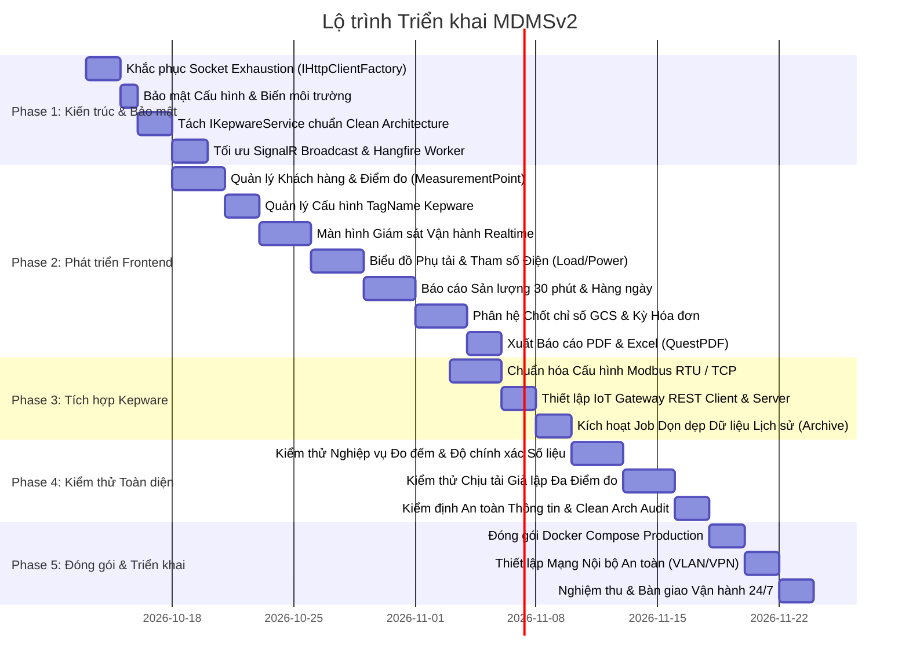

# KẾ HOẠCH TRIỂN KHAI CHI TIẾT DỰ ÁN MDMSv2
## Hệ Thống Quản Lý Dữ Liệu Đo Đếm Công Tơ Điện (Meter Data Management System v2)

* **Tên dự án**: MDMSv2 (Meter Data Management System v2)
* **Ngày lập kế hoạch**: 12/10/2026
* **Phiên bản tài liệu**: v1.0.0
* **Kiến trúc triển khai**: Mô hình phân tán 2 Máy chủ:
  * **Máy chủ 1 (Application Server)**: .NET 8 Clean Architecture (Backend WebApi + Hangfire) & React 18 + Vite (Frontend SPA) & MySQL Database.
  * **Máy chủ 2 (Communication Server)**: Kepware V6.6.350.00 (Modbus RTU/TCP Driver & IoT Gateway Plug-in).
* **Đơn vị điều phối**: Hệ thống Multi-Agent (`MDMS-Planner`, `MDMS-Coder`, `MDMS-Tester`, `MDMS-Reviewer`) phối hợp cùng Kỹ sư phát triển.

---

## 1. MỤC TIÊU VÀ PHẠM VI DỰ ÁN

### 1.1. Mục tiêu Cốt lõi
1. **Hoàn thiện chuỗi thu thập dữ liệu tự động**: Thu thập ổn định dữ liệu tức thời ($U, I, P, Q, Cos\varphi$) và chỉ số tích lũy ($kWh, kVARh$) từ các công tơ điện trường qua Kepware V6.6 về Application Server.
2. **Khắc phục triệt để các lỗ hổng kỹ thuật & bảo mật**: Xử lý socket exhaustion, loại bỏ plain-text credentials, chuẩn hóa Clean Architecture và tối ưu tải SignalR/Hangfire.
3. **Phát triển hoàn chỉnh giao diện Frontend**: Hoàn thiện các trang quản trị, giám sát thời gian thực, biểu đồ phụ tải và báo cáo chốt sản lượng phục vụ vận hành và tính hóa đơn.
4. **Đóng gói và triển khai ổn định**: Đảm bảo hệ thống vận hành liên tục 24/7 trên môi trường sản xuất với độ sẵn sàng cao.

### 1.2. Phạm vi Công việc (Scope of Work)
* **Communication Server**: Cấu hình Channel, Device, Tag trong Kepware cho Modbus RTU và Modbus TCP; cấu hình IoT Gateway REST Client Agent (đẩy dữ liệu tự động) và REST Server Agent (phục vụ PULL chốt chỉ số).
* **Backend (.NET 8)**: Tái cấu trúc service giao tiếp Kepware, bảo mật cấu hình, tối ưu hóa Hangfire Jobs và hoàn thiện API.
* **Frontend (React 18 + TypeScript + Ant Design 5)**: Xây dựng toàn bộ giao diện người dùng theo thiết kế nghiệp vụ đo đếm.
* **Kiểm thử & Đóng gói**: Giả lập tải đa công tơ, kiểm thử tính toàn vẹn dữ liệu đo đếm và đóng gói Docker container.

---

## 2. LỘ TRÌNH TRIỂN KHAI TỔNG THỂ (PHASED ROADMAP)

---

## 3. PHÂN RÃ CÔNG VIỆC CHI TIẾT (WORK BREAKDOWN STRUCTURE - WBS)

### GIAI ĐOẠN 1: KHẮC PHỤC LỖ HỔNG KỸ THUẬT & BẢO MẬT (PHASE 1)
*Mục tiêu: Đưa hệ thống Backend về trạng thái an toàn, loại bỏ nguy cơ treo máy chủ và tuân thủ Clean Architecture.*

- [ ] **Task 1.1 [P0 - Critical]**: Thay thế `new HttpClient()` bằng `IHttpClientFactory`
  * **Mô tả**: Sửa đổi hàm `CallApiAsync` trong `GcsCutOffCycleReadOnlyRepository.cs`, cấu hình `AddHttpClient("KepwareClient")` với timeout, retry policy (Polly) trong `Program.cs`.
  * **Phụ trách**: `MDMS-Coder`
  * **Kiểm tra**: `MDMS-Tester` (Stress test 500 requests liên tục không phát sinh lỗi TIME_WAIT).
  * **Phê duyệt**: `MDMS-Reviewer`

- [ ] **Task 1.2 [P0 - Critical]**: Loại bỏ Plain-Text Credentials trong cấu hình
  * **Mô tả**: Rà soát và gỡ bỏ toàn bộ mật khẩu MySQL (`Abc@123456`), Gmail app password, và JWT symmetric key khỏi các file `appsettings.json`, `appsettings.Development.json`, `appsettings.Production.json`. Chuyển sang nạp qua Environment Variables (`docker-compose` hoặc hệ điều hành). Tạo file mẫu `appsettings.Example.json`.
  * **Phụ trách**: `MDMS-Coder`
  * **Phê duyệt**: `MDMS-Reviewer` (Security Audit).

- [ ] **Task 1.3 [P1 - High]**: Tái cấu trúc Service Giao tiếp Kepware theo Clean Architecture
  * **Mô tả**: Chuyển logic gọi HTTP sang Kepware ra khỏi `GcsCutOffCycleReadOnlyRepository`. Tạo interface `IKepwareGatewayService` trong `Application` và triển khai trong `Infrastructure/Services/KepwareGatewayService.cs`.
  * **Phụ trách**: `MDMS-Planner` (thiết kế interface), `MDMS-Coder` (triển khai mã nguồn).
  * **Phê duyệt**: `MDMS-Reviewer` (Clean Architecture check).

- [ ] **Task 1.4 [P1 - High]**: Tối ưu hóa SignalR Notification Broadcast & Hangfire Worker
  * **Mô tả**: Tối ưu hàm `ProcessMeasurementPointMonitoring` trong `MeasurementPointMonitoringCommandHandler.cs`. Gom nhóm message SignalR thay vì duyệt vòng lặp `foreach` phát đơn lẻ từng điểm đo. Bẫy lỗi parse kiểu dữ liệu `ConvertToString` để tránh exception khi Kepware trả về chất lượng xấu (Bad Quality).
  * **Phụ trách**: `MDMS-Coder`
  * **Kiểm tra**: `MDMS-Tester`

---

### GIAI ĐOẠN 2: HOÀN THIỆN PHÂN HỆ FRONTEND (PHASE 2)
*Mục tiêu: Xây dựng toàn bộ giao diện SPA bằng React 18, TypeScript, Vite và Ant Design 5 tương ứng với các API sẵn có của Backend.*

- [ ] **Task 2.1 [P1 - High]**: Phân hệ Quản lý Khách hàng & Điểm đo (Customers & Measurement Points)
  * **Mô tả**: Xây dựng màn hình danh sách, thêm mới, cập nhật, xóa mềm điểm đo; gán khách hàng quản lý; hiển thị trạng thái kết nối (`Online`, `Offline`, `Alert`).
  * **Phụ trách**: `MDMS-Coder`
  * **Kiểm tra**: `MDMS-Tester` (Kiểm tra form validation, phân trang, lọc theo khách hàng).

- [ ] **Task 2.2 [P1 - High]**: Phân hệ Cấu hình TagName Liên kết Kepware
  * **Mô tả**: Xây dựng giao diện cấu hình ánh xạ TagName Kepware vào từng điểm đo: Tên Tag trong Kepware (ví dụ: `Channel1.Device1.P_Total`), mô tả đại lượng đo, đơn vị tính ($kW, kVAR, V, A$), loại thông số (tức thời / chốt chỉ số).
  * **Phụ trách**: `MDMS-Coder`
  * **Kiểm tra**: `MDMS-Tester`

- [ ] **Task 2.3 [P1 - High]**: Màn hình Giám sát Vận hành Thời gian Thực (Realtime Monitoring Dashboard)
  * **Mô tả**: Xây dựng Dashboard hiển thị danh sách toàn bộ điểm đo với dữ liệu cập nhật thời gian thực qua SignalR (`/listnotificationhub` và `/detailnotificationhub`): Điện áp 3 pha ($U_A, U_B, U_C$), dòng điện ($I_A, I_B, I_C$), công suất tổng ($P, Q, S$), hệ số công suất ($Cos\varphi$), cảnh báo mất kết nối.
  * **Phụ trách**: `MDMS-Coder`
  * **Kiểm tra**: `MDMS-Tester` (Kiểm tra độ mượt khi nhận SignalR event liên tục).

- [ ] **Task 2.4 [P2 - Medium]**: Biểu đồ Phụ tải & Tham số Vận hành (Load & Power Charts)
  * **Mô tả**: Tích hợp thư viện biểu đồ hiển thị: Biểu đồ đường phụ tải công suất theo chu kỳ 30 phút, biểu đồ dao động điện áp, biểu đồ tiêu thụ điện năng theo ngày/tháng.
  * **Phụ trách**: `MDMS-Coder`
  * **Kiểm tra**: `MDMS-Tester` (Kiểm tra khả năng zoom, lọc theo ngày giờ, hiển thị tooltip).

- [ ] **Task 2.5 [P1 - High]**: Báo cáo Sản lượng Điện Nửa giờ & Hàng ngày
  * **Mô tả**: Màn hình tra cứu và lọc báo cáo sản lượng điện: Báo cáo 48 chu kỳ nửa giờ (`HalfHourFinalizedEnergyReport`), báo cáo tổng hợp ngày (`DailyFinalizedEnergyReport`). Hiển thị chi tiết biểu giờ Bình thường (BT), Cao điểm (CD), Thấp điểm (TD).
  * **Phụ trách**: `MDMS-Coder`
  * **Kiểm tra**: `MDMS-Tester` (Kiểm tra tính khớp giữa tổng 48 chu kỳ và sản lượng ngày).

- [ ] **Task 2.6 [P1 - High]**: Phân hệ Chốt Chỉ Số Công Tơ (GCS) & Bảng Kê Kỳ Hóa Đơn
  * **Mô tả**: Giao diện quản lý chu kỳ chốt chỉ số (`GcsCutoffCycle`), nút bấm chốt chỉ số tức thời từ Kepware, hiển thị bảng kê đối soát sản lượng định kỳ (`PeriodicEnergyStatement`) phục vụ tính tiền điện.
  * **Phụ trách**: `MDMS-Coder`
  * **Kiểm tra**: `MDMS-Tester`

- [ ] **Task 2.7 [P2 - Medium]**: Chức năng Xuất Báo Cáo File (PDF & Excel/CSV)
  * **Mô tả**: Tích hợp các nút tải file báo cáo đã được render sẵn từ Backend (sử dụng QuestPDF và CsvHelper) cho toàn bộ các màn hình bảng dữ liệu và báo cáo sản lượng.
  * **Phụ trách**: `MDMS-Coder`
  * **Kiểm tra**: `MDMS-Tester` (Kiểm tra định dạng file PDF/Excel tải về đầy đủ font tiếng Việt và số liệu).

---

### GIAI ĐOẠN 3: TỐI ƯU HÓA COMMUNICATION SERVER (KEPWARE V6.6) & HANGFIRE (PHASE 3)
*Mục tiêu: Đảm bảo tầng truyền thông thu thập từ công tơ hoạt động trơn tru, không nghẽn đường truyền vật lý và dữ liệu được lưu trữ khoa học.*

- [ ] **Task 3.1 [P1 - High]**: Chuẩn hóa Cấu hình Modbus RTU trên Kepware
  * **Mô tả**: Đối với các công tơ kết nối chuỗi nối tiếp RS-485:
    * Cấu hình baudrate đồng nhất (9600 hoặc 19200 bps), Parity Even/None, Stop bit 1.
    * Nhóm địa chỉ thanh ghi liên tục và bật **Block Read** trong Device Properties để đọc 1 lần toàn bộ khối dữ liệu.
    * Đặt Request Timeout (1000ms), Retry Attempts (2 lần), Inter-Request Delay (20-50ms) để không gây xung đột trên đường bus.
  * **Phụ trách**: Kỹ sư Hệ thống & `MDMS-Planner` hướng dẫn.

- [ ] **Task 3.2 [P1 - High]**: Chuẩn hóa Cấu hình Modbus TCP trên Kepware
  * **Mô tả**: Đối với các công tơ hoặc gateway Ethernet: Cấu hình địa chỉ IP tĩnh, cổng TCP 502 mặc định, thiết lập Scan Rate 2s cho thông số tức thời và 15 phút cho chỉ số điện năng tích lũy.
  * **Phụ trách**: Kỹ sư Hệ thống.

- [ ] **Task 3.3 [P1 - High]**: Cấu hình Kepware IoT Gateway Plug-in
  * **Mô tả**:
    * **REST Client Agent**: Cấu hình URL đích `http://<IP-AppServer>:19089/api/v1/iot/measurement-point-monitoring`, định dạng JSON, tần suất gửi (Update Rate) phù hợp với yêu cầu giám sát.
    * **REST Server Agent**: Bật dịch vụ REST Server trên cổng `39320`, cấp phép truy cập từ địa chỉ IP của Application Server.
  * **Phụ trách**: Kỹ sư Hệ thống & `MDMS-Tester` kiểm tra kết nối.

- [ ] **Task 3.4 [P2 - Medium]**: Kích hoạt và Tối ưu Job Dọn dẹp/Lưu trữ Dữ liệu Lịch sử (Data Archiving)
  * **Mô tả**: Bỏ comment và hoàn thiện job `BackgroundJobArchiveDataService.ArchiveDataMeasurementPointMonitoring` trong `Program.cs`. Xây dựng cơ chế di chuyển dữ liệu đo đếm tức thời cũ hơn 30 ngày sang bảng lưu trữ `ArchiveDataMeasurementPointMonitoringEntity` để giữ kích thước bảng chính luôn gọn nhẹ và truy vấn nhanh.
  * **Phụ trách**: `MDMS-Coder`
  * **Kiểm tra**: `MDMS-Tester`

---

### GIAI ĐOẠN 4: KIỂM THỬ TOÀN DIỆN & TỐI ƯU HIỆU NĂNG (PHASE 4)
*Mục tiêu: Đảm bảo độ chính xác tuyệt đối của số liệu đo đếm điện năng và hệ thống chịu tải tốt.*

- [ ] **Task 4.1 [P0 - Critical]**: Kiểm thử Nghiệp vụ Đo đếm & Tính toán Số liệu
  * **Mô tả**: Kiểm tra tính lũy kế đơn điệu của chỉ số công tơ; kiểm tra sai số giữa tổng 48 chu kỳ nửa giờ và sản lượng ngày; kiểm tra tính đúng đắn khi công tơ quay vòng chỉ số (Rollover).
  * **Phụ trách**: `MDMS-Tester`
  * **Tiêu chuẩn**: Báo cáo `TEST_REPORT.md` đạt 100% Pass.

- [ ] **Task 4.2 [P1 - High]**: Kiểm thử Chịu tải Giả lập Đa Điểm đo (Load Testing)
  * **Mô tả**: Sử dụng công cụ kiểm thử (k6 hoặc JMeter hoặc script giả lập) gửi đồng thời dữ liệu từ 50 - 200 điểm đo với tần suất 5 giây/lần vào `IoTController`.
  * **Phụ trách**: `MDMS-Tester`
  * **Tiêu chuẩn**: CPU Application Server < 60%, độ trễ phản hồi API < 200ms, không có job Hangfire nào bị văng exception hoặc kẹt retry.

- [ ] **Task 4.3 [P0 - Critical]**: Thẩm định Kiến trúc & Kiểm toán An toàn Bảo mật (Code Review & Security Audit)
  * **Mô tả**: Quét toàn bộ mã nguồn kiểm tra SQL Injection trong các raw query của EF Core MySQL, rà soát lỗ hổng XSS/CSRF, kiểm tra quyền truy cập Tenant/Customer Isolation, xác thực JWT.
  * **Phụ trách**: `MDMS-Reviewer`
  * **Tiêu chuẩn**: Báo cáo `CODE_REVIEW.md` ra quyết định **APPROVED**.

---

### GIAI ĐOẠN 5: ĐÓNG GÓI TRIỂN KHAI & BÀN GIAO VẬN HÀNH 24/7 (PHASE 5)
*Mục tiêu: Đưa toàn bộ hệ thống lên môi trường vận hành thực tế.*

- [ ] **Task 5.1 [P1 - High]**: Chuẩn hóa Docker Compose Môi trường Production
  * **Mô tả**: Cập nhật `docker-compose.yml` cho Application Server:
    * Service `webapi`: Build từ .NET 8 SDK, multi-stage build, giới hạn RAM/CPU.
    * Service `frontend`: Đóng gói Nginx phục vụ static bundle, reverse proxy API và SignalR WebSocket.
    * Service `mysql`: Cấu hình volume lưu trữ dữ liệu an toàn, thiết lập buffer pool tối ưu cho dữ liệu time-series.
  * **Phụ trách**: `MDMS-Coder` & Kỹ sư DevOps.

- [ ] **Task 5.2 [P1 - High]**: Thiết lập Mạng Kết nối An toàn giữa 2 Máy tính
  * **Mô tả**: Thiết lập đường truyền mạng nội bộ (VLAN hoặc kênh truyền riêng) giữa Communication Server và Application Server. Cấu hình Windows Firewall trên Communication Server chỉ cho phép Application Server truy cập port `39320`.
  * **Phụ trách**: Kỹ sư Hệ thống Mạng.

- [ ] **Task 5.3 [P1 - High]**: Quy trình Sao lưu & Phục hồi Sự cố (Backup & Disaster Recovery)
  * **Mô tả**:
    * Lập lịch tự động sao lưu cơ sở dữ liệu MySQL hàng ngày (Automated mysqldump).
    * Sao lưu định kỳ tệp cấu hình dự án Kepware (`*.opf`).
    * Soạn thảo tài liệu hướng dẫn khôi phục hệ thống khi gặp sự cố phần cứng trên một trong hai máy chủ.
  * **Phụ trách**: `MDMS-Planner` soạn tài liệu hướng dẫn.

---

## 4. MA TRẬN PHÂN CÔNG TRÁCH NHIỆM (RACI MATRIX)

| Giai đoạn / Hạng mục | MDMS-Planner | MDMS-Coder | MDMS-Tester | MDMS-Reviewer | Kỹ sư Vận hành |
|---|:---:|:---:|:---:|:---:|:---:|
| **1. Khắc phục Lỗ hổng Kỹ thuật & Bảo mật** | C | **A / R** | C | **A** | I |
| **2. Phát triển Hoàn thiện Giao diện Frontend** | **A** | **R** | C | C | I |
| **3. Cấu hình Kepware Modbus RTU/TCP & IoT Gateway** | C | I | C | I | **A / R** |
| **4. Kiểm thử Chịu tải & Nghiệp vụ Đo đếm** | I | C | **A / R** | C | I |
| **5. Thẩm định Mã nguồn & An ninh Thông tin** | I | C | I | **A / R** | I |
| **6. Đóng gói Docker & Triển khai Production** | C | **R** | I | C | **A** |

*Ghi chú*:
* **R (Responsible)**: Người/Agent trực tiếp thực hiện công việc.
* **A (Accountable)**: Người/Agent chịu trách nhiệm cuối cùng về chất lượng đầu ra.
* **C (Consulted)**: Người/Agent được tham vấn ý kiến chuyên môn.
* **I (Informed)**: Người/Agent nhận thông tin báo cáo kết quả.

---

## 5. BẢNG THEO DÕI RỦI RO & PHƯƠNG ÁN PHÒNG NGỪA (RISK MANAGEMENT)

| Mã rủi ro | Mô tả Rủi ro Kỹ thuật | Mức độ | Hậu quả tiềm ẩn | Phương án Phòng ngừa & Xử lý |
|---|---|:---:|---|---|
| **RSK-01** | Công tơ mất kết nối vật lý (đứt dây RS-485 / lỏng giắc) | Cao | Dữ liệu đo đếm bị gián đoạn, thiếu chu kỳ 30 phút | Kepware gắn cờ Quality = Bad; Backend ghi nhận cảnh báo `MeasurementPointAlert`, tự động nội suy hoặc đánh dấu để người dùng kiểm tra |
| **RSK-02** | Xung đột địa chỉ Modbus Slave ID trên cùng đường bus RS-485 | Trung bình | Gói tin Modbus bị nghẽn, không đọc được dữ liệu | Quy hoạch dải Slave ID từ 1 - 247 rõ ràng trong bảng phân bổ thiết bị trước khi đấu nối |
| **RSK-03** | Bảng dữ liệu giám sát tăng trưởng quá nhanh làm chậm DB | Cao | Truy vấn dashboard và báo cáo bị timeout | Bật partition table theo tháng trong MySQL cho bảng `MeasurementPointMonitoringEntity`; kích hoạt job Archive dọn dữ liệu cũ |
| **RSK-04** | Đứt kết nối mạng giữa Communication Server và App Server | Trung bình | Dữ liệu tức thời không đẩy được sang App Server | Cấu hình tính năng Buffer / Store and Forward trên Kepware IoT Gateway để tự động đẩy bù khi mạng thông suốt trở lại |
| **RSK-05** | Quay vòng chỉ số công tơ (Meter Rollover khi chạm ngưỡng 999999) | Thấp | Sản lượng tính ra bị âm nếu tính bằng phép trừ thông thường | Cài đặt thuật toán xử lý rollover trong `BackgroundJobService`: nếu $Reading_{sau} < Reading_{trước}$ thì áp dụng công thức bù cơ số quay vòng |

---

## 6. TIÊU CHUẨN NGHIỆM THU DỰ ÁN (DEFINITION OF DONE - DoD)

Dự án được nghiệm thu và bàn giao khi thỏa mãn 100% các tiêu chí sau:

1. **Về Truyền thông & Thu thập (Communication)**:
   * Kepware V6.6 kết nối ổn định với 100% công tơ đã khai báo qua Modbus RTU và Modbus TCP, tỉ lệ truyền tin thành công $\ge 99.5\%$.
   * REST Client Agent đẩy dữ liệu định kỳ không phát sinh lỗi timeout hoặc rớt gói.
2. **Về Backend & Dữ liệu (Backend & Data Integrity)**:
   * Không còn bất kỳ instance `new HttpClient()` tự tạo nào; 100% kết nối qua `IHttpClientFactory`.
   * Toàn bộ mật khẩu, chuỗi kết nối và secret keys được nạp qua biến môi trường.
   * Dữ liệu báo cáo sản lượng 48 chu kỳ nửa giờ khớp chính xác với sản lượng ngày và kỳ hóa đơn (sai lệch $= 0.00 kWh$).
   * Tác vụ Hangfire vận hành liên tục không lỗi.
3. **Về Giao diện (Frontend Experience)**:
   * Toàn bộ các màn hình Quản lý điểm đo, Tag, Dashboard giám sát thời gian thực, Báo cáo và Chốt GCS hoạt động mượt mà trên trình duyệt.
   * Kết nối WebSocket SignalR tự động khôi phục (Auto-reconnect) khi ngắt mạng tạm thời.
   * Xuất file PDF và Excel báo cáo chuẩn form tiếng Việt.
4. **Về Quản lý Mã nguồn (Source Control)**:
   * 100% commit tuân thủ quy chuẩn `SourceControl.md` và `commitlint.config.cjs`.
   * Nhánh `main` được đóng dấu Release Tag `v1.1.0` hoàn chỉnh.
