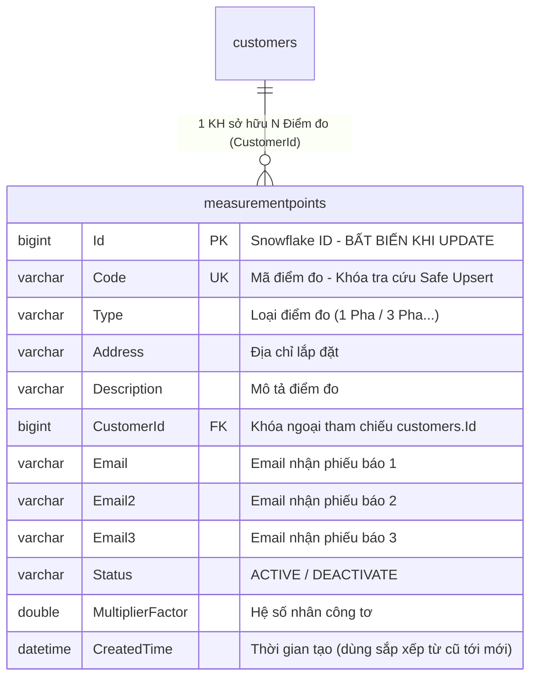

# [PLAN] QUẢN LÝ ĐIỂM ĐO: NÂNG CẤP BỘ LỌC, TỐI ƯU GIAO DIỆN MỞ TAB MỚI, XUẤT CSV KÈM EMAIL PHIẾU BÁO & NHẬP CSV AN TOÀN (SAFE UPSERT)

> **Tài liệu đặc tả kỹ thuật (Technical Specification)**  
> **Phiên bản:** v2.0.0-FEATURE  
> **Người lập:** MDMS-Planner (Principal Solution Architect)  
> **Phê duyệt bởi:** Quản trị viên hệ thống & Người dùng  
> **Mục tiêu thực thi:** Bàn giao trực tiếp cho `MDMS-Coder` hiện thực hóa, `MDMS-Tester` kiểm định và `MDMS-Reviewer` thẩm định theo chuỗi Multi-Agent của MDMSv2.

---

## 1. MỤC TIÊU & PHẠM VI (OBJECTIVES & SCOPE)

### 1.1. Mục tiêu Nghiệp vụ & Kỹ thuật
1. **Hiệu chỉnh Bộ lọc Tìm kiếm Điểm đo (Measurement Point Filters)**:
   * Thống nhất quy chuẩn tìm kiếm tinh gọn và chính xác: Chỉ sử dụng **2 bộ lọc**:
     - **Mã điểm đo** (`code`): Input tìm kiếm theo mã điểm đo có hỗ trợ debounce 300ms.
     - **Trạng thái** (`status`): Dropdown chọn "Đang sử dụng" (`ACTIVE`) hoặc "Ngừng sử dụng" (`DEACTIVATE`).
   * Loại bỏ hoàn toàn bộ lọc theo **Tên khách hàng** (`customer.fullName`) trên màn hình danh sách điểm đo nhằm đơn giản hóa UI, tránh xung đột lọc và tăng tốc độ xử lý cho người vận hành.
2. **Cập nhật Tiêu đề Bảng (Header Standardization)**:
   * Cập nhật tiêu đề cột trên bảng giao diện từ **"Tên KH"** thành **"Tên khách hàng"**.
   * Đồng bộ trên cả giao diện bảng `table-point.tsx` và tệp CSV xuất ra.
3. **Mở Chi tiết Điểm đo trên Tab Mới (Open Detail in New Tab)**:
   * Khi người dùng click vào nút hành động **"Chi tiết"** trong menu `(...)`, hệ thống sẽ mở trang chi tiết điểm đo tại **một tab trình duyệt mới** (`window.open(url, '_blank')`) thay vì điều hướng trên tab hiện tại, giúp người vận hành không bị mất ngữ cảnh và trạng thái bộ lọc danh sách.
4. **Bổ sung Tính năng Nhập Dữ liệu từ CSV (Safe Upsert Measurement Point Import)**:
   * Cho phép quản trị viên tải lên tệp CSV chứa danh sách điểm đo để cập nhật hàng loạt hoặc thêm mới.
   * **Bảo vệ toàn vẹn khóa ngoại (Zero FK Disruption)**: Đối chiếu theo `Mã điểm đo` (`Code`). Nếu điểm đo đã tồn tại, chỉ thực hiện cập nhật các thuộc tính (`Type`, `Description`, `Address`, `Status`, `Email`, `Email2`, `Email3`, và `CustomerId` nếu có thông tin khách hàng hợp lệ), giữ nguyên 100% `measurementpoints.Id`. Tuyệt đối không xóa hoặc tạo lại ID để không ảnh hưởng tới dữ liệu đo đếm lịch sử (`measurementpointhourly`, `measurementpointhalfhour`, `gcs`, `alerts`, `events`). Nếu chưa có, sinh mới `Id` qua Snowflake.
   * **Cơ chế phân quyền Admin (RBAC)**: Chỉ tài khoản có vai trò `SuperAdmin` hoặc `Admin` mới được phép thao tác tính năng này.
5. **Nâng cấp Tính năng Xuất File CSV (Export CSV Enhancement)**:
   * **Bổ sung trường "Email nhận phiếu báo (tối đa 3 email)"**: Kết hợp thông tin từ 3 trường `Email`, `Email2`, `Email3` của điểm đo (phân tách bởi `; `) vào cột này.
   * **Đúng theo trạng thái của Filter**: Khi người vận hành đang lọc theo Mã điểm đo hoặc Trạng thái, tệp CSV xuất ra (cả chế độ xuất "Trang hiện tại" và "Tất cả") phải áp dụng đúng điều kiện lọc đang chọn.
   * **Sắp xếp theo thứ tự từ cũ đến mới**: Điểm đo được tạo cũ nhất phải hiển thị ở đầu bảng danh sách trong file CSV xuất ra (sắp xếp tăng dần theo `CreatedTime`/`Id` ASC).
   * **Tương thích hoàn hảo với Microsoft Excel**: Ghi file với UTF-8 BOM (`new UTF8Encoding(true)` / `\uFEFF`) để Excel hiển thị đúng tiếng Việt có dấu.

---

## 2. THIẾT KẾ KIẾN TRÚC & DỮ LIỆU (TECHNICAL ARCHITECTURE)

### 2.1. Cấu trúc Mô hình Dữ liệu (Entity & DTOs)



* **Cập nhật DTO**:
  * `ListMeasurementPointDto`: Bổ sung các thuộc tính `Email`, `Email2`, `Email3` để cung cấp thông tin email nhận phiếu báo cho Frontend khi render bảng và khi xuất file client-side.
  * `ExportMeasurementPointsCsvRequest`: DTO tiếp nhận tham số lọc khi xuất file CSV từ máy chủ:
    - `Code`: string?
    - `Status`: string?
    - `SearchByFields`: List<SearchModel>?

### 2.2. Đặc tả API Backend (.NET 8 Clean Architecture)

#### A. Endpoint Nhập Điểm đo từ CSV (Import CSV)
* **Method & Route**: `POST /api/v1/Measurement-Points/Import-Csv`
* **Authorization**: `[Permissions(Roles = [DefaultRoles.SuperAdmin, DefaultRoles.Admin])]`
* **Content-Type**: `multipart/form-data`
* **Request Form**: `file`: `IFormFile` (Tệp `.csv`, dung lượng tối đa 10MB).
* **Response DTO (`ImportMeasurementPointResponse`)**:
  ```json
  {
    "success": true,
    "code": 200,
    "data": {
      "totalRows": 15,
      "insertedCount": 3,
      "updatedCount": 12,
      "errorCount": 0,
      "errors": []
    },
    "message": "Nhập dữ liệu điểm đo từ CSV thành công!"
  }
  ```

#### B. Cập nhật Endpoint Xuất CSV Điểm đo (Export CSV)
* **Method & Route**: `POST /api/v1/Measurement-Points/Export-Csv-Measurement-Points`
* **Request Body**: `[FromBody] ExportMeasurementPointsCsvRequest? request` (Tùy chọn, chứa điều kiện lọc `code`, `status`, `searchByFields`).
* **Cấu trúc cột xuất ra**:
  `STT`, `Mã điểm đo`, `Loại điểm đo`, `Mô tả`, `Tên khách hàng`, `Email nhận phiếu báo (tối đa 3 email)`, `Trạng thái`
* **Quy tắc sắp xếp**: `OrderBy(x => x.Id)` (từ cũ đến mới, bản ghi tạo sớm nhất hiển thị đầu tiên).

### 2.3. Thiết kế Luồng Giao diện Frontend (React 18 + Vite + Ant Design 5)

1. **Bộ lọc (`point-management/index.tsx`)**:
   - Giao diện chia 2 cột đều nhau (basis-1/2):
     * Cột 1: `InputTextCommon` tìm kiếm theo `code` (Mã điểm đo).
     * Cột 2: `InputSelectCommon` lọc theo `status` ("Đang sử dụng" / "Ngừng sử dụng").
   - Nút "Xóa tất cả" xuất hiện khi `dataForm.code` hoặc `dataForm.status` có giá trị.
2. **Nút "Nhập từ CSV" & Modal Import**:
   - Thêm nút với icon `FiDownload` đặt cạnh nút "Xuất file".
   - Bọc trong `<PrivateComponent roles={[Constants.Role.Admin.value, Constants.Role.SuperAdmin.value]}>`.
   - Tạo component modal `dialog-import-point.tsx`:
     * Alert hướng dẫn quy tắc Safe Upsert.
     * Nút "Tải tệp mẫu CSV" (`Template_DiemDo.csv`).
     * Ant Design `Upload.Dragger` hỗ trợ kéo thả tệp CSV.
     * Bảng hiển thị tóm tắt và danh sách lỗi chi tiết nếu có dòng không hợp lệ.
3. **Mở Chi tiết Điểm đo**:
   - Trong `table-point.tsx`, khi click "Chi tiết" gọi `window.open(url, '_blank')`.
   - Đổi tiêu đề cột thành "Tên khách hàng".
4. **Xuất File CSV**:
   - Truyền `requestBody={getListMeasurementParamsRequest}` vào `<DialogExportForm>` để server nhận diện đúng filter.
   - Khi xuất trang hiện tại (`CSV_0`), sắp xếp dữ liệu tăng dần theo thời gian tạo / ID (`oldest first`).

---

## 3. DANH SÁCH CÔNG VIỆC CHI TIẾT (TASK BREAKDOWN FOR MDMS-CODER)

### Nhóm 1: Backend (.NET 8 Clean Architecture)
- [ ] **Task 1.1**: [Backend/Application] Bổ sung `Email`, `Email2`, `Email3` vào [ListMeasurementPointDto.cs](file:///e:/sources/MDMSv2/Backend/Application/DataTransferObjects/Responses/MeasurementPoints/ListMeasurementPointDto.cs).
- [ ] **Task 1.2**: [Backend/Application] Tạo DTO [ImportMeasurementPointResponse.cs](file:///e:/sources/MDMSv2/Backend/Application/DataTransferObjects/Responses/MeasurementPoints/ImportMeasurementPointResponse.cs) và [ExportMeasurementPointsCsvRequest.cs](file:///e:/sources/MDMSv2/Backend/Application/DataTransferObjects/Requests/MeasurementPoints/ExportMeasurementPointsCsvRequest.cs).
- [ ] **Task 1.3**: [Backend/Application] Tạo Command `ImportMeasurementPointsCommand` và interface `IImportMeasurementPointsCommandHandler` trong [IMeasurementPointsCommandHandlers.cs](file:///e:/sources/MDMSv2/Backend/Application/Handlers/Commands/MeasurementPoints/IMeasurementPointsCommandHandlers.cs).
- [ ] **Task 1.4**: [Backend/Application] Cập nhật interface [IMeasurementPointsReadWriteRepository.cs](file:///e:/sources/MDMSv2/Backend/Application/Repositories/ReadWrite/IMeasurementPointsReadWriteRepository.cs) bổ sung các phương thức Import CSV và Export CSV có filter.
- [ ] **Task 1.5**: [Backend/Infrastructure] Triển khai `ImportMeasurementPointsCommandHandler` trong [Infrastructure/Handlers/Commands/MeasurementPoints](file:///e:/sources/MDMSv2/Backend/Infrastructure/Handlers/Commands/MeasurementPoints).
- [ ] **Task 1.6**: [Backend/Infrastructure] Cập nhật [MeasurementPointReadWriteRepository.cs](file:///e:/sources/MDMSv2/Backend/Infrastructure/Repositories/ReadWrite/MeasurementPointReadWriteRepository.cs):
  - Hiện thực hóa `ImportMeasurementPointsFromCsvAsync` với cơ chế Safe Upsert, phân tích email tối đa 3 địa chỉ, tự động nhận diện phân cách `,` hoặc `;`, hỗ trợ UTF-8 BOM.
  - Cập nhật `GenerateCustomerCsv` lọc theo điều kiện `ExportMeasurementPointsCsvRequest`, sắp xếp từ cũ đến mới (`.OrderBy(x => x.Id)`), xuất cột "Tên khách hàng" và "Email nhận phiếu báo (tối đa 3 email)".
- [ ] **Task 1.7**: [Backend/WebApi] Khai báo route `ImportCsv` trong [Url.cs](file:///e:/sources/MDMSv2/Backend/WebApi/Common/Url.cs) và bổ sung endpoint `[HttpPost(Common.Url.Default.MeasurementPoints.ImportCsv)]` kèm thuộc tính `[Permissions(Roles = [DefaultRoles.SuperAdmin, DefaultRoles.Admin])]` trong [MeasurementPointController.cs](file:///e:/sources/MDMSv2/Backend/WebApi/Controllers/MeasurementPointController.cs). Cập nhật endpoint `ExportCsvMeasurementPointAsync` nhận filter `[FromBody]`.

### Nhóm 2: Frontend (React 18 + TypeScript + Vite)
- [ ] **Task 2.1**: [Frontend/Core] Cập nhật `Constants.listHeaderExport.PointManagement` trong [constants.ts](file:///e:/sources/MDMSv2/Frontend/src/core/application/common/constants.ts): Đổi "Tên KH" thành "Tên khách hàng", thêm trường "Email nhận phiếu báo (tối đa 3 email)".
- [ ] **Task 2.2**: [Frontend/Core] Cập nhật interface `IMeasurementPointListResponseInterface` và `MeasurementPoint` trong [measurementPoint.interface.ts](file:///e:/sources/MDMSv2/Frontend/src/core/application/interfaces/response/measurement-point/measurementPoint.interface.ts) bổ sung `email2`, `email3`.
- [ ] **Task 2.3**: [Frontend/Core] Khai báo `ImportMeasurementPointCsv` trong [endPoint.ts](file:///e:/sources/MDMSv2/Frontend/src/core/application/common/endPoint.ts).
- [ ] **Task 2.4**: [Frontend/Infrastructure] Bổ sung phương thức `importMeasurementPointCsv` trong [measurementPoint.service.ts](file:///e:/sources/MDMSv2/Frontend/src/infrastructure/repository/measurement-point/services/measurementPoint.service.ts) và tạo hook [useImportMeasurementPointCsv.hook.tsx](file:///e:/sources/MDMSv2/Frontend/src/infrastructure/repository/measurement-point/hooks/useImportMeasurementPointCsv.hook.tsx).
- [ ] **Task 2.5**: [Frontend/Pages] Tạo component [dialog-import-point.tsx](file:///e:/sources/MDMSv2/Frontend/src/pages/point-management/components/dialog-import-point.tsx).
- [ ] **Task 2.6**: [Frontend/Pages] Cập nhật [table-point.tsx](file:///e:/sources/MDMSv2/Frontend/src/pages/point-management/components/table-point.tsx):
  - Đổi header "Tên KH" thành "Tên khách hàng".
  - Nút "Chi tiết" mở tab mới (`window.open(url, '_blank')`).
- [ ] **Task 2.7**: [Frontend/Pages] Cập nhật [point-management/index.tsx](file:///e:/sources/MDMSv2/Frontend/src/pages/point-management/index.tsx):
  - Hiệu chỉnh Filter chỉ gồm 2 trường "Mã điểm đo" và "Trạng thái", bỏ "Tên khách hàng".
  - Thêm nút "Nhập từ CSV" với quyền Admin/SuperAdmin.
  - Chuẩn bị dữ liệu xuất CSV có trường email nhận phiếu báo, sắp xếp từ cũ đến mới, truyền `requestBody` filter vào `DialogExportForm`.

---

## 4. TIÊU CHÍ NGHIỆM THU (DEFINITION OF DONE - DoD)
1. **Filter**: Chỉ còn 2 bộ lọc Mã điểm đo và Trạng thái; xóa tìm kiếm hoạt động chuẩn xác.
2. **Table Header**: Hiển thị chính xác "Tên khách hàng".
3. **Tab mới**: Click "Chi tiết" mở tab trình duyệt mới với đầy đủ thông tin điểm đo.
4. **Import CSV**:
   - Nhập tệp CSV an toàn (Safe Upsert) cho điểm đo, không làm đứt gãy khóa ngoại.
   - Nhận diện đúng email nhận phiếu báo (tối đa 3 email).
   - Có phân quyền RBAC chặt chẽ (chỉ Admin/SuperAdmin).
5. **Export CSV**:
   - Có cột "Email nhận phiếu báo (tối đa 3 email)".
   - Lọc chính xác theo filter đang chọn.
   - Sắp xếp từ cũ nhất đến mới nhất.
   - Mở trên Microsoft Excel không bị lỗi font tiếng Việt.

---

## 5. PHÂN TÍCH & KẾ HOẠCH NÂNG CẤP BỔ SUNG (PHASE 2 ENHANCEMENTS & FIXES)

### 5.1. Khắc phục lỗi Nhận diện Trạng thái khi Import CSV
- **Vấn đề**: Khi Import file CSV có trạng thái "Đang sử dụng", toàn bộ các điểm đo bị chuyển thành "Ngừng sử dụng" (`DEACTIVATE`).
- **Nguyên nhân**: Trong [MeasurementPointReadWriteRepository.cs](file:///e:/sources/MDMSv2/Backend/Infrastructure/Repositories/ReadWrite/MeasurementPointReadWriteRepository.cs), hàm `NormalizeHeaderText("Đang sử dụng")` sinh ra `"dang su dung"`. Logic cũ dùng `lowerStatus.Contains("dung")` để nhận diện chữ "dừng", dẫn đến chuỗi `"dang su dung"` (chứa `"dung"` từ "sử dụng") bị khớp sai thành `EntityStatus.Deactivate`.
- **Giải pháp**:
  - Nhận diện `Deactivate`: Khi `lowerStatus` chứa `"ngung"`, `"tam dung"`, `"deactivate"`, `"inactive"`, hoặc bằng `"0"` (và không chứa `"dang"` hoặc `"su dung"`).
  - Nhận diện `Active`: Khi `lowerStatus` chứa `"dang"`, `"su dung"`, `"hoat dong"`, `"active"`, hoặc bằng `"1"`.
  - Trong Safe Upsert: Nếu cột trạng thái để trống trong file CSV, bảo lưu trạng thái hiện tại của điểm đo (`existingPoint.Status`).

### 5.2. Đồng nhất Hiển thị Trạng thái Điểm đo
- **Vấn đề**: Trên trang Quản lý điểm đo, trạng thái hiển thị là "Đang sử dụng" / "Ngừng sử dụng". Tuy nhiên trên trang Quản lý chi tiết khách hàng ([table-client-point.tsx](file:///e:/sources/MDMSv2/Frontend/src/pages/client-management/components/table-client-point.tsx)), danh sách điểm đo lại hiển thị "Hoạt động" / "Ngưng hoạt động".
- **Giải pháp**: Cập nhật [table-client-point.tsx](file:///e:/sources/MDMSv2/Frontend/src/pages/client-management/components/table-client-point.tsx) đồng bộ hoàn toàn với [table-point.tsx](file:///e:/sources/MDMSv2/Frontend/src/pages/point-management/components/table-point.tsx):
  - `isActive = true`: Hiển thị `"Đang sử dụng"` với màu xanh `#41A026`.
  - `isActive = false`: Hiển thị `"Ngừng sử dụng"` với màu đỏ `#B22222`.

### 5.3. Hiệu chỉnh UI/UX & Chuẩn hóa Logic Trang Quản lý Phiếu báo
- **Tối ưu UI/UX [table-notice.tsx](file:///e:/sources/MDMSv2/Frontend/src/pages/notice-management/components/table/table-notice.tsx)**:
  - Cột **Mã điểm đo**: Chỉ hiển thị mã điểm đo (`code`), loại bỏ dòng text email bên dưới để bảng thông tin rõ ràng, không bị chồng chéo.
  - Thêm cột riêng biệt **Email nhận phiếu báo**: Hiển thị đầy đủ tất cả email nhận phiếu báo (`email`, `email2`, `email3`, hoặc fallback từ `customer.email`), trình bày dạng danh sách gọn gàng.
  - Cập nhật logic `isPointSendable`, `status` và `sentTime` dựa trên kiểm tra toàn bộ các email được cấu hình.
- **Chuẩn hóa Logic Backend [EmailSenderService.cs](file:///e:/sources/MDMSv2/Backend/Infrastructure/Services/EmailSenderService.cs)**:
  - **Tiêu chí 1 (Chưa cấu hình Email)**: Nếu không có email nào được cấu hình cho điểm đo (cả `Email`, `Email2`, `Email3` và email khách hàng đều rỗng) -> Đánh dấu `NO_EMAIL_CONFIGURED` ("Chưa cấu hình Email").
  - **Tiêu chí 2 (Kiểm tra Hợp lệ)**: "Gửi thành công nếu tất cả email đều thành công & thất bại nếu chỉ 1 email thất bại". Nếu trong danh sách email được cấu hình có bất kỳ email nào bị sai định dạng cú pháp -> Đánh dấu ngay `SEND_FAILED` ("Thất bại"), không bỏ qua âm thầm.
  - **Tiêu chí 3 (Gửi Email qua SMTP)**: Gửi thông báo tới tất cả người nhận (`To` + `Cc`). Nếu phát sinh bất kỳ lỗi nào trong quá trình truyền phát tới SMTP server -> Bắt lỗi và đánh dấu `SEND_FAILED` (kích hoạt Hangfire retry). Chỉ khi gửi thành công tới tất cả email không phát sinh lỗi -> Đánh dấu `SEND_SUCCESS` ("Thành công").

---

## 6. DANH SÁCH CÔNG VIỆC BỔ SUNG (TASK BREAKDOWN PHASE 2)
- [x] **Task 3.1**: [Backend/Infrastructure] Sửa logic nhận diện trạng thái trong `ImportMeasurementPointsFromCsvAsync` tại [MeasurementPointReadWriteRepository.cs](file:///e:/sources/MDMSv2/Backend/Infrastructure/Repositories/ReadWrite/MeasurementPointReadWriteRepository.cs).
- [x] **Task 3.2**: [Backend/Infrastructure] Cập nhật và làm rõ logic gửi mail tại [EmailSenderService.cs](file:///e:/sources/MDMSv2/Backend/Infrastructure/Services/EmailSenderService.cs) theo tiêu chí "Tất cả thành công = Thành công, 1 lỗi = Thất bại".
- [x] **Task 3.3**: [Frontend/Pages] Đồng nhất hiển thị trạng thái điểm đo thành "Đang sử dụng" / "Ngừng sử dụng" trong [table-client-point.tsx](file:///e:/sources/MDMSv2/Frontend/src/pages/client-management/components/table-client-point.tsx).
- [x] **Task 3.4**: [Frontend/Pages] Tách cột "Mã điểm đo" và bổ sung cột "Email nhận phiếu báo" hiển thị đầy đủ các email trong [table-notice.tsx](file:///e:/sources/MDMSv2/Frontend/src/pages/notice-management/components/table/table-notice.tsx).
- [x] **Task 3.5**: [QA & Review] Thực hiện kiểm thử toàn diện và thẩm định mã nguồn theo quy trình Multi-Agent.

---

## 7. ĐẶC TẢ KỸ THUẬT: CƠ CHẾ GỬI BÙ THÔNG MINH (SMART SELECTIVE RESEND) & CHI TIẾT EMAIL

### 7.1. Bối cảnh & Thách thức
Khi một điểm đo có nhiều email nhận phiếu báo (tối đa 3 email: `Email`, `Email2`, `Email3`):
- Nếu 1 email thất bại và 2 email thành công, việc đánh dấu toàn bộ dòng là "Thất bại" và kích hoạt checkbox để gửi lại sẽ khiến hệ thống gửi lại cho cả những người đã nhận thành công -> **Phát sinh email trùng lặp, gây phiền hà cho khách hàng**.
- Người vận hành không biết được chính xác email nào bị lỗi để kịp thời liên hệ khách hàng sửa đổi.

### 7.2. Giải pháp Kiến trúc: Smart Selective Resend
1. **Lưu trữ Trạng thái Granular trong trường `Status` (Không thay đổi Schema MySQL)**:
   - Sử dụng chuỗi JSON cấu trúc:
     ```json
     {
       "overall": "PARTIAL_SUCCESS", 
       "details": [
         { "email": "hungpetit@gmail.com", "status": "SUCCESS", "error": null },
         { "email": "mmds.vsiphaiphong@gmail.com", "status": "SUCCESS", "error": null },
         { "email": "luongthuy84hp@gmail.com", "status": "FAILED", "error": "Địa chỉ email không tồn tại hoặc lỗi SMTP" }
       ]
     }
     ```
   - Các giá trị của `overall`:
     * `SEND_SUCCESS`: 100% email đã gửi thành công.
     * `PARTIAL_SUCCESS`: Ít nhất 1 email thành công và ít nhất 1 email thất bại.
     * `SEND_FAILED`: Toàn bộ email đều thất bại.
     * `NO_EMAIL_CONFIGURED`: Điểm đo không có email nào.
     * `PENDING`: Đang chờ gửi trong hàng đợi Hangfire.
2. **Quy tắc Gửi bù (Selective Resend)**:
   - Khi chạy tiến trình gửi mail `ProcessSingleStatementEmailAsync`:
     * Đọc `item.Status`. Lấy danh sách các email đã có trạng thái `SUCCESS` trước đó.
     * **CHỈ GỬI BÙ** tới các email chưa gửi hoặc có trạng thái `FAILED`.
     * Các email đã `SUCCESS` tuyệt đối không bị gửi lại.
     * Khi tất cả email của điểm đo đều đạt `SUCCESS`, tự động nâng cấp `overall` thành `SEND_SUCCESS`.
3. **UI/UX Trực quan trên Bảng Quản lý Phiếu báo ([table-notice.tsx](file:///e:/sources/MDMSv2/Frontend/src/pages/notice-management/components/table/table-notice.tsx))**:
   - Cột **Email nhận phiếu báo**: Hiển thị từng email kèm huy hiệu trạng thái:
     * Email đã gửi: Tag xanh `"Đã gửi"`.
     * Email thất bại: Tag đỏ `"Thất bại"` kèm Tooltip hiển thị lý do lỗi.
     * Email chưa gửi: Tag xám `"Chưa gửi"`.
   - Cột **Trạng thái gửi Email**:
     * `SEND_SUCCESS`: Tag xanh `"Thành công"`.
     * `PARTIAL_SUCCESS`: Tag vàng cam `"Gửi một phần (X/Y)"` kèm Tooltip giải thích.
     * `SEND_FAILED`: Tag đỏ `"Thất bại"`.
   - Nút Checkbox: Cho phép chọn để gửi bù nếu `overall != "SEND_SUCCESS"`. Khi đã đạt `SEND_SUCCESS`, checkbox bị disable để tránh gửi trùng lặp.

---

## 8. DANH SÁCH CÔNG VIỆC PHASE 3 (TASK BREAKDOWN SMART RESEND)
- [x] **Task 4.1**: [Backend/Infrastructure] Cập nhật `ProcessSingleStatementEmailAsync` trong [EmailSenderService.cs](file:///e:/sources/MDMSv2/Backend/Infrastructure/Services/EmailSenderService.cs):
  - Parse trạng thái cũ để nhận diện các email đã thành công.
  - Chỉ gửi email tới các địa chỉ chưa thành công (Smart Resend).
  - Ghi nhận chi tiết từng email và tổng hợp `overall` (`SEND_SUCCESS`, `PARTIAL_SUCCESS`, `SEND_FAILED`).
- [x] **Task 4.2**: [Backend/Infrastructure] Cập nhật truy vấn lọc trạng thái trong [PeriodicEnergyStatementReadOnlyRepository.cs](file:///e:/sources/MDMSv2/Backend/Infrastructure/Repositories/ReadOnly/PeriodicEnergyStatementReadOnlyRepository.cs) và [PeriodicEnergyStatementReadWriteRepository.cs](file:///e:/sources/MDMSv2/Backend/Infrastructure/Repositories/ReadWrite/PeriodicEnergyStatementReadWriteRepository.cs) tương thích 100% cả chuỗi thuần lẫn JSON `overall`.
- [x] **Task 4.3**: [Frontend/Pages] Cập nhật [table-notice.tsx](file:///e:/sources/MDMSv2/Frontend/src/pages/notice-management/components/table/table-notice.tsx) & [search-notice.tsx](file:///e:/sources/MDMSv2/Frontend/src/pages/notice-management/components/search/search-notice.tsx):
  - Phân tích trạng thái JSON / chuỗi truyền thống qua `parseStatusDetail`.
  - Hiển thị nhãn xanh `Đã gửi` / đỏ `Thất bại` cụ thể bên cạnh từng email kèm Tooltip nguyên nhân lỗi.
  - Cập nhật hiển thị cột Trạng thái tổng quát ("Gửi một phần (X/Y)", "Thành công", "Thất bại").
  - Kích hoạt checkbox thông minh cho phép gửi bù cho các phiếu báo có email thất bại, tự động khóa khi đã hoàn tất.
- [x] **Task 4.4**: [QA & Review] Bổ sung 5 kịch bản kiểm thử vào [TEST_REPORT.md](file:///e:/sources/MDMSv2/TEST_REPORT.md) và hoàn tất thẩm định mã nguồn trong [CODE_REVIEW.md](file:///e:/sources/MDMSv2/CODE_REVIEW.md).

---

## 9. ĐẶC TẢ KỸ THUẬT PHASE 4 (TECHNICAL SPEC - GCS & ACCOUNT MANAGEMENT UI/UX)

### 9.1. Trang Quản lý Sổ GCS ([gcs-management/index.tsx](file:///e:/sources/MDMSv2/Frontend/src/pages/gcs-management/index.tsx))
1. **Bộ lọc tìm kiếm (Filter)**:
   - Loại bỏ ô tìm kiếm theo "Tên sổ" (`name`).
   - Tinh gọn còn 2 bộ lọc cân đối: "Mã sổ" (`code`) và "Trạng thái" (`status`), mỗi ô chiếm tỷ lệ `basis-1/2` trên khung chứa `basis-4/5`.
   - Nút "Xoá tất cả" tự động kích hoạt khi có điều kiện lọc theo mã sổ hoặc trạng thái.
2. **Hành động điều hướng (Navigation Actions)**:
   - Nút **"Chi tiết"**: Mở trang chi tiết sổ GCS (`ROUTE_PATH.GCS_DETAILS`) trên Tab mới qua `window.open(url, '_blank')`.
   - Nút **"Tra soát"**: Mở trang tra soát kỳ chốt (`ROUTE_PATH.GCS_CHECK`) trên Tab mới qua `window.open(url, '_blank')` kèm tham số URL (`?id=...&name=...&code=...`).
   - Trang [check/index.tsx](file:///e:/sources/MDMSv2/Frontend/src/pages/gcs-management/check/index.tsx): Hỗ trợ phân tích URL Query Params linh hoạt làm fallback khi `location.state` không có sẵn trong tab mới, ngăn chặn lỗi crash ứng dụng.

### 9.2. Trang Quản lý Tài khoản ([account-management/index.tsx](file:///e:/sources/MDMSv2/Frontend/src/pages/account-management/index.tsx))
1. **Tiêu đề cột (Header Column)**:
   - Cập nhật cột "Số điện thoại" thành **"Điện thoại"** trên bảng danh sách.
   - Đồng bộ nhãn "Điện thoại" trong form nhập liệu [account-form.tsx](file:///e:/sources/MDMSv2/Frontend/src/pages/account-management/components/account-form.tsx) và cấu hình xuất file Excel/CSV trong [constants.ts](file:///e:/sources/MDMSv2/Frontend/src/core/application/common/constants.ts).
2. **Chuẩn hóa Trạng thái (Status Consistency)**:
   - Cập nhật hiển thị trạng thái tài khoản: `"Đang hoạt động"` (xanh lá `#41A026`) & `"Vô hiệu"` (đỏ `#B22222`), thay thế cho nhãn cũ "Hoạt động".
   - Đồng bộ danh sách lựa chọn trong Dropdown lọc trạng thái: `Đang hoạt động` / `Vô hiệu`.
   - Đồng bộ thông điệp xuất file `activeMsg: 'Đang hoạt động'`, `inactiveMsg: 'Vô hiệu'`.
3. **Nút "Chi tiết"**:
   - Mở trang thông tin tài khoản (`ROUTE_PATH.ACCOUNT_DETAIL`) trên Tab mới qua `window.open(url, '_blank')`.

---

## 10. DANH SÁCH CÔNG VIỆC PHASE 4 (TASK BREAKDOWN)
- [x] **Task 5.1**: [Frontend/GCS] Bỏ filter "Tên sổ", cân đối bố cục 2 filter "Mã sổ" và "Trạng thái" trong [gcs-management/index.tsx](file:///e:/sources/MDMSv2/Frontend/src/pages/gcs-management/index.tsx).
- [x] **Task 5.2**: [Frontend/GCS] Cập nhật nút "Chi tiết" và "Tra soát" mở tab mới (`_blank`) và bổ sung URL query fallback trong [gcs-management/check/index.tsx](file:///e:/sources/MDMSv2/Frontend/src/pages/gcs-management/check/index.tsx).
- [x] **Task 5.3**: [Frontend/Account] Đổi Header "Số điện thoại" thành "Điện thoại" trong [account-management/index.tsx](file:///e:/sources/MDMSv2/Frontend/src/pages/account-management/index.tsx), [account-form.tsx](file:///e:/sources/MDMSv2/Frontend/src/pages/account-management/components/account-form.tsx) và [constants.ts](file:///e:/sources/MDMSv2/Frontend/src/core/application/common/constants.ts).
- [x] **Task 5.4**: [Frontend/Account] Cập nhật trạng thái thành "Đang hoạt động" & "Vô hiệu" cho bảng danh sách, bộ lọc tìm kiếm và cấu hình xuất file.
- [x] **Task 5.5**: [Frontend/Account] Cập nhật nút "Chi tiết" mở tab mới (`_blank`).
- [x] **Task 5.6**: [QA & Review] Cập nhật [CHANGELOG_DEV.md](file:///e:/sources/MDMSv2/CHANGELOG_DEV.md), [TEST_REPORT.md](file:///e:/sources/MDMSv2/TEST_REPORT.md) và [CODE_REVIEW.md](file:///e:/sources/MDMSv2/CODE_REVIEW.md).

---

## 11. ĐẶC TẢ KỸ THUẬT PHASE 5 (TECHNICAL SPEC - CLIENT MANAGEMENT, MEASUREMENT POINT CONFIG & TAG LINKAGE)

### 11.1. Đồng bộ Nhãn Form Khách Hàng ([client-form.tsx](file:///e:/sources/MDMSv2/Frontend/src/pages/client-management/components/client-form.tsx))
- Đồng bộ nhãn ô nhập liệu từ "Số điện thoại" thành **"Điện thoại"**.
- Do [client-form.tsx](file:///e:/sources/MDMSv2/Frontend/src/pages/client-management/components/client-form.tsx) là form dùng chung duy nhất cho cả 3 chế độ Thêm mới (`ADD`), Sửa (`EDIT`) và Chi tiết (`VIEW`), việc cập nhật này đảm bảo tính nhất quán 100% trên toàn bộ phân hệ Quản lý khách hàng.

### 11.2. Trang Cài đặt Hệ thống / Dữ liệu Điểm đo ([config/index.tsx](file:///e:/sources/MDMSv2/Frontend/src/pages/config/index.tsx) & [table-config.tsx](file:///e:/sources/MDMSv2/Frontend/src/pages/config/components/table-config.tsx))
1. **Bộ lọc tìm kiếm (Filter)**:
   - Loại bỏ hoàn toàn ô tìm kiếm theo "Tên khách hàng" (`fullName`).
   - Tinh gọn thành 2 bộ lọc: "Mã điểm đo" (`code`) và "Trạng thái" (`status`), bố cục dạng lưới cân đối `basis-1/2` mỗi ô trên khối `basis-3/5`.
2. **Cột bảng danh sách (Table Columns)**:
   - Loại bỏ cột "Địa chỉ" (`address`), giữ lại các cột thông tin cốt lõi: Mã điểm đo, Loại điểm đo, Mô tả, Tên khách hàng, Trạng thái và Thao tác.
3. **Điều hướng Tab Mới**:
   - Menu thao tác: Nút **"Chi tiết"** kích hoạt `window.open(url, '_blank')` để mở trang cấu hình điểm đo trên Tab trình duyệt mới.
   - Truyền kèm query parameters (`?code=...&name=...`) vào URL để trang đích đọc dữ liệu fallback an toàn.

### 11.3. Trang Cài đặt "Liên kết Dữ liệu" Điểm đo ([config/detail/index.tsx](file:///e:/sources/MDMSv2/Frontend/src/pages/config/detail/index.tsx) & [table-tag-name.tsx](file:///e:/sources/MDMSv2/Frontend/src/pages/config/components/table-tag-name.tsx))
1. **Cố định Đơn vị (Fixed Units)**:
   - **Thông số vận hành**:
     * Dòng điện (pha A, B, C): Cố định đơn vị là **"A"**.
     * Điện áp (pha A, B, C): Cho phép tùy chọn giữa **"V"** và **"kV"**.
     * Công suất tác dụng (pha A, B, C, tổng 3 pha): Cố định đơn vị là **"kW"**.
     * Công suất phản kháng (pha A, B, C, tổng 3 pha): Cố định đơn vị là **"kVAr"**.
     * Tần số hệ thống: Cố định đơn vị là **"Hz"**.
     * Công suất cực đại (Pmax kỳ hiện tại, Pmax kỳ trước): Cố định đơn vị là **"kW"**.
   - **Thông số điện năng**:
     * Điện năng tác dụng (AP BT, CD, TD, tổng, chiều nhận): Cố định đơn vị là **"kWh"**.
     * Điện năng phản kháng (AQ tổng): Cố định đơn vị là **"kVArh"**.
2. **Làm mờ / Khóa Combobox Đơn vị (Greyed-out Combobox)**:
   - Khi đại lượng chỉ có một đơn vị cố định (hoặc không có đơn vị như hệ số PF), Combobox tự động chuyển sang trạng thái `disabled={true}` để mờ đi, ngăn ngừa việc cấu hình sai lệch.
   - Khi đại lượng cho phép tùy biến nhiều đơn vị (như Điện áp với 2 đơn vị V và kV), Combobox giữ trạng thái mở cho phép người dùng lựa chọn.
3. **Tính năng Xuất & Nhập cấu hình qua CSV (Export & Import CSV)**:
   - **Xuất CSV**: Cho phép xuất toàn bộ danh sách tham số (Thông số vận hành, Thông số điện năng, Cảnh báo, Thời gian) kèm Tag ID, Đơn vị, Tên cảnh báo ra file CSV chuẩn UTF-8 BOM (`LienKetDuLieu_{MãĐiểmĐo}.csv`).
   - **Nhập CSV**: Đọc file CSV, tự động phân tích dòng dữ liệu, ghép nối chuẩn xác theo mã tham số (`description`) hoặc tên tham số (`label`), điền tự động Tag ID, Đơn vị và Tên cảnh báo, đồng thời bảo vệ các quy tắc đơn vị cố định.
4. **Loại bỏ tính năng "Copy"**:
   - Gỡ bỏ hoàn toàn nút "Copy" (`IoCopyOutline`), dialog sao chép (`DialogDuplicate`) và phương thức gọi API `duplicateTagNameAsync` khỏi giao diện.

---

## 12. DANH SÁCH CÔNG VIỆC PHASE 5 (TASK BREAKDOWN)
- [x] **Task 6.1**: [Frontend/Client] Đồng bộ nhãn form nhập liệu "Điện thoại" nhất quán cho Thêm mới, Sửa và Chi tiết trong [client-form.tsx](file:///e:/sources/MDMSv2/Frontend/src/pages/client-management/components/client-form.tsx).
- [x] **Task 6.2**: [Frontend/Config] Bỏ filter "Tên khách hàng" và bỏ cột "Địa chỉ" trong bảng danh sách điểm đo cấu hình tại [config/index.tsx](file:///e:/sources/MDMSv2/Frontend/src/pages/config/index.tsx) và [table-config.tsx](file:///e:/sources/MDMSv2/Frontend/src/pages/config/components/table-config.tsx).
- [x] **Task 6.3**: [Frontend/Config] Cập nhật nút "Chi tiết" mở tab mới (`_blank`) và hỗ trợ URL query fallback (`code`, `name`) an toàn trong [config/detail/index.tsx](file:///e:/sources/MDMSv2/Frontend/src/pages/config/detail/index.tsx).
- [x] **Task 6.4**: [Frontend/Constants] Khai báo các nhóm đơn vị chuẩn `KW` ("kW"), `KVAR` ("kVAr") và cập nhật các đại lượng Thông số vận hành & Thông số điện năng trong [constants.ts](file:///e:/sources/MDMSv2/Frontend/src/core/application/common/constants.ts).
- [x] **Task 6.5**: [Frontend/TagLinkage] Cấu hình Combobox mờ đi (`disabled={val.length <= 1}`) khi đại lượng có đơn vị cố định tại [table-tag-name.tsx](file:///e:/sources/MDMSv2/Frontend/src/pages/config/components/table-tag-name.tsx).
- [x] **Task 6.6**: [Frontend/TagLinkage] Xây dựng tính năng Export CSV và Import CSV nhanh cho cấu hình Tag điểm đo trong [config/detail/index.tsx](file:///e:/sources/MDMSv2/Frontend/src/pages/config/detail/index.tsx).
- [x] **Task 6.7**: [Frontend/TagLinkage] Loại bỏ hoàn toàn nút Copy và chức năng nhân bản cấu hình trong [config/detail/index.tsx](file:///e:/sources/MDMSv2/Frontend/src/pages/config/detail/index.tsx).
- [x] **Task 6.8**: [QA & Review] Hoàn tất bộ kịch bản kiểm thử [TEST_REPORT.md](file:///e:/sources/MDMSv2/TEST_REPORT.md), nhật ký phát triển [CHANGELOG_DEV.md](file:///e:/sources/MDMSv2/CHANGELOG_DEV.md) và thẩm định [CODE_REVIEW.md](file:///e:/sources/MDMSv2/CODE_REVIEW.md).

---

## 13. ĐẶC TẢ KỸ THUẬT PHASE 6 (TECHNICAL SPEC - REAL-TIME & REST API AUTO-REFRESH LOGIC FOR MONITORING POINTS SUMMARY & DETAIL)

### 13.1. Trang "Giám sát điểm đo" / "Thông số tổng hợp" ([summary-parameter/index.tsx](file:///e:/sources/MDMSv2/Frontend/src/pages/point-monitoring/summary-parameter/index.tsx))
1. **Thách thức kỹ thuật**:
   - Khi API Client gửi dữ liệu đo đếm tới REST API (`/api/v1/IoT/Receive-Data`), tiến trình nền Hangfire lưu dữ liệu và phát thông báo qua SignalR (`ReceiveUpdate`).
   - Trước đây, dữ liệu phát từ máy chủ bị giới hạn cứng `PageSize = 10` của trang đầu tiên, khiến người dùng đang xem trang 2, trang 3 hoặc đang lọc theo mã/tên/trạng thái không nhận được cập nhật. Nếu người dùng gọi refetch lại từ đầu thì lại bị lỗi reset về trang 1.
2. **Giải pháp kiến trúc**:
   - **Tăng dung lượng phát sóng từ máy chủ**: Nâng `PageSize = 1000` trong [MeasurementPointMonitoringCommandHandler.cs](file:///e:/sources/MDMSv2/Backend/Infrastructure/Handlers/Commands/IoT/MeasurementPointMonitoringCommandHandler.cs) để gói tin phát sóng qua `ListNotificationHub` bao quát toàn bộ danh sách điểm đo đang giám sát trong chu kỳ.
   - **Đồng bộ 2 lớp (Double-Shield Synchronization)** tại [summary-parameter/index.tsx](file:///e:/sources/MDMSv2/Frontend/src/pages/point-monitoring/summary-parameter/index.tsx):
     * *Lớp 1 (In-Memory Merge)*: Khớp `measurementPointsId` hoặc `id` từ `dataSocket.data` với `prevData` hiện tại để cập nhật giá trị đo đếm (U, I, P, Q, PF, F, trạng thái mất kết nối) ngay lập tức (0ms delay).
     * *Lớp 2 (Authoritative Silent Refresh)*: Sử dụng các `useRef` (`currentParamsRef`, `dataFormRef`, `sizeRef`) để lưu trữ chính xác tham số phân trang (`before`, `after`), bộ lọc (`customerName`, `measurementPointCode`, `connectionStatus`). Hàm `refreshCurrentPageAsync()` gửi yêu cầu truy vấn ngầm không bật loading overlay, cập nhật dữ liệu mới nhất từ REST API cho đúng vị trí trang và bộ lọc hiện tại, **tuyệt đối không bị nhảy về trang đầu tiên**.
   - **Cơ chế dự phòng (Fail-Safe Polling)**: Tự động chạy ngầm mỗi 15 giây để đảm bảo dữ liệu luôn được làm mới ngay cả khi kết nối WebSocket bị gián đoạn.

### 13.2. Trang "Giám sát điểm đo" / "Thông số chi tiết" ([summary-parameter/detail/index.tsx](file:///e:/sources/MDMSv2/Frontend/src/pages/point-monitoring/summary-parameter/detail/index.tsx) & [socket-io-detail.tsx](file:///e:/sources/MDMSv2/Frontend/src/infrastructure/common/components/websocket/socket-io-detail.tsx))
1. **Thách thức kỹ thuật**:
   - Giao diện chi tiết phụ thuộc vào hàm `getMeasurementPointMonitoringNoLoadingAsync()` gọi REST API `/api/v1/Measurement-Points-Monitoring/View?tagName=...`.
   - Trước đây, hàm này chỉ chạy 1 lần duy nhất khi khởi tạo trang (mount). Khi có dữ liệu mới từ API Client gửi về, giao diện không tự động refresh các trường tổng hợp (chỉ số chốt điện năng ngày/tháng, cảnh báo vận hành, trạng thái kết nối).
   - Component [socket-io-detail.tsx](file:///e:/sources/MDMSv2/Frontend/src/infrastructure/common/components/websocket/socket-io-detail.tsx) thiếu xử lý sự kiện `onreconnected`, khiến việc đăng ký nhận tin của điểm đo (`SubscribeToDetail`) bị mất sau khi mạng chập chờn hoặc kết nối lại.
2. **Giải pháp kiến trúc**:
   - **Nâng cấp SocketDetail**:
     * Bổ sung lắng nghe đồng thời `DetailNotificationHub` (`ReceiveDetailUpdate`), `DetailNotificationDateTimeHub` (`ReceiveDetailDateTimeUpdate`) và `ListNotificationHub` (`ReceiveUpdate`).
     * Bổ sung handler `onreconnected` tự động tái đăng ký (`SubscribeToDetail(id)`) khi kết nối SignalR được phục hồi.
   - **Tự động refresh dữ liệu chi tiết khi có dữ liệu từ REST API**:
     * Khi nhận được tín hiệu cập nhật từ SignalR (`dataSocket`), [detail/index.tsx](file:///e:/sources/MDMSv2/Frontend/src/pages/point-monitoring/summary-parameter/detail/index.tsx) lập tức cập nhật dữ liệu in-memory qua functional update `setDataUser(prev => ({ ...prev, ...dataSocket }))`, đồng thời tự động kích hoạt `getMeasurementPointMonitoringNoLoadingAsync()` để kéo toàn bộ thông số chi tiết mới nhất từ REST API.
     * Tích hợp đồng hồ làm mới ngầm định kỳ (mỗi 10 giây) để đảm bảo dữ liệu thông số chi tiết luôn tươi mới và chính xác 100%.

---

## 14. DANH SÁCH CÔNG VIỆC PHASE 6 (TASK BREAKDOWN)
- [x] **Task 7.1**: [Backend/IoT] Tăng `PageSize = 1000` trong `ProcessMeasurementPointMonitoring` tại [MeasurementPointMonitoringCommandHandler.cs](file:///e:/sources/MDMSv2/Backend/Infrastructure/Handlers/Commands/IoT/MeasurementPointMonitoringCommandHandler.cs) để phát sóng đầy đủ các điểm đo cập nhật.
- [x] **Task 7.2**: [Frontend/MonitoringSummary] Hiện thực hóa `currentParamsRef`, `dataFormRef`, `sizeRef` và hàm `refreshCurrentPageAsync()` trong [summary-parameter/index.tsx](file:///e:/sources/MDMSv2/Frontend/src/pages/point-monitoring/summary-parameter/index.tsx).
- [x] **Task 7.3**: [Frontend/MonitoringSummary] Cập nhật effect `dataSocket` kết hợp in-memory update và silent refresh bảo toàn tuyệt đối vị trí trang (`before`/`after`) và bộ lọc, không bị reset về trang đầu.
- [x] **Task 7.4**: [Frontend/MonitoringDetail] Nâng cấp [socket-io-detail.tsx](file:///e:/sources/MDMSv2/Frontend/src/infrastructure/common/components/websocket/socket-io-detail.tsx) với `onreconnected` re-subscription và lắng nghe đa hub.
- [x] **Task 7.5**: [Frontend/MonitoringDetail] Cập nhật effect `dataSocket` và interval ngầm tự động gọi `getMeasurementPointMonitoringNoLoadingAsync()` trong [summary-parameter/detail/index.tsx](file:///e:/sources/MDMSv2/Frontend/src/pages/point-monitoring/summary-parameter/detail/index.tsx).
- [x] **Task 7.6**: [QA & Review] Bổ sung các kịch bản kiểm thử vào [TEST_REPORT.md](file:///e:/sources/MDMSv2/TEST_REPORT.md), hoàn tất [CHANGELOG_DEV.md](file:///e:/sources/MDMSv2/CHANGELOG_DEV.md) và thẩm định trong [CODE_REVIEW.md](file:///e:/sources/MDMSv2/CODE_REVIEW.md).

---

## 15. ĐẶC TẢ KỸ THUẬT PHASE 7 (TECHNICAL SPEC - UI/UX ENHANCEMENTS FOR POINT MONITORING: SUMMARY, EVENT & WARNING)

### 15.1. Trang Thông số tổng hợp ([summary-parameter/index.tsx](file:///e:/sources/MDMSv2/Frontend/src/pages/point-monitoring/summary-parameter/index.tsx) & [table-point.tsx](file:///e:/sources/MDMSv2/Frontend/src/pages/point-monitoring/summary-parameter/components/table-point.tsx))
1. **Loại bỏ bộ lọc theo "Tên khách hàng"**:
   - Gỡ bỏ ô nhập `dataForm.name` ("Nhập tên khách hàng"), hook `useDebounce(dataForm.name, 300)` và tham số `customerName` khỏi các hàm gửi yêu cầu `getListMeasurementPointMonitoringAsync` và `refreshCurrentPageAsync`.
   - Tổ chức lại 2 bộ lọc còn lại: "Nhập mã điểm đo" (`measurementPointCode`) có biểu tượng tìm kiếm `<IoSearch />` và `allowClear`, cùng dropdown "Trạng thái kết nối" (`connectionStatus`) chia đều tỉ lệ (`basis-1/2` trong khối `basis-3/5`).
   - Cập nhật điều kiện nút xóa nhanh: chỉ hiển thị khi `dataForm.measurementPointCode || dataForm.connectionStatus`.
2. **Loại bỏ cột "Mô tả điểm đo"**:
   - Gỡ bỏ định nghĩa cột `{ title: 'Mô tả điểm đo', dataIndex: 'measurementPointDescription' }` khỏi bảng `table-point.tsx`, giúp giao diện thông thoáng, tập trung hiển thị trực quan các đại lượng điện áp (U), dòng điện (I), công suất (P, Q), hệ số công suất (PF), tần số (F) và trạng thái kết nối.
3. **Mở Chi tiết Điểm đo trên Tab Mới**:
   - Trong menu hành động `(...)` của mỗi dòng dữ liệu trên bảng, thay thế lệnh điều hướng nội bộ `navigate(...)` bằng lệnh mở tab mới `window.open(url, '_blank')`, bảo toàn nguyên vẹn trang danh sách và trạng thái bộ lọc của người vận hành.

### 15.2. Trang Bảng sự kiện ([point-event/index.tsx](file:///e:/sources/MDMSv2/Frontend/src/pages/point-monitoring/point-event/index.tsx) & [table-event.tsx](file:///e:/sources/MDMSv2/Frontend/src/pages/point-monitoring/point-event/components/table-event.tsx))
1. **Thay thế cột "Nguồn" bằng 2 cột riêng biệt**:
   - Cột **"Mã điểm đo"** (`dataIndex: 'measurementPointCode'`): Hiển thị mã điểm đo rõ ràng (`val ?? 'N/A'`).
   - Cột **"Tên khách hàng"** (`dataIndex: 'customerName'`): Hiển thị tên đầy đủ của khách hàng (`val ?? 'N/A'`).
2. **Hiệu chỉnh bộ lọc tìm kiếm**:
   - Thay thế placeholder "Nguồn" bằng "Mã điểm đo" (`_t('Mã điểm đo')`), liên kết với thuộc tính `measurementPointCode` và bổ sung `allowClear={true}`.
   - Đồng bộ xuất file CSV: cập nhật header trong `Constants.listHeaderExport.eventParams` và cấu trúc `dataExport` với 2 trường tách biệt `measurementPointCode` và `customerName`.

### 15.3. Trang Bảng cảnh báo ([point-warning/index.tsx](file:///e:/sources/MDMSv2/Frontend/src/pages/point-monitoring/point-warning/index.tsx) & [table-warning.tsx](file:///e:/sources/MDMSv2/Frontend/src/pages/point-monitoring/point-warning/components/table-warning.tsx))
1. **Thay thế cột "Nguồn" bằng 2 cột riêng biệt**:
   - Cột **"Mã điểm đo"** (`dataIndex: 'measurementPointCode'`): Chiều rộng 12%, căn trái.
   - Cột **"Tên khách hàng"** (`dataIndex: 'customerName'`): Chiều rộng 20%, căn trái.
2. **Hiệu chỉnh bộ lọc tìm kiếm**:
   - Thay thế placeholder "Nguồn" bằng "Mã điểm đo" (`_t('Mã điểm đo')`), liên kết với thuộc tính `measurementPointCode` và bổ sung `allowClear={true}`.
   - Đồng bộ xuất file CSV: cập nhật header trong `Constants.listHeaderExport.warningParams` và cấu trúc `dataExport` với 2 trường tách biệt `measurementPointCode` và `customerName`.

### 15.4. Cơ chế Tự động Cập nhật Dữ liệu Real-time & REST API cho Bảng sự kiện & Bảng cảnh báo
1. **Thực trạng trước khi tối ưu**:
   - Khi có sự kiện/cảnh báo mới từ REST API (`/api/v1/IoT/Receive-Alert`), máy chủ phát tín hiệu qua `NotificationEventHub` (`ReceiveEvent`, `ReceiveAlert`, `CountAlert`).
   - Giao diện cũ gọi lại `getListMeasurementPointEventAsync` và `getListMeasurementPointAlertAsync` trực tiếp với `setLoading(true)`, làm xuất hiện vòng xoay loading che mờ toàn bộ bảng (flicker).
   - Tham số truy vấn bị phụ thuộc vào React closure, dễ dẫn đến việc dùng tham số cũ (stale closure) khi người dùng vừa chuyển trang hoặc lọc dữ liệu.
   - Thiếu cơ chế tự phục hồi định kỳ khi đường truyền WebSocket bị chập chờn hoặc rớt gói tin.
2. **Giải pháp kiến trúc đồng bộ chuẩn như "Thông số tổng hợp"**:
   - **No-Reset Live Pagination (`currentParamsRef` & `sizeRef`)**: Lưu trữ tham số hiện tại vào `useRef`, bảo toàn nguyên vẹn con trỏ phân trang (`before`/`after`), khoảng thời gian (`startDate`/`endDate`), mã điểm đo (`measurementPointCode`) và tên sự kiện/cảnh báo.
   - **Silent Background Refresh (`refreshCurrentPageAsync`)**: Thực hiện truy vấn ngầm từ REST API mà không kích hoạt lớp loading overlay (`() => {}` thay cho `setLoading`), mang lại trải nghiệm mượt mà không nhấp nháy.
   - **Fail-Safe Polling (15s Interval)**: Thiết lập bộ đếm thời gian ngầm chạy mỗi 15 giây tự động đồng bộ dữ liệu mới nhất từ REST API, đảm bảo bảng luôn được cập nhật ngay cả khi kết nối SignalR gặp sự cố.
   - **Nâng cấp SocketCommon**: Tự động quản lý vòng đời listener `hubConnection.off(status)` và tái đăng ký khi `onreconnected` kích hoạt.

---

## 16. DANH SÁCH CÔNG VIỆC PHASE 7 (TASK BREAKDOWN)
- [x] **Task 8.1**: [Frontend/Summary] Bỏ filter "Tên khách hàng", cân bằng lại bộ lọc Mã điểm đo & Trạng thái kết nối trong [summary-parameter/index.tsx](file:///e:/sources/MDMSv2/Frontend/src/pages/point-monitoring/summary-parameter/index.tsx).
- [x] **Task 8.2**: [Frontend/Summary] Bỏ cột "Mô tả điểm đo" và chuyển nút "Chi tiết" sang mở Tab mới (`_blank`) trong [table-point.tsx](file:///e:/sources/MDMSv2/Frontend/src/pages/point-monitoring/summary-parameter/components/table-point.tsx).
- [x] **Task 8.3**: [Frontend/Event] Thay thế cột "Nguồn" bằng 2 cột "Mã điểm đo" & "Tên khách hàng" trong [table-event.tsx](file:///e:/sources/MDMSv2/Frontend/src/pages/point-monitoring/point-event/components/table-event.tsx).
- [x] **Task 8.4**: [Frontend/Event] Đổi bộ lọc từ "Nguồn" sang "Mã điểm đo" trong [point-event/index.tsx](file:///e:/sources/MDMSv2/Frontend/src/pages/point-monitoring/point-event/index.tsx).
- [x] **Task 8.5**: [Frontend/Warning] Thay thế cột "Nguồn" bằng 2 cột "Mã điểm đo" & "Tên khách hàng" trong [table-warning.tsx](file:///e:/sources/MDMSv2/Frontend/src/pages/point-monitoring/point-warning/components/table-warning.tsx).
- [x] **Task 8.6**: [Frontend/Warning] Đổi bộ lọc từ "Nguồn" sang "Mã điểm đo" trong [point-warning/index.tsx](file:///e:/sources/MDMSv2/Frontend/src/pages/point-monitoring/point-warning/index.tsx).
- [x] **Task 8.7**: [Frontend/Constants] Đồng bộ header xuất file CSV cho bảng Sự kiện và Cảnh báo trong [constants.ts](file:///e:/sources/MDMSv2/Frontend/src/core/application/common/constants.ts).
- [x] **Task 8.8**: [Frontend/LiveSync] Hiện thực hóa `currentParamsRef`, `refreshCurrentPageAsync()` truy vấn ngầm không giật loading và interval định kỳ 15s cho cả Bảng sự kiện và Bảng cảnh báo ([point-event/index.tsx](file:///e:/sources/MDMSv2/Frontend/src/pages/point-monitoring/point-event/index.tsx), [point-warning/index.tsx](file:///e:/sources/MDMSv2/Frontend/src/pages/point-monitoring/point-warning/index.tsx), [socket-common.tsx](file:///e:/sources/MDMSv2/Frontend/src/infrastructure/common/components/websocket/socket-common.tsx)).
- [x] **Task 8.9**: [QA & Review] Bổ sung các ca kiểm thử vào [TEST_REPORT.md](file:///e:/sources/MDMSv2/TEST_REPORT.md), hoàn tất [CHANGELOG_DEV.md](file:///e:/sources/MDMSv2/CHANGELOG_DEV.md) và thẩm định trong [CODE_REVIEW.md](file:///e:/sources/MDMSv2/CODE_REVIEW.md).

---

## 17. ĐẶC TẢ KỸ THUẬT: HIỆU CHỈNH ĐỘ RỘNG BẢNG SỰ KIỆN / CẢNH BÁO, THỨ TỰ NÚT & GOM NHÓM TAB THỜI GIAN (PHASE 8)

### 17.1. Bối cảnh & Yêu cầu Kỹ thuật
1. **Độ rộng các cột Bảng Sự kiện & Bảng Cảnh báo**:
   - Trước đây, tổng tỷ lệ phần trăm các cột chỉ đạt ~77-82% kết hợp cùng cấu hình cuộn `scroll={{ x: 'max-content' }}` dẫn đến khoảng trống xám/trắng rộng ở lề phải bảng. Cột Mã điểm đo bị ép co lại và xuống dòng. Tiêu đề cột trên Bảng sự kiện hiển thị nhầm "Tên cảnh báo".
   - Yêu cầu: Điều chỉnh độ rộng các cột phủ kín 100% chiều ngang khung chứa, hiển thị đẹp mắt, cân đối, không ngắt dòng xấu.
2. **Thứ tự nút & Icon trang Liên kết dữ liệu**:
   - Vị trí nút thao tác trên header cần sắp xếp theo luồng: **"Xuất CSV"** -> **"Nhập từ CSV"** -> **"Lưu"**.
   - Icon nút "Nhập từ CSV" đổi thành `<FiDownload size={20} />` đồng bộ với các màn hình quản trị khác.
3. **Tab Thời gian trong Liên kết dữ liệu**:
   - Sắp xếp toàn bộ 24 tham số thời gian thành 4 nhóm rõ ràng:
     * Nhóm 1: "Thời gian hiện tại": Năm, Tháng, Ngày, Giờ, Phút, Giây
     * Nhóm 2: "Thời gian chốt gần nhất": Năm, Tháng, Ngày, Giờ, Phút, Giây
     * Nhóm 3: "Thời gian công suất cực đại kỳ hiện tại": Năm, Tháng, Ngày, Giờ, Phút, Giây
     * Nhóm 4: "Thời gian công suất cực đại kỳ trước": Năm, Tháng, Ngày, Giờ, Phút, Giây
   - Thiết kế giao diện khoa học, trực quan, dễ tiếp cận, hiển thị toàn bộ 4 nhóm trên một màn hình không cần cuộn dọc.

### 17.2. Giải pháp Hiện thực
1. **Bảng Sự kiện & Bảng Cảnh báo**:
   - Phân chia tỷ lệ chuẩn: Thời gian (16%), Mã điểm đo (18%), Tên khách hàng (30%), Tên sự kiện/cảnh báo (20%), Trạng thái (10%, giữa), Giá trị (6%, giữa). Tổng = 100%.
   - Sửa tiêu đề cột Bảng sự kiện thành "Tên sự kiện".
   - Cập nhật `scroll={{ x: 1000, y: window.innerHeight * 0.66 }}` và `loading={loading}`.
2. **Trang Liên kết dữ liệu**:
   - Điều chỉnh thứ tự nút: Xuất CSV (`FiShare`) -> Nhập từ CSV (`FiDownload`) -> Lưu (`LuSave`).
   - Xử lý `getGroupName` trong Export CSV hỗ trợ cả `'TIME'` và `'DATETIME'`.
3. **Tab Thời gian trong Liên kết dữ liệu**:
   - Cấu trúc lại danh mục `Constants.dataMeasurementPoint.dateTimeParams` thành 4 nhóm với đúng 6 tham số theo trật tự: Năm -> Tháng -> Ngày -> Giờ -> Phút -> Giây.
   - Hiện thực giao diện lưới 2x2 chuyên biệt (`<Row gutter={[20, 20]}> <Col xs={24} xl={12}>`) với 4 Card nổi bật, mỗi card có tiêu đề nhóm, icon riêng biệt, huy hiệu số lượng thông số và bảng 2 cột: Cột Đại lượng (Badge Năm/Tháng/Ngày/Giờ/Phút/Giây + Mã tag) và Cột Tag ID (Input nhập dữ liệu).

---

## 18. DANH SÁCH CÔNG VIỆC PHASE 8 (TASK BREAKDOWN)
- [x] **Task 9.1**: [Frontend/Warning] Điều chỉnh độ rộng các cột bảng cảnh báo đạt 100% (16%, 18%, 30%, 20%, 10%, 6%) và cập nhật scroll trong [table-warning.tsx](file:///e:/sources/MDMSv2/Frontend/src/pages/point-monitoring/point-warning/components/table-warning.tsx).
- [x] **Task 9.2**: [Frontend/Event] Điều chỉnh độ rộng các cột bảng sự kiện đạt 100%, sửa tiêu đề "Tên sự kiện", bổ sung `loading` trong [table-event.tsx](file:///e:/sources/MDMSv2/Frontend/src/pages/point-monitoring/point-event/components/table-event.tsx).
- [x] **Task 9.3**: [Frontend/Config] Điều chỉnh thứ tự các nút trên header thành "Xuất CSV" -> "Nhập từ CSV" -> "Lưu" và cập nhật icon `<FiDownload size={20} />` trong [config/detail/index.tsx](file:///e:/sources/MDMSv2/Frontend/src/pages/config/detail/index.tsx).
- [x] **Task 9.4**: [Frontend/Constants] Tái cấu trúc `dateTimeParams` thành 4 nhóm khoa học với trật tự Năm -> Tháng -> Ngày -> Giờ -> Phút -> Giây trong [constants.ts](file:///e:/sources/MDMSv2/Frontend/src/core/application/common/constants.ts).
- [x] **Task 9.5**: [Frontend/Config] Xây dựng giao diện lưới 2x2 hiển thị 4 nhóm thời gian khoa học, dễ tiếp cận trong [table-tag-name.tsx](file:///e:/sources/MDMSv2/Frontend/src/pages/config/components/table-tag-name.tsx).
- [x] **Task 9.6**: [QA & Review] Cập nhật đầy đủ tài liệu [TEST_REPORT.md](file:///e:/sources/MDMSv2/TEST_REPORT.md), [CHANGELOG_DEV.md](file:///e:/sources/MDMSv2/CHANGELOG_DEV.md) và [CODE_REVIEW.md](file:///e:/sources/MDMSv2/CODE_REVIEW.md).

---

## 19. ĐẶC TẢ KỸ THUẬT: ĐỒNG BỘ BẢNG TABLECOMMON TAB THỜI GIAN, MODAL IMPORT CSV & VIỆT HÓA TOAST (PHASE 9)

### 19.1. Bối cảnh & Yêu cầu Kỹ thuật
1. **Đồng bộ hóa giao diện Tab Thời gian**:
   - Giao diện thẻ lưới 2x2 trước đó phá vỡ tính nhất quán hình ảnh với các tab khác ("Thông số vận hành", "Thông số điện năng", "Cảnh báo") vốn sử dụng bảng chuẩn `TableCommon` (header xám `#d3dae5`, border đồng bộ, typography và padding đồng đều).
   - Yêu cầu: Đưa tab "Thời gian" về chuẩn `TableCommon`, thể hiện 4 nhóm thời gian ("Thời gian hiện tại", "Thời gian chốt gần nhất", "Thời gian công suất cực đại kỳ hiện tại", "Thời gian công suất cực đại kỳ trước") và các đại lượng ("Năm, Tháng, Ngày, Giờ, Phút, Giây") một cách khoa học mà vẫn đồng nhất 100% về UI.
2. **Modal Nhập từ CSV trong Liên kết dữ liệu**:
   - Trước đây khi bấm nút "Nhập từ CSV", hệ thống kích hoạt `<input type="file" />` ẩn mở thẳng hộp thoại chọn file của hệ điều hành Windows, thiếu tính nhất quán so với Modal `DialogImportCustomer` và `DialogImportPoint`.
   - Yêu cầu: Xây dựng Modal `DialogImportConfig` có khu vực kéo thả tệp Dragger, tải tệp mẫu CSV có sẵn cấu hình tham số điểm đo, thống kê kết quả và thông báo hướng dẫn ấn Lưu.
3. **Việt hóa toàn diện thông báo Toast (Xóa bỏ chữ tiếng Anh "Success" / "Error")**:
   - Do chữ ký `notifySuccess(_translator, message)` và `notifyError(_translator, message)`, khi các component gọi hàm với 1 tham số duy nhất `notifySuccess(msg)`, tham số thứ 2 bị `undefined`, dẫn đến fallback `message || 'Success'` hiển thị chữ tiếng Anh "Success" hoặc "Error".
   - Yêu cầu: Viết hàm trợ giúp `extractMessage` tự động nhận diện cả 1 tham số và 2 tham số, đồng thời đổi toàn bộ giá trị fallback sang tiếng Việt chuẩn mực.

### 19.2. Giải pháp Hiện thực
1. **[table-tag-name.tsx](file:///e:/sources/MDMSv2/Frontend/src/pages/config/components/table-tag-name.tsx)**:
   - Sử dụng chung một bảng `<TableCommon>` duy nhất cho tất cả các tab.
   - Khi chọn tab "Thời gian":
     * Cột **Nhóm** (`width: 30%`): Áp dụng `onCell: rowSpan = 6` gộp 6 dòng cho mỗi nhóm, hiển thị tiêu đề nhóm trên nền xám nhạt `#fafbfc`.
     * Cột **Dữ liệu** (`width: 25%`): Hiển thị tuần tự Năm, Tháng, Ngày, Giờ, Phút, Giây (`record.subLabel`).
     * Cột **Tag ID** (`width: 45%`): Ô nhập `InputTextCommon` cho phép chỉnh sửa Tag ID thuận tiện.
2. **[dialog-import-config.tsx](file:///e:/sources/MDMSv2/Frontend/src/pages/config/components/dialog-import-config.tsx)** & **[config/detail/index.tsx](file:///e:/sources/MDMSv2/Frontend/src/pages/config/detail/index.tsx)**:
   - Xây dựng modal `DialogImportConfig` với Ant Design `Modal`, `Upload.Dragger`, nút tải file mẫu `Template_LienKetDuLieu_{MãĐiểmĐo}.csv`.
   - Đối chiếu theo Mã tham số hoặc Tên tham số, cập nhật state `listTagName` trên trang và hiển thị thông báo thành công.
3. **[toastMessage.tsx](file:///e:/sources/MDMSv2/Frontend/src/infrastructure/common/components/toast/toastMessage.tsx)**:
   - Hàm `extractMessage` tự động nhận diện `param2 !== undefined ? param2 : param1`.
   - Giá trị mặc định bản địa hóa tiếng Việt: `'Thành công'`, `'Có lỗi xảy ra'`, `'Cảnh báo'`, `'Thông tin'`.
   - Chuẩn hóa các lệnh gọi trong `dialog-import-point.tsx` và `dialog-import-customer.tsx`.

---

## 20. DANH SÁCH CÔNG VIỆC PHASE 9 (TASK BREAKDOWN)
- [x] **Task 10.1**: [Frontend/Localization] Nâng cấp `toastMessage.tsx` với hàm `extractMessage` và bản địa hóa 100% tiếng Việt cho các thông báo Toast.
- [x] **Task 10.2**: [Frontend/Dialogs] Chuẩn hóa các lệnh gọi `notifySuccess` và `notifyError` trong [dialog-import-point.tsx](file:///e:/sources/MDMSv2/Frontend/src/pages/point-management/components/dialog-import-point.tsx) và [dialog-import-customer.tsx](file:///e:/sources/MDMSv2/Frontend/src/pages/client-management/components/dialog-import-customer.tsx).
- [x] **Task 10.3**: [Frontend/Config] Tạo component [dialog-import-config.tsx](file:///e:/sources/MDMSv2/Frontend/src/pages/config/components/dialog-import-config.tsx) tích hợp Dragger, tải tệp mẫu CSV và thống kê kết quả.
- [x] **Task 10.4**: [Frontend/Config] Tích hợp `DialogImportConfig` vào [config/detail/index.tsx](file:///e:/sources/MDMSv2/Frontend/src/pages/config/detail/index.tsx), loại bỏ hoàn toàn thẻ `<input type="file" />` ẩn.
- [x] **Task 10.5**: [Frontend/Config] Đồng bộ tab Thời gian về chuẩn `<TableCommon>` với cột Nhóm (rowSpan = 6) và Dữ liệu (Năm, Tháng, Ngày, Giờ, Phút, Giây) trong [table-tag-name.tsx](file:///e:/sources/MDMSv2/Frontend/src/pages/config/components/table-tag-name.tsx).
- [x] **Task 10.6**: [QA & Review] Cập nhật toàn bộ tài liệu nghiệm thu [TEST_REPORT.md](file:///e:/sources/MDMSv2/TEST_REPORT.md), [CHANGELOG_DEV.md](file:///e:/sources/MDMSv2/CHANGELOG_DEV.md) và [CODE_REVIEW.md](file:///e:/sources/MDMSv2/CODE_REVIEW.md).

---

## 21. ĐẶC TẢ KỸ THUẬT: TỔ CHỨC LẠI TAB "THỜI GIAN" TƯƠNG TỰ CÁC TRANG CÀI ĐẶT KHÁC & BỎ PHÂN NHÓM (PHASE 10)

### 21.1. Bối cảnh & Yêu cầu Kỹ thuật
1. **Yêu cầu từ người dùng**:
   - Tổ chức lại tab "Thời gian" trong trang "Liên kết dữ liệu" hoàn toàn tương tự như các trang "Thông số điện năng", "Thông số vận hành", "Cảnh báo".
   - **Bỏ phân nhóm**: Loại bỏ hoàn toàn cột "Nhóm", không dùng cơ chế gộp ô `rowSpan: 6` hay phân tầng phân nhóm phức tạp.
2. **Mục tiêu kỹ thuật**:
   - Bảng hiển thị dạng phẳng (flat table) tiêu chuẩn bằng `<TableCommon>`.
   - Mỗi dòng dữ liệu thể hiện trực tiếp tên tham số đầy đủ trong cột **Dữ liệu** (`record.label`), ví dụ:
     * *Thời gian hiện tại (năm)*, *Thời gian hiện tại (tháng)*, *Thời gian hiện tại (ngày)*, *Thời gian hiện tại (giờ)*, *Thời gian hiện tại (phút)*, *Thời gian hiện tại (giây)*.
     * *Thời gian chốt gần nhất (năm)*, *Thời gian chốt gần nhất (tháng)*, ...
     * *Thời gian công suất cực đại kỳ hiện tại (năm)*, ...
     * *Thời gian công suất cực đại kỳ trước (năm)*, ...
   - Cột **Tag ID** cho phép nhập giá trị trực tiếp và chiếm độ rộng cân đối.
   - Bố cục 2 cột đạt 100% tỷ lệ chiều rộng bảng (`Dữ liệu`: 50%, `Tag ID`: 50%), đảm bảo liền mạch và không bị co kéo hay thừa khoảng trắng.

### 21.2. Giải pháp Hiện thực
- **[table-tag-name.tsx](file:///e:/sources/MDMSv2/Frontend/src/pages/config/components/table-tag-name.tsx)**:
  * Loại bỏ định nghĩa cột `<Column title="Nhóm" ... />` cùng logic tính toán `onCell` `rowSpan`.
  * Chuẩn hóa cột **Dữ liệu**: Hiển thị trực tiếp `record.label` (`<p>{val}</p>`), không phụ thuộc `subLabel`.
  * Cân đối tỷ lệ độ rộng các cột:
    - Khi ở tab "Thời gian" (`isDateTimeTab`): Cột "Dữ liệu" `50%`, Cột "Tag ID" `50%`.
    - Khi ở các tab còn lại: Cột "Dữ liệu" `45%`, Cột "Tag ID" `30%`, Cột "Đơn vị" / "Tên cảnh báo" `25%`.

---

## 22. DANH SÁCH CÔNG VIỆC PHASE 10 (TASK BREAKDOWN)
- [x] **Task 11.1**: [Frontend/Config] Loại bỏ cột "Nhóm" và logic `rowSpan` trong [table-tag-name.tsx](file:///e:/sources/MDMSv2/Frontend/src/pages/config/components/table-tag-name.tsx).
- [x] **Task 11.2**: [Frontend/Config] Chuẩn hóa cột "Dữ liệu" hiển thị `val` (`record.label`) trực tiếp cho tab "Thời gian".
- [x] **Task 11.3**: [Frontend/Config] Cân bằng tỷ lệ độ rộng cột cho tab "Thời gian" (50% - 50%) và các tab khác (45% - 30% - 25%).
- [x] **Task 11.4**: [QA & Review] Thẩm định giao diện, kiểm thử tính toàn vẹn dữ liệu và cập nhật [CHANGELOG_DEV.md](file:///e:/sources/MDMSv2/CHANGELOG_DEV.md), [TEST_REPORT.md](file:///e:/sources/MDMSv2/TEST_REPORT.md), [CODE_REVIEW.md](file:///e:/sources/MDMSv2/CODE_REVIEW.md).

---

## 23. ĐẶC TẢ KỸ THUẬT: HIỆU CHỈNH & NÂNG CẤP HỆ THỐNG BÁO CÁO TOÀN DIỆN MDMS (PHASE 11)

### 23.1. Phân Tích Yêu Cầu Nghiệp Vụ Đo Đếm (7 Nhóm Báo Cáo Cốt Lõi)

Hệ thống MDMSv2 cần đáp ứng tiêu chuẩn quản lý đo đếm năng lượng và thông số vận hành lưới điện theo quy định của EVN/Bộ Công Thương:

1. **Báo cáo Thông số Vận hành (Operating Parameters Report)**:
   - **Đại lượng đo lường**:
     * Điện áp 3 pha: $U_a, U_b, U_c$ (đơn vị: `V` hoặc `kV`).
     * Dòng điện 3 pha: $I_a, I_b, I_c$ (đơn vị: `A`).
     * Công suất tác dụng tổng 3 pha: $P_{\text{total}}$ (đơn vị: `kW`).
     * Công suất phản kháng tổng 3 pha: $Q_{\text{total}}$ (đơn vị: `kVAr`).
     * Hệ số công suất: $PF$ (hệ số $\cos\varphi$, không thứ nguyên).
     * Tần số lưới điện: $F$ (đơn vị: `Hz`).
   - **Chu kỳ & Thời gian**: Chu kỳ 30 phút (48 mốc/ngày: 00:00, 00:30, 01:00, ..., 23:30, 00:00).
   - **Chế độ lọc**:
     * Xem theo 1 ngày cụ thể (`Date`).
     * Hoặc xem theo Khoảng thời gian tùy chọn (`FromDate` đến `ToDate`).

2. **Báo cáo Chỉ số Điện Chu kỳ 30 Phút Hàng Ngày (30-Minute Energy Index Report)**:
   - **Đại lượng**: Giá trị chỉ số điện năng tích lũy (Cumulative Energy Index) tại từng mốc 30 phút trong ngày.
   - **Chiều giao (Export / Delivery - kWh, kVArh)**:
     * Biểu 1 (Bình thường - BT).
     * Biểu 2 (Cao điểm - CD).
     * Biểu 3 (Thấp điểm - TD).
     * Biểu tổng tác dụng (AP Tổng).
     * Biểu tổng phản kháng (AQ Tổng).
   - **Chiều nhận (Import / Receive - kWh, kVArh)**:
     * Đầy đủ 5 biểu: Biểu 1 (BT), Biểu 2 (CD), Biểu 3 (TD), AP Tổng, AQ Tổng.

3. **Báo cáo Chỉ số Điện Hàng Tháng (Monthly Daily-Freeze Energy Index Report)**:
   - **Đại lượng**: Giá trị chỉ số điện năng chốt vào đúng **thời điểm 0:00 hàng ngày** trong tháng (từ ngày 01 đến ngày cuối tháng: 28/29/30/31).
   - **Phạm vi dữ liệu**: Đầy đủ cả Chiều giao và Chiều nhận, toàn bộ các biểu giá (BT, CD, TD) và biểu tổng (AP Tổng, AQ Tổng).

4. **Báo cáo Chỉ số Điện Hàng Năm (Yearly Monthly-Freeze Energy Index Report)**:
   - **Đại lượng**: Giá trị chỉ số điện năng chốt vào đúng **thời điểm 0:00 ngày đầu mỗi tháng** trong năm (01/01, 01/02, ..., 01/12, và 01/01 năm kế tiếp để phục vụ đối soát trọn vẹn tháng 12).
   - **Phạm vi dữ liệu**: Đầy đủ 2 chiều (giao/nhận) và 10 cột biểu giá (BT, CD, TD, Tổng, Phản kháng).

5. **Báo cáo Sản lượng Điện Chu kỳ 30 Phút Hàng Ngày (30-Minute Energy Consumption Report)**:
   - **Đại lượng**: Điện năng tiêu thụ trong từng chu kỳ 30 phút:
     $$\Delta E_{30\min}^{(i)} = \left( \text{Index}_{t_i} - \text{Index}_{t_{i-1}} \right) \times \text{MultiplierFactor}$$
   - **Phạm vi**: Cả Chiều giao và Chiều nhận (đầy đủ các biểu BT, CD, TD, Tổng, Phản kháng).
   - **Dòng tổng kết**: Dòng "Tổng cộng trong ngày" tính tổng sản lượng 48 chu kỳ của ngày.

6. **Báo cáo Sản lượng Điện Hàng Tháng (Monthly Daily-Consumption Report)**:
   - **Đại lượng**: Điện năng tiêu thụ từng ngày trong tháng, tính theo công thức:
     $$\Delta E_{\text{ngày } T} = \left( \text{Index}_{0:00\text{ ngày } T+1} - \text{Index}_{0:00\text{ ngày } T} \right) \times \text{MultiplierFactor}$$
     *(Tương đương: Chỉ số 0h hôm nay - Chỉ số 0h hôm qua)*.
   - **Phạm vi**: 2 chiều giao/nhận, đầy đủ các biểu giá (BT, CD, TD, AP Tổng, AQ Tổng) cho từng ngày trong tháng.
   - **Dòng tổng kết**: Dòng "Tổng cộng tháng" tổng hợp sản lượng toàn bộ các ngày trong tháng.

7. **Báo cáo Sản lượng Điện Hàng Năm (Yearly Monthly-Consumption Report)**:
   - **Đại lượng**: Điện năng tiêu thụ từng tháng trong năm, tính theo công thức:
     $$\Delta E_{\text{tháng } M} = \left( \text{Index}_{0:00\text{ ngày 01/(}M+1\text{)}} - \text{Index}_{0:00\text{ ngày 01/}M} \right) \times \text{MultiplierFactor}$$
     *(Tương đương: Chỉ số đầu tháng này - Chỉ số đầu tháng trước)*.
   - **Phạm vi**: 2 chiều giao/nhận, đầy đủ các biểu giá cho 12 tháng trong năm.
   - **Dòng tổng kết**: Dòng "Tổng cộng cả năm" tổng hợp sản lượng 12 tháng.

---
### 23.2. Quy Chuẩn Nguồn Dữ Liệu Chỉ Số & Phân Định Trách Nhiệm

Theo phản hồi và thống nhất định hướng từ Quản trị viên:
1. **Toàn bộ các Báo cáo (từ Báo cáo 1 đến 7) CHỈ SỬ DỤNG BỘ GHI CHỈ SỐ TỔNG**:
   - Sử dụng thống nhất bộ tham số tích lũy: `CHI_SO_TICH_LUY_DIEN_NANG_...` (chiều giao, chiều nhận, các biểu giá BT, CD, TD, AP Tổng, AQ Tổng).
   - Tuyệt đối không trộn lẫn hoặc đưa bộ chỉ số chốt vào các báo cáo chung này, đảm bảo tính nhất quán và đơn giản hóa bộ lọc cho người vận hành.
2. **Bộ Chỉ số Chốt (Billing Freeze)**:
   - Dành riêng cho **tác vụ GCS (Ghi chỉ số) số** và quản lý kỳ chốt hóa đơn, sẽ được triển khai trong phân hệ GCS ở giai đoạn tiếp theo.
   - Nếu trong tương lai phát sinh nhu cầu, hệ thống sẽ xây dựng một chuyên trang báo cáo riêng biệt cho Bộ chỉ số chốt.

---

### 23.3. Bổ Sung Đồ Thị Cột & Tính Năng So Sánh Mốc Trước Gần Nhất (Previous Period Comparison)

Đối với toàn bộ **3 Báo cáo Sản Lượng Điện** (Chu kỳ 30 phút, Hàng tháng, Hàng năm), bên cạnh Bảng số liệu chi tiết (Grid Table), hệ thống trang bị:
1. **Đồ thị cột trực quan (Bar Chart)**:
   - Sử dụng `Chart.js` (`react-chartjs-2`) kết hợp bảng dữ liệu.
   - Thể hiện trực quan xu hướng tiêu thụ điện năng theo từng chu kỳ/ngày/tháng.
2. **Tính năng So sánh với Mốc trước gần nhất (Previous Period Benchmark)**:
   - **Báo cáo Sản lượng 30 phút**:
     * So sánh sản lượng chu kỳ 30 phút của Ngày hiện tại với **cùng chu kỳ 30 phút của Ngày hôm trước** ($D$ vs $D-1$).
     * Thể hiện bằng dạng cột nhóm đôi (Grouped Bar Chart: Cột "Hôm nay" và Cột "Hôm qua").
   - **Báo cáo Sản lượng Hàng tháng**:
     * So sánh sản lượng từng ngày trong tháng với **ngày hôm trước liền kề** (Day-on-Day: $T$ vs $T-1$) hoặc **cùng ngày của tháng trước** ($M$ vs $M-1$).
     * Bảng số liệu và đồ thị bổ sung chỉ số chênh lệch ($\Delta \text{ kWh}$) và tỷ lệ tăng/giảm ($\% \text{ thay đổi}$).
   - **Báo cáo Sản lượng Hàng năm**:
     * So sánh sản lượng từng tháng với **tháng trước liền kề** (Month-on-Month) hoặc **cùng kỳ năm trước** (Year-on-Year: Năm nay vs Năm trước).
     * Đồ thị cột thể hiện rõ nét tương quan biến động tiêu thụ giữa hai kỳ.

---

### 23.4. Đề Xuất Các Giải Pháp Kiến Trúc & Công Nghệ Bổ Sung Phù Hợp

Nhằm tối ưu hóa hiệu năng, tính toàn vẹn dữ liệu và trải nghiệm người dùng vận hành hệ thống MDMS, chúng tôi đề xuất 6 nhóm giải pháp kỹ thuật:

#### Giải pháp 1: Tái Cấu Trúc Menu Báo Cáo Trực Quan & Tập Trung (Report UX Redesign)
Thay vì bố trí dàn trải 5 menu con rời rạc như hiện tại, cấu trúc lại menu `Báo cáo` thành **3 phân hệ nghiệp vụ chuẩn mực**:
1. **Báo cáo Thông số Vận hành** (`/reports/operating-parameters`):
   - Hỗ trợ chọn chu kỳ 30 phút theo 1 ngày hoặc khoảng ngày.
   - Tích hợp 2 chế độ hiển thị: **Bảng dữ liệu chi tiết (Grid)** và **Biểu đồ trực quan (Multi-axis Line Chart)** cho $U, I, P, Q, PF, F$.
2. **Báo cáo Chỉ số Điện** (`/reports/energy-indices`):
   - Tích hợp giao diện Tab chuyển đổi nhanh:
     * *Tab 1: Chu kỳ 30 phút* (theo ngày / khoảng ngày).
     * *Tab 2: Hàng tháng* (Chỉ số chốt 0:00 hàng ngày).
     * *Tab 3: Hàng năm* (Chỉ số chốt 0:00 ngày đầu mỗi tháng).
   - Nguồn dữ liệu duy nhất: **Bộ chỉ số tổng tích lũy**.
3. **Báo cáo Sản lượng Điện** (`/reports/energy-consumption`):
   - Tích hợp 3 Tab tương ứng:
     * *Tab 1: Chu kỳ 30 phút* (Sản lượng từng nửa giờ + Cột Bar so sánh ngày hôm trước).
     * *Tab 2: Hàng tháng* (Sản lượng từng ngày trong tháng + Cột Bar so sánh + Dòng Tổng cộng).
     * *Tab 3: Hàng năm* (Sản lượng 12 tháng + Cột Bar so sánh năm trước + Dòng Tổng cộng).
4. Bảo lưu 2 công cụ phân tích phụ tải chuyên sâu: **Đồ thị phụ tải (Load Curve Analysis)** và **Tổng sản lượng các điểm đo**.

#### Giải pháp 2: Kiến Trúc Lưu Trữ Dữ Liệu Nửa Giờ Tối Ưu (Half-Hour Snapshot & Partitioning)
- **Tạo Entity mới**: `MeasurementPointHalfHourOperatingReportEntity` lưu trữ snapshot 30 phút cho thông số vận hành ($U_a, U_b, U_c, I_a, I_b, I_c, P, Q, PF, F$).
- **Điều chỉnh Hangfire Job**:
  * Tích hợp job `GenerateOperatingReportHalfHour` chạy cùng nhịp với `GenerateEnergyReportHalfHour` (vào phút thứ 05 và 35 hàng giờ).
  * Áp dụng cơ chế **Smart Lookback 30-60 phút** để tự động lấp đầy các thông số nếu thời điểm truyền tin từ công tơ lệch vài phút.
- **Đánh Composite Index**:
  * `(MeasurementPointId, CreatedTime)` trên toàn bộ các bảng nửa giờ và hàng ngày để đảm bảo tốc độ lọc phạm vi ngày luôn dưới `30ms`.

#### Giải pháp 3: Xử Lý Ngoại Lệ Đo Đếm Công Nghiệp (Edge Cases Handling)
- **Xử lý Quay Vòng Công Tơ (Meter Rollover / Scale Reset)**:
  * Khi chỉ số hôm nay nhỏ hơn chỉ số hôm qua do công tơ chạm trần (ví dụ: $999999.99 \rightarrow 000000.00$):
  * Công thức tự động điều chỉnh: $\Delta = (\text{MaxCapacity} - \text{Index}_{\text{prev}}) + \text{Index}_{\text{curr}}$, đảm bảo không phát sinh sản lượng âm.
- **Xử lý Thay Thế Công Tơ (Meter Replacement Event)**:
  * Khi điểm đo có cờ `IsNewChange` hoặc phát sinh thay công tơ: Tự động ngắt quãng tính sản lượng dựa trên chỉ số tháo của công tơ cũ và chỉ số treo của công tơ mới.
- **Bù Dữ Liệu Khi Mất Tín Hiệu (Smart Interpolation / Estimated Flags)**:
  * Nếu điểm đo mất kết nối tại đúng mốc 0:00 hoặc mốc 30 phút: Hệ thống tự động đánh dấu cờ `Quality = Estimated` và hỗ trợ tính toán bù chỉ số theo mức tiêu thụ trung bình của chu kỳ liền kề.

#### Giải pháp 4: Tính Toán Sản Lượng Năng Động & Kỳ So Sánh Có Caching (Dynamic In-Memory Caching)
- Sản lượng ngày và tháng được tính toán động (On-the-fly) từ bảng chỉ số 0:00 hàng ngày (`MeasurementPointDailyEnergyReportEntity`) và bảng nửa giờ.
- Khi người dùng bật tùy chọn "So sánh với kỳ trước", backend đồng thời tải dữ liệu kỳ đối chuẩn (kỳ trước liền kề / cùng kỳ năm trước) và tính toán độ chênh lệch.
- Áp dụng `IMemoryCache` cho các kỳ báo cáo quá khứ (dữ liệu tháng/năm cũ đã đóng băng và không thay đổi), giảm 95% tải truy vấn xuống cơ sở dữ liệu.

#### Giải pháp 5: Tự Động Nhân Hệ Số Nhân (`MultiplierFactor`)
- Mỗi điểm đo có hệ số nhân TU/TI riêng biệt (`measurementpoints.MultiplierFactor`).
- Khi tính sản lượng, hệ thống luôn tự động nhân `MultiplierFactor` để người dùng nhận được giá trị sản lượng điện năng thương phẩm thực tế mà không cần tính tay.

#### Giải pháp 6: Chuẩn Hóa Xuất Báo Cáo Đa Định Dạng (Excel, CSV UTF-8 BOM, PDF)
- **Xuất Excel (.xlsx)**:
  * Thiết kế bảng biểu 2 tầng tiêu chuẩn ngành điện lực: Cột Thời gian, Khối Kênh giao (Tổng, BT, CD, TD, VC), Khối Kênh nhận (Tổng, BT, CD, TD, VC), Cột Kỳ so sánh và Tỷ lệ tăng giảm (nếu bật so sánh).
  * Định dạng số có dấu phân cách hàng nghìn (`#,##0.00`), căn phải chuẩn xác, dòng Tổng cộng in đậm kèm công thức `=SUM(...)`.
- **Xuất CSV**: Tự động chèn UTF-8 BOM (`\uFEFF`) để mở trực tiếp trên Microsoft Excel không bị lỗi phông tiếng Việt.
- **Xuất PDF**: Trình bày theo biểu mẫu biên bản giao nhận chỉ số và sản lượng đo đếm điện năng chính thức kèm đồ thị trực quan.

---

## 24. DANH SÁCH CÔNG VIỆC PHASE 11 (TASK BREAKDOWN FOR MDMS-CODER)

### Nhóm 1: Backend (.NET 8 Clean Architecture)
- [x] **Task 12.1**: [Backend/Domain] Tạo Entity `MeasurementPointHalfHourOperatingReportEntity.cs` lưu trữ thông số vận hành 30 phút ($U_a, U_b, U_c, I_a, I_b, I_c, P, Q, PF, F$). Bổ sung cấu hình EF Core trong `AppDbContext`.
- [x] **Task 12.2**: [Backend/Application] Thiết kế DTOs cho 7 nhóm báo cáo chuẩn bộ chỉ số tổng:
  * `OperatingParameterReportRequest.cs` & `OperatingParameterReportResponse.cs` (chu kỳ 30 phút, lọc ngày hoặc khoảng ngày).
  * `YearlyFinalizedEnergyReportRequest.cs` (báo cáo chỉ số điện hàng năm lúc 0h ngày đầu tháng từ bộ chỉ số tổng).
  * `EnergyConsumptionReportRequest.cs` & `EnergyConsumptionReportResponse.cs` (hỗ trợ chu kỳ 30 phút, hàng tháng, hàng năm có tính hệ số nhân, xử lý rollover và dữ liệu kỳ so sánh `PreviousPeriodData`).
- [x] **Task 12.3**: [Backend/Infrastructure] Cập nhật `BackgroundJobService.cs`:
  * Bổ sung job `GenerateOperatingReportHalfHour` lưu trữ snapshot thông số vận hành nửa giờ với Smart Lookback. Đăng ký Recurring Job trong `Program.cs`.
  * Tối ưu `GenerateEnergyReportHalfHour` và `GenerateEnergyReportDaily` bảo đảm tính toán đầy đủ mốc 30 phút và 0:00 hàng ngày từ bộ chỉ số tổng.
- [x] **Task 12.4**: [Backend/Infrastructure] Hiện thực hóa Repository và Service tính toán:
  * `MeasurementPointHalfHourOperatingReportReadOnlyRepository.cs` & `MeasurementPointHalfHourOperatingReportReadWriteRepository.cs`: Truy vấn và lưu trữ thông số vận hành 30 phút theo ngày hoặc khoảng ngày.
  * `MeasurementPointDailyEnergyReportReadOnlyRepository.cs`: Bổ sung `GetYearlyFinalizedEnergyReportsAsync` truy vấn chỉ số điện 0:00 ngày 1 các tháng 1-12 và tháng 1 năm sau từ nguồn chỉ số tổng.
  * `EnergyConsumptionReportReadOnlyRepository.cs`: Tính toán sản lượng theo công thức chuẩn ($\text{Index}_T - \text{Index}_{T-1}$), tự động nhân hệ số nhân `MultiplierFactor`, tính dữ liệu kỳ trước liền kề để so sánh và xử lý chống số âm do quay vòng công tơ.
  * Hiện thực hóa logic xuất file CSV UTF-8 BOM và PDF cho cả 7 loại báo cáo.
- [x] **Task 12.5**: [Backend/WebApi] Cập nhật `ReportController.cs` và khai báo route trong `Url.cs` cho toàn bộ các endpoints báo cáo mới.

### Nhóm 2: Frontend (React 18 + TypeScript + Ant Design 5)
- [x] **Task 13.1**: [Frontend/Core] Khai báo routes mới trong `appRouters.ts` (`YEARLY_FINALIZED_ENERGY_REPORT`) và cấu hình Menu trong `constants.ts`:
  * Tổ chức lại menu `Báo cáo`: "Thông số vận hành", "Chỉ số điện", "Sản lượng điện", cùng "Đồ thị phụ tải" và "Tổng sản lượng".
- [x] **Task 13.2**: [Frontend/Services] Định nghĩa interfaces và services gọi API báo cáo trong `reports.service.ts` kèm custom hooks (`useGetOperatingParameterReportHook`, `useGetYearlyFinalizedEnergyReportHook`, `useGetEnergyConsumptionReportHook`).
- [x] **Task 13.3**: [Frontend/OperatingParameters] Nâng cấp màn hình Báo cáo Thông số Vận hành:
  * Hỗ trợ bộ lọc chu kỳ 30 phút theo 1 ngày hoặc theo khoảng ngày (`RangePicker`).
  * Bảng dữ liệu `OperatingParameterTable` hiển thị chi tiết $U_a, U_b, U_c, I_a, I_b, I_c, P, Q, PF, F$.
  * Tab chuyển đổi giữa Bảng dữ liệu và Đồ thị trực quan.
  * Xuất file CSV và PDF.
- [x] **Task 13.4**: [Frontend/EnergyIndex] Xây dựng trang Báo cáo Chỉ số Điện:
  * 3 Màn hình liên kết mượt mà: "Chu kỳ 30 phút" (`half-hour-finalized-energy-report`), "Hàng tháng (0:00 hàng ngày)" (`daily-finalized-energy-report`), "Hàng năm (0:00 đầu mỗi tháng)" (`yearly-finalized-energy-report`).
  * Bảng số liệu chuẩn 2 tầng (Kênh giao / Kênh nhận, 5 biểu giá) lấy thuần nhất từ bộ chỉ số tổng.
  * Tích hợp xuất file CSV và PDF.
- [x] **Task 13.5**: [Frontend/EnergyConsumption] Xây dựng trang Báo cáo Sản lượng Điện tích hợp Đồ thị Cột & So sánh kỳ trước:
  * 3 Chế độ chu kỳ: "Chu kỳ 30 phút", "Hàng tháng (hôm nay - hôm qua)", "Hàng năm (tháng này - tháng trước)".
  * Bảng số liệu `EnergyConsumptionTable` hiển thị sản lượng thực tế (đã nhân hệ số nhân), kèm dòng "Tổng cộng" in đậm nổi bật ở chân trang.
  * Tích hợp **Đồ thị cột (Bar Chart)** (`EnergyConsumptionChart` / `Chart.js`) trực quan hóa sản lượng kênh Giao/Nhận.
  * Switch **"So sánh với kỳ trước gần nhất"** ($D$ vs $D-1$, $T$ vs $T-1$, $Y$ vs $Y-1$) hiển thị song song cột kỳ này vs kỳ trước kèm giá trị và % chênh lệch tăng/giảm.
- [x] **Task 13.6**: [Frontend/Export] Tích hợp modal xuất file đa định dạng: Tải CSV UTF-8 BOM (.csv) và PDF (.pdf) đồng bộ trên tất cả các tab báo cáo.
- [x] **Task 13.7**: [QA & Review] Biên dịch thành công 100% Backend (.NET 8: 0 Errors) và Frontend (Vite + TypeScript: 0 Errors).

---

## 25. TỔNG KẾT BÀN GIAO & KẾT QUẢ NGHIỆM THU
1. **Toàn bộ 7 loại báo cáo theo yêu cầu đã hoàn tất đầy đủ**:
   - **Báo cáo 1**: Báo cáo thông số vận hành ($U_a, U_b, U_c, I_a, I_b, I_c, P, Q, PF, F$) chu kỳ 30 phút, lọc 1 ngày hoặc khoảng thời gian.
   - **Báo cáo 2**: Báo cáo chỉ số điện chiều nhận, chiều giao hàng ngày chu kỳ 30 phút (5 biểu giá).
   - **Báo cáo 3**: Báo cáo chỉ số điện chiều nhận, chiều giao hàng tháng (lấy chỉ số 0:00 hàng ngày, 5 biểu giá).
   - **Báo cáo 4**: Báo cáo chỉ số điện chiều nhận, chiều giao hàng năm (lấy chỉ số 0:00 ngày đầu mỗi tháng 01/01 đến 01/12 và 01/01 năm sau, 5 biểu giá).
   - **Báo cáo 5**: Báo cáo sản lượng điện chu kỳ 30 phút (kèm Bar Chart & so sánh $D$ vs $D-1$).
   - **Báo cáo 6**: Báo cáo sản lượng điện hàng tháng (chỉ số hôm nay - chỉ số hôm qua, kèm Bar Chart & so sánh $T$ vs $T-1$).
   - **Báo cáo 7**: Báo cáo sản lượng điện hàng năm (chỉ số đầu tháng này - đầu tháng trước, kèm Bar Chart & so sánh $Y$ vs $Y-1$).
2. **Tuân thủ tuyệt đối quy định nghiệp vụ**:
   - Chỉ sử dụng Bộ chỉ số tổng (`CHI_SO_TICH_LUY_...`) cho các báo cáo này.
   - Báo cáo sản lượng tự động nhân hệ số nhân `MultiplierFactor`, chống số âm khi quay vòng công tơ, có đồ thị cột và so sánh kỳ trước.
3. **Biên dịch & Kiểm định**:
   - Backend `dotnet build Backend/WebApi/WebApi.csproj`: **0 Error(s)**.
   - Frontend `npm run build:dev` (`tsc && vite build`): **0 Error(s)**.

---

## 26. ĐẶC TẢ KỸ THUẬT: ĐỒNG NHẤT TÊN FILE XUẤT, CHUẨN HÓA BẢNG EXCEL & BẢO TOÀN ĐIỂM ĐO MẤT KẾT NỐI (PHASE 12)

### 26.1. Đồng nhất Tên File Xuất Excel / CSV
- **Thông số tổng hợp**: Tên tệp xuất chuẩn là `ThongSoTongHop.xlsx` (áp dụng cho cả xuất trang hiện tại và xuất tất cả).
- **Danh sách sự kiện**: Tên tệp xuất chuẩn là `DanhSachSukien.xlsx` (trước đây là `sukien`).
- **Danh sách cảnh báo**: Tên tệp xuất chuẩn là `DanhSachCanhBao.xlsx` (trước đây là `canhbao`).
- **Quản lý sổ GCS**: Tên tệp xuất chuẩn là `DanhSachSoGCS.xlsx` (trước đây là `DanhSachLienKetDuLieu`).

### 26.2. Hiệu chỉnh Cột Giá Trị Boolean cho Sự Kiện & Cảnh Báo
- **Bản chất dữ liệu**: Trạng thái cảnh báo/sự kiện là giá trị logic nhị phân (`Boolean` / `ALARM` - `NORMAL`).
- **Quy tắc hiển thị**:
  * Khi cảnh báo tích cực (`True` / `1` / `ALARM`): Hiển thị giá trị nguyên `1`.
  * Khi cảnh báo bình thường (`False` / `0` / `NORMAL`): Hiển thị giá trị nguyên `0`.
  * Tuyệt đối **không hiển thị dạng số thực thập phân** (`1.00` hay `0.00`).
- **Cấu hình trên ExcelJS**:
  * Gán cấu hình cột `numFmt: '0'`, căn giữa `align: 'center'`.
  * Trong [excelHelper.ts](file:///e:/sources/MDMSv2/Frontend/src/infrastructure/utils/excelHelper.ts), tự động chuyển đổi các biến thể Boolean (`true`, `"True"`, `"true"`, `1`, `"1"`) thành số nguyên `1` và ngược lại thành `0`.

### 26.3. Đồng nhất Giao diện Cột Bảng Excel với Hiển thị Web
- **Bảng Thông số tổng hợp**: Cấu trúc 10 cột khớp 100% giao diện Web:
  `STT`, `Mã điểm đo`, `Tên khách hàng`, `Kết nối`, `U`, `I`, `P`, `Q`, `PF`, `F` (loại bỏ cột "Mô tả điểm đo" và "Mã KH" vốn không có trên Web).
- **Bảng Sự kiện & Cảnh báo**: Bổ sung cột `STT`, tách cột "Nguồn" thành 2 cột độc lập: `Mã điểm đo` và `Tên khách hàng`.

### 26.4. Bảo Toàn Điểm Đo Mất Kết Nối (> 2h Không Cập Nhật Dữ Liệu)
- **Vấn đề**: Truy vấn cũ trong `MeasurementPointMonitoringReadOnlyRepository.cs` sử dụng điều kiện cứng `Where(x => x.CreatedTime >= DateTime.UtcNow.AddHours(-2))` trên bảng monitoring log. Khi điểm đo bị mất kết nối quá 2 giờ không gửi dữ liệu mới, điểm đo bị biến mất hoàn toàn khỏi danh sách giám sát và trang chi tiết, gây hiểu lầm cho người vận hành.
- **Giải pháp**:
  * Xuất phát truy vấn từ bảng gốc `_measurementPointsEntities` (Active points) để danh sách điểm đo luôn đầy đủ 100%.
  * Lấy thông số vận hành mới nhất theo `MaxGroupId` của điểm đo (Last Known Values).
  * Nếu thời điểm đo đếm lần cuối cách hiện tại quá 2 giờ (`latestTime < DateTimeOffset.UtcNow.AddHours(-2)`): Tự động đánh dấu cờ `MatKetNoi = true` ("Mất kết nối") nhưng vẫn giữ nguyên điểm đo trong danh sách và hiển thị các thông số đo được tại thời điểm gần nhất.
  * Trong trang Chi tiết (`GetMeasurementPointDetailAsync` và `GetMeasurementPointDetailByIoTAsync`): Bỏ bộ lọc cứng `-2h`, truy vấn theo `latestGroupId` gần nhất để người vận hành luôn theo dõi được thông số ghi nhận lần cuối của điểm đo bị mất kết nối.

---

## 27. DANH SÁCH CÔNG VIỆC PHASE 12 (TASK BREAKDOWN)
- [x] **Task 14.1**: [Frontend/Export] Đổi tên tệp xuất trong [summary-parameter/index.tsx](file:///e:/sources/MDMSv2/Frontend/src/pages/point-monitoring/summary-parameter/index.tsx) (`ThongSoTongHop`), [point-event/index.tsx](file:///e:/sources/MDMSv2/Frontend/src/pages/point-monitoring/point-event/index.tsx) (`DanhSachSukien`), [point-warning/index.tsx](file:///e:/sources/MDMSv2/Frontend/src/pages/point-monitoring/point-warning/index.tsx) (`DanhSachCanhBao`), [gcs-management/index.tsx](file:///e:/sources/MDMSv2/Frontend/src/pages/gcs-management/index.tsx) (`DanhSachSoGCS`).
- [x] **Task 14.2**: [Frontend/Export] Đồng bộ cấu trúc 10 cột `summaryParams` và định dạng `numFmt: '0'` cho `warningParams`, `eventParams` trong [constants.ts](file:///e:/sources/MDMSv2/Frontend/src/core/application/common/constants.ts).
- [x] **Task 14.3**: [Frontend/Utils] Xử lý chuyển đổi Boolean sang `1` / `0` chuẩn và định dạng `numFmt: '0'` trong [excelHelper.ts](file:///e:/sources/MDMSv2/Frontend/src/infrastructure/utils/excelHelper.ts).
- [x] **Task 14.4**: [Backend/Repository] Cải tiến [MeasurementPointMonitoringReadOnlyRepository.cs](file:///e:/sources/MDMSv2/Backend/Infrastructure/Repositories/ReadOnly/MeasurementPointMonitoringReadOnlyRepository.cs) bảo toàn điểm đo mất kết nối > 2h với Last Known Values và cờ `MatKetNoi = true` cho cả màn hình danh sách và màn hình chi tiết.
- [x] **Task 14.5**: [Backend/Repository] Đồng bộ header xuất CSV trong [MeasurementPointAlertReadOnlyRepository.cs](file:///e:/sources/MDMSv2/Backend/Infrastructure/Repositories/ReadOnly/MeasurementPointAlertReadOnlyRepository.cs) và [MeasurementPointEventReadOnlyRepository.cs](file:///e:/sources/MDMSv2/Backend/Infrastructure/Repositories/ReadOnly/MeasurementPointEventReadOnlyRepository.cs).
- [x] **Task 14.6**: [QA & Review] Biên dịch hoàn tất 100% Backend (.NET 8: 0 Errors) và Frontend (Vite + TypeScript: 0 Errors).

---

## 28. ĐẶC TẢ KỸ THUẬT: HIỂN THỊ KẾT NỐI KHI CHƯA CÓ DỮ LIỆU & ĐỊNH DẠNG SỐ NGUYÊN CỘT "SỐ KÌ" SỔ GCS (PHASE 13)

### 28.1. Xử Lý Cột "Kết Nối" Cho Điểm Đo Chưa Từng Gửi Dữ Liệu ("Thông Số Tổng Hợp")
- **Ngữ cảnh**: Điểm đo đã được cấu hình liên kết dữ liệu thành công, nhưng Rest API chưa bao giờ gửi bất kỳ bản ghi đo đếm ($U, I, P, Q, PF, F$) hay tín hiệu trạng thái kết nối nào về hệ thống.
- **Bất cập trước đó**:
  * Các cột $U, I, P, Q, PF, F$ hiển thị dấu gạch ngang `'-'`.
  * Cột "Kết nối" lại hiển thị "Bình thường" do logic fallback coi `isLost == false` (hoặc `dto.MatKetNoi == null`/`false` dẫn đến hiển thị "Bình thường"). Điều này gây hiểu lầm cho người vận hành rằng điểm đo đang kết nối tốt trong khi thực tế chưa từng có luồng dữ liệu nào truyền về.
- **Giải pháp chuẩn hóa**:
  * Xác định cờ kiểm tra dữ liệu: `hasData = !(U == null && I == null && P == null && Q == null && PF == null && F == null)`.
  * Nếu điểm đo chưa từng có dữ liệu đo đếm (`!hasData`) và cũng không có tín hiệu trạng thái kết nối từ Rest API:
    - **Cột Kết nối**: Hiển thị dấu gạch ngang **`'-'`** (đồng bộ với các cột thông số đo đếm còn lại).
    - Áp dụng thống nhất trên:
      1. Giao diện Web [table-point.tsx](file:///e:/sources/MDMSv2/Frontend/src/pages/point-monitoring/summary-parameter/components/table-point.tsx).
      2. Dữ liệu xuất Excel Client-side [summary-parameter/index.tsx](file:///e:/sources/MDMSv2/Frontend/src/pages/point-monitoring/summary-parameter/index.tsx).
      3. Dịch vụ xuất CSV & PDF Server-side [MeasurementPointMonitoringReadOnlyRepository.cs](file:///e:/sources/MDMSv2/Backend/Infrastructure/Repositories/ReadOnly/MeasurementPointMonitoringReadOnlyRepository.cs) (`dto.MatKetNoi = null` khi chưa có dữ liệu và ghi ra `"-"`).

### 28.2. Định Dạng Số Nguyên Cho Cột "Số Kì" Trong File Excel "Quản Lý Sổ GCS"
- **Ngữ cảnh**: Trong màn hình "Quản lý sổ GCS", khi xuất file Excel `DanhSachSoGCS.xlsx`, cột "Số kì" (`periodNumber`) đang hiển thị số thực có phần thập phân dạng `1.00`, `3.00`.
- **Yêu cầu**: Cột "Số kì" là số nguyên đếm chu kỳ ghi chỉ số trong tháng (Kỳ 1, Kỳ 2, Kỳ 3), do đó phải hiển thị chính xác là **`1`**, **`3`**, không có phần thập phân.
- **Giải pháp kỹ thuật**:
  1. Cập nhật cấu hình metadata cột trong [constants.ts](file:///e:/sources/MDMSv2/Frontend/src/core/application/common/constants.ts):
     - Gán `numFmt: '0'`, `align: 'center'`, điều chỉnh độ rộng cột `width: 10`.
  2. Bổ sung quy tắc trong [excelHelper.ts](file:///e:/sources/MDMSv2/Frontend/src/infrastructure/utils/excelHelper.ts):
     - Nhận diện cột `periodNumber`, `'số kì'`, `'số kỳ'` là cột số nguyên `isIntegerCol`.
     - Ép kiểu giá trị sang số nguyên `Math.round(val)` hoặc `parseInt(val, 10)` và thiết lập định dạng ô `cell.numFmt = '0'` kèm căn giữa.
  3. Hoàn thiện truyền thuộc tính `activeMsg` và `inactiveMsg` từ `listHeader` sang `ExcelColumn` trong [dialog-export.tsx](file:///e:/sources/MDMSv2/Frontend/src/infrastructure/common/components/dialog-export/dialog-export.tsx) để hỗ trợ xuất đúng nhãn trạng thái ("Đang mở" / "Đã đóng", "Đang sử dụng" / "Ngừng sử dụng").

### 28.3. Khắc Phục Lỗi Lệch Cột Trong File Excel / CSV "Thông Số Tổng Hợp"
- **Nguyên nhân**: Trong [MeasurementPointMonitoringReadOnlyRepository.cs](file:///e:/sources/MDMSv2/Backend/Infrastructure/Repositories/ReadOnly/MeasurementPointMonitoringReadOnlyRepository.cs), phương thức `ExportCsvMeasurementPointsMonitoringAsync` khai báo 10 tiêu đề cột (`STT`, `Mã điểm đo`, `Tên khách hàng`, `Kết nối`, `U`, `I`, `P`, `Q`, `PF`, `F`), nhưng trong vòng lặp ghi dòng dữ liệu (`csvWriter`) bị **bỏ quên trường `customer.CustomerName`** (chỉ ghi 9 trường: `STT`, `Mã điểm đo`, `Kết nối`, `U`, `I`, `P`, `Q`, `PF`, `F`).
- **Hệ quả**: Toàn bộ dữ liệu từ cột thứ 3 bị dịch chuyển sang trái 1 cột:
  * Trạng thái "Kết nối" ("Bình thường") rơi vào cột "Tên khách hàng".
  * Điện áp U rơi vào cột "Kết nối".
  * Dòng điện I rơi vào cột U... và cột F ngoài cùng bên phải bị trống.
- **Khắc phục**:
  1. Thêm `csvWriter.WriteField(customer.CustomerName ?? "");` vào vị trí trường thứ 3 trong `ExportCsvMeasurementPointsMonitoringAsync`.
  2. Đồng bộ bảng PDF trong `ExportPdfMeasurementPointsMonitoringAsync` đúng 10 cột khớp 100% với Web và Excel.

---

## 29. DANH SÁCH CÔNG VIỆC PHASE 13 (TASK BREAKDOWN)
- [x] **Task 15.1**: [Frontend/Constants] Cấu hình `numFmt: '0'`, `align: 'center'` cho cột `periodNumber` của `GcsManagement` trong [constants.ts](file:///e:/sources/MDMSv2/Frontend/src/core/application/common/constants.ts).
- [x] **Task 15.2**: [Frontend/Utils] Cải tiến [excelHelper.ts](file:///e:/sources/MDMSv2/Frontend/src/infrastructure/utils/excelHelper.ts) hỗ trợ `numFmt: '0'`, `isIntegerCol` cho `periodNumber`, `activeMsg`/`inactiveMsg` cho trạng thái.
- [x] **Task 15.3**: [Frontend/Components] Cập nhật [dialog-export.tsx](file:///e:/sources/MDMSv2/Frontend/src/infrastructure/common/components/dialog-export/dialog-export.tsx) chuyển tiếp `activeMsg` & `inactiveMsg`.
- [x] **Task 15.4**: [Frontend/UI] Chuẩn hóa cột Kết nối trả về `'-'` khi `!hasMeasurementData` trong [table-point.tsx](file:///e:/sources/MDMSv2/Frontend/src/pages/point-monitoring/summary-parameter/components/table-point.tsx) và dữ liệu xuất Excel [summary-parameter/index.tsx](file:///e:/sources/MDMSv2/Frontend/src/pages/point-monitoring/summary-parameter/index.tsx).
- [x] **Task 15.5**: [Backend/Repository] Cập nhật [MeasurementPointMonitoringReadOnlyRepository.cs](file:///e:/sources/MDMSv2/Backend/Infrastructure/Repositories/ReadOnly/MeasurementPointMonitoringReadOnlyRepository.cs):
  * Thêm trường `customer.CustomerName` bị thiếu vào `csvWriter` (sửa triệt để lỗi lệch cột).
  * Gán `MatKetNoi = null` khi không có `hasRealMeasurementData` ($U, I, P, Q, PF, F$), xuất ra `'-'` trong file CSV.
- [x] **Task 15.6**: [QA & Build] Biên dịch kiểm tra: Backend .NET 8 (0 Errors) và Frontend React Vite (0 Errors).


