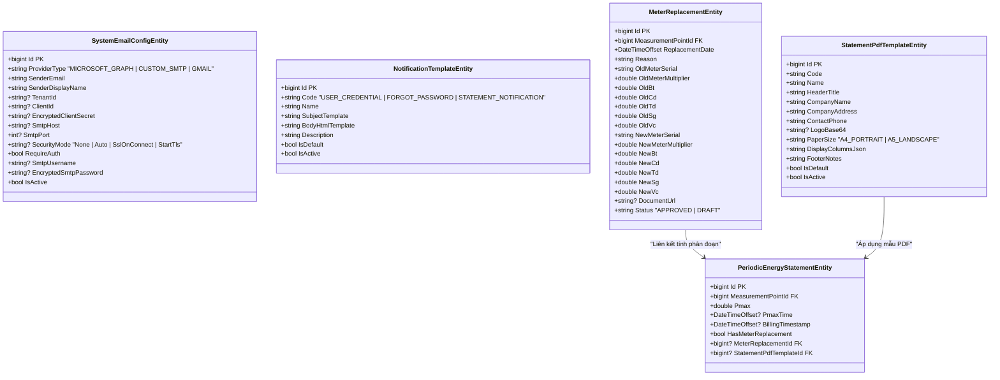

# [PLAN] NÂNG CẤP HỆ THỐNG EMAIL DOANH NGHIỆP (MICROSOFT GRAPH API & SMTP/GMAIL), QUẢN LÝ ĐA MẪU THÔNG BÁO VÀ NGHIỆP VỤ ĐO ĐẾM CHUYÊN SÂU CÔNG TƠ EDMI MK6 (PMAX, TREO THÁO & CHỐT CHỈ SỐ)

> **Tài liệu đặc tả kỹ thuật kiến trúc & Kế hoạch triển khai (Technical Specification & Task Breakdown)**  
> **Phiên bản:** v2.1.0-ENTERPRISE  
> **Tác giả:** MDMS-Planner (Principal Solution Architect)  
> **Dự án:** MDMSv2 - Hệ thống Quản trị Dữ liệu Đo đếm Công tơ Điện tử (Meter Data Management System)  
> **Địa bàn triển khai thực tế:** Khu Công Nghiệp VSIP Hải Phòng  
> **Mục tiêu thực thi:** Chuyển giao trực tiếp cho `MDMS-Coder` thực thi mã nguồn, `MDMS-Tester` kiểm thử toàn diện và `MDMS-Reviewer` thẩm định chất lượng theo chuỗi Multi-Agent của MDMSv2.

---

## 1. MỤC TIÊU & PHẠM VI (OBJECTIVES & SCOPE)

### 1.1. Module 1: Nâng cấp Đa Nền tảng Dịch vụ Email Doanh Nghiệp (Enterprise Email Providers)
1. **Hỗ trợ Microsoft Graph API (OAuth 2.0 Client Credentials Grant Flow)**:
   * Đáp ứng trực tiếp yêu cầu từ phòng IT của **VSIP Hải Phòng** (`noreply.hoadondientu.hp@vsip.com.vn`).
   * Sử dụng App Registration trên Azure AD/Entra ID với các thông số:
     - **Tenant ID**: `5e5bd7f8-2adb-4595-956a-a03d68ea32a6`
     - **Client ID**: `6a86904e-3153-496f-8c1b-986ae398747a`
     - **Client Secret**: `[AZURE_CLIENT_SECRET]`
     - **Endpoint**: `https://graph.microsoft.com/v1.0/users/{senderEmail}/sendMail`
   * Cơ chế tự động quản lý và cache Access Token (kèm refresh token khi hết hạn), hỗ trợ gửi đính kèm file PDF base64.
2. **Hỗ trợ Custom SMTP Server (Doanh nghiệp nội bộ)**:
   * Cho phép khách hàng kết nối tới hệ sinh thái máy chủ thư điện tử riêng (Exchange On-Premise, Postfix, Zimbra, Lotus Domino...).
   * Hỗ trợ cấu hình cổng linh hoạt: Port 25 (Internal IP Relay không yêu cầu mật khẩu), Port 465 (SSL), Port 587 (STARTTLS).
   * Cơ chế xác thực tùy biến: Có xác thực (Username/Password) hoặc Không xác thực (Relay IP Whitelist).
3. **Bảo lưu và hoàn thiện kết nối Gmail / Google Workspace (App Password)**:
   * Hỗ trợ doanh nghiệp vừa và nhỏ sử dụng Gmail SMTP (`smtp.gmail.com:587`).
4. **Quản trị Cấu hình Động & Kiểm thử Kết nối (Dynamic Configuration & Test Connection)**:
   * Toàn bộ cấu hình Email Server được quản lý trong Cơ sở dữ liệu và giao diện Quản trị SuperAdmin/Admin (bảo mật mã hóa AES-256 các thông tin nhạy cảm Client Secret, Password).
   * Bổ sung tính năng **"Kiểm tra kết nối (Test Connection)"**: Nhập địa chỉ email bất kỳ $\to$ Hệ thống gửi thư kiểm tra và hiển thị ngay kết quả thông suốt kèm log chi tiết.

---

### 1.2. Module 2: Quản lý Đa Mẫu Email và Đa Mẫu "Phiếu Báo" (Customizable Multi-Templates)
1. **Quản lý Đa Mẫu Email (Email Templates)**:
   * Cho phép tạo mới, chỉnh sửa, nhân bản và xóa nhiều mẫu email cho từng nghiệp vụ:
     - `USER_CREDENTIAL`: Email thông báo tài khoản / mật khẩu khởi tạo cho người dùng.
     - `FORGOT_PASSWORD`: Email cấp lại mật khẩu hoặc liên kết đặt lại mật khẩu.
     - `STATEMENT_NOTIFICATION`: Email thông báo chỉ số, sản lượng và gửi kèm Phiếu báo điện năng hàng tháng.
   * Tích hợp **Template Engine (Fluid / Liquid Syntax)** hỗ trợ bộ thẻ biến nghiệp vụ động (Merge Tags / Placeholders):
     - Biến khách hàng: `{{CustomerName}}`, `{{PointCode}}`, `{{Address}}`, `{{SerialNumber}}`.
     - Biến chỉ số & sản lượng: `{{Bt}}`, `{{Cd}}`, `{{Td}}`, `{{Sg}}`, `{{Vc}}`, `{{PreviousBt}}`, `{{ConsumtionBt}}`, `{{ConsumtionTotal}}`.
     - Biến công suất: `{{Pmax}}`, `{{PmaxTime}}`.
     - Biến chăm sóc khách hàng: `{{CareFullname}}`, `{{CareEmail}}`, `{{CarePhone}}`.
   * Giao diện trình soạn thảo trực quan Rich Text Editor kèm tính năng **"Xem trước (Live Preview)"** với dữ liệu mẫu thực tế.
2. **Quản lý Đa Mẫu "Phiếu Báo" PDF (PDF Statement Templates)**:
   * Cho phép định nghĩa nhiều Profile mẫu phiếu báo PDF phù hợp với từng phân khúc khách hàng hoặc từng thời điểm:
     - Tải lên Logo đơn vị bán điện riêng biệt (Base64 / URL).
     - Tùy chỉnh thông tin Bên A (Đơn vị bán điện): Tên doanh nghiệp, Địa chỉ, Mã số thuế, Hotline, Fax.
     - Tùy chỉnh kích thước khổ giấy: **A5 Landscape** (khổ ngang truyền thống) hoặc **A4 Portrait** (khổ đứng chuẩn hồ sơ kế toán).
     - Bật / Tắt linh hoạt các cột dữ liệu: Cột $P_{max}$, Cột Hệ số công suất $Cos\varphi$, Cột Điện năng phản kháng Vô công ($AQ$).
     - Tùy biến phần xác nhận chân trang (Footer): 1 bên ký hoặc 2 bên cùng ký xác nhận.
   * Cho phép chọn mẫu Phiếu báo áp dụng mặc định theo Điểm đo (`MeasurementPoint`) hoặc chọn mẫu áp dụng ngay tại thời điểm xuất/phát hành hàng loạt.

---

### 1.3. Module 3: Nghiệp vụ Đo đếm Chuyên sâu cho Công tơ EDMI MK6E & MK6N (VSIP Hải Phòng)
1. **Khai thác Bộ chỉ số Chốt Tự động (Frozen Billing Registers) của EDMI MK6**:
   * Công tơ EDMI MK6E/MK6N tự động thực hiện Billing Reset vào thời điểm cài đặt (00:00:00 ngày đầu kỳ) và lưu giữ bất biến bộ chỉ số chốt trong bộ nhớ EEPROM.
   * Hệ thống thiết lập ưu tiên tuyệt đối: Khi thực hiện chốt sổ GCS kỳ, hệ thống sẽ đọc trực tiếp các thanh ghi **Previous Billing Registers** của công tơ. Đảm bảo dữ liệu chốt luôn chính xác 100% tại thời điểm 00:00:00 của công tơ, loại bỏ hoàn toàn sai số trôi dạt do độ trễ truyền thông Modbus RTU qua mạng.
2. **Ghi nhận Công suất Cực đại ($P_{max}$ - Max Demand) & Thời điểm Ghi nhận ($T_{Pmax}$)**:
   * Thu thập đồng thời:
     - $P_{max}$ và $T_{Pmax}$ của kỳ chốt vừa qua (Previous Billing Demand).
     - $P_{max}$ và $T_{Pmax}$ của kỳ đang vận hành hiện tại (Current Demand).
   * Lưu trữ dấu thời gian chính xác (Ngày, tháng, năm, giờ, phút) và hiển thị minh bạch trên Phiếu báo số điện.
3. **Nghiệp vụ "Treo / Tháo" Công tơ (Meter Replacement) & Tính Sản lượng Phân đoạn**:
   * Xây dựng chức năng lập **"Biên bản Treo / Tháo công tơ"**:
     - Ghi nhận thông tin công tơ tháo (Serial cũ, Chỉ số tháo $CS_{tháo}$, Hệ số nhân cũ $HS_{cũ}$).
     - Ghi nhận thông tin công tơ treo (Serial mới, Chỉ số treo ban đầu $CS_{treo}$, Hệ số nhân mới $HS_{mới}$).
     - Đính kèm tệp biên bản bàn giao hiện trường.
   * **Thuật toán tính sản lượng phân đoạn tự động**:
     $$\text{Sản lượng kỳ} = (CS_{tháo} - CS_{đầu\ kỳ}) \times HS_{cũ} + (CS_{cuối\ kỳ} - CS_{treo}) \times HS_{mới}$$
   * Phiếu báo trong kỳ có treo tháo tự động hiển thị **2 dòng chi tiết** (Dòng công tơ cũ và Dòng công tơ mới) kèm tổng sản lượng gộp, đảm bảo tính pháp lý và minh bạch tuyệt đối đối với khách hàng mua điện.
4. **Nghiệp vụ "Reset" Chỉ số & Tự động Bù Tràn số Công tơ (Rollover Protection)**:
   * Ghi nhận sự kiện Reset công tơ (Manual Billing Reset hoặc Reset thanh ghi).
   * Tự động phát hiện hiện tượng tràn số tự nhiên của công tơ ($CS_{mới} < CS_{cũ}$) để áp dụng công thức bù tràn số:
     $$\text{Sản lượng} = [(10^n - CS_{cũ}) + CS_{mới}] \times \text{Hệ số nhân}$$
   * Cơ chế cảnh báo bất thường (`ANOMALY_METER_READING`): Nếu chỉ số mới giảm mà không có biên bản treo tháo/reset và không khớp điều kiện tràn số hợp lý, hệ thống sẽ tự động chặn xuất phiếu báo và đẩy vào hàng đợi phúc tra.

---

## 2. THIẾT KẾ KIẾN TRÚC & DỮ LIỆU (TECHNICAL ARCHITECTURE)



---

### 2.1. Chi tiết Mô hình Cơ sở Dữ liệu (Database Schema - MySQL EF Core)

#### Bảng `system_email_configs` (Cấu hình Máy chủ Gửi Thư)
```csharp
namespace Domain.Entities;

public class SystemEmailConfigEntity : IEntity<long>
{
    public long Id { get; set; }
    public string ProviderType { get; set; } = "MICROSOFT_GRAPH"; // MICROSOFT_GRAPH, CUSTOM_SMTP, GMAIL
    public string SenderEmail { get; set; } = string.Empty;
    public string SenderDisplayName { get; set; } = string.Empty;
    
    // Microsoft Graph API (OAuth 2.0)
    public string? TenantId { get; set; }
    public string? ClientId { get; set; }
    public string? EncryptedClientSecret { get; set; }
    
    // Custom SMTP / Gmail
    public string? SmtpHost { get; set; }
    public int? SmtpPort { get; set; }
    public string? SecurityMode { get; set; } = "StartTls"; // None, Auto, SslOnConnect, StartTls
    public bool RequireAuth { get; set; } = true;
    public string? SmtpUsername { get; set; }
    public string? EncryptedSmtpPassword { get; set; }
    
    public bool IsActive { get; set; } = true;
    public DateTimeOffset CreatedTime { get; set; }
    public DateTimeOffset? ModifiedTime { get; set; }
}
```

#### Bảng `notification_templates` (Quản lý Mẫu Email Đa Dạng)
```csharp
namespace Domain.Entities;

public class NotificationTemplateEntity : IEntity<long>
{
    public long Id { get; set; }
    public string Code { get; set; } = string.Empty; // USER_CREDENTIAL, FORGOT_PASSWORD, STATEMENT_NOTIFICATION
    public string Name { get; set; } = string.Empty;
    public string SubjectTemplate { get; set; } = string.Empty;
    public string BodyHtmlTemplate { get; set; } = string.Empty;
    public string? Description { get; set; }
    public bool IsDefault { get; set; } = false;
    public bool IsActive { get; set; } = true;
    public DateTimeOffset CreatedTime { get; set; }
    public DateTimeOffset? ModifiedTime { get; set; }
}
```

#### Bảng `statement_pdf_templates` (Quản lý Mẫu Phiếu Báo PDF)
```csharp
namespace Domain.Entities;

public class StatementPdfTemplateEntity : IEntity<long>
{
    public long Id { get; set; }
    public string Code { get; set; } = string.Empty;
    public string Name { get; set; } = string.Empty;
    public string HeaderTitle { get; set; } = "PHIẾU GHI SỐ ĐIỆN HÀNG THÁNG";
    public string SubHeaderTitle { get; set; } = "MONTHLY POWER METER READING";
    public string CompanyName { get; set; } = "CÔNG TY TNHH VSIP HẢI PHÒNG";
    public string CompanyAddress { get; set; } = string.Empty;
    public string ContactPhone { get; set; } = string.Empty;
    public string? LogoBase64 { get; set; }
    public string PaperSize { get; set; } = "A5_LANDSCAPE"; // A5_LANDSCAPE, A4_PORTRAIT
    public string DisplayColumnsJson { get; set; } = "[\"BT\",\"CD\",\"TD\",\"SG\",\"VC\",\"PMAX\",\"COSPHI\"]";
    public string FooterNotes { get; set; } = string.Empty;
    public bool RequireDualSignatures { get; set; } = true; // True: Cả Bên A và Bên B ký; False: Chỉ Bên A ký
    public bool IsDefault { get; set; } = false;
    public bool IsActive { get; set; } = true;
    public DateTimeOffset CreatedTime { get; set; }
    public DateTimeOffset? ModifiedTime { get; set; }
}
```

#### Bảng `meter_replacements` (Biên bản Treo / Tháo Công Tơ)
```csharp
namespace Domain.Entities;

public class MeterReplacementEntity : IEntity<long>
{
    public long Id { get; set; }
    public long MeasurementPointId { get; set; }
    public MeasurementPointsEntity MeasurementPoint { get; set; }
    public DateTimeOffset ReplacementDate { get; set; }
    public string Reason { get; set; } = string.Empty; // Kiểm định định kỳ, Hỏng màn hình, Nâng công suất
    
    // Chỉ số công tơ tháo
    public string OldMeterSerial { get; set; } = string.Empty;
    public double OldMeterMultiplier { get; set; } = 1.0;
    public double OldBt { get; set; }
    public double OldCd { get; set; }
    public double OldTd { get; set; }
    public double OldSg { get; set; }
    public double OldVc { get; set; }
    public double OldPmax { get; set; }
    
    // Chỉ số công tơ treo mới
    public string NewMeterSerial { get; set; } = string.Empty;
    public double NewMeterMultiplier { get; set; } = 1.0;
    public double NewBt { get; set; }
    public double NewCd { get; set; }
    public double NewTd { get; set; }
    public double NewSg { get; set; }
    public double NewVc { get; set; }
    public double NewPmax { get; set; }
    
    public string? DocumentUrl { get; set; } // Ảnh scan hoặc PDF biên bản treo tháo
    public string Status { get; set; } = "APPROVED"; // DRAFT, APPROVED, CANCELLED
    public DateTimeOffset CreatedTime { get; set; }
    public long? CreatedBy { get; set; }
    public string? CreatedName { get; set; }
}
```

#### Mở rộng bảng `periodic_energy_statements`
* Bổ sung các trường:
  - `Pmax`: double (Công suất cực đại chu kỳ chốt).
  - `PmaxTime`: DateTimeOffset? (Thời điểm ghi nhận $P_{max}$).
  - `BillingTimestamp`: DateTimeOffset? (Thời điểm chốt ghi nhận trực tiếp từ thanh ghi EDMI).
  - `HasMeterReplacement`: bool (Đánh dấu kỳ có phát sinh treo tháo).
  - `MeterReplacementId`: long? (Khóa ngoại tham chiếu `meter_replacements`).
  - `StatementPdfTemplateId`: long? (Khóa ngoại tham chiếu `statement_pdf_templates` áp dụng).

---

### 2.2. Đặc tả API Specifications (Endpoints & Contracts)

#### A. Nhóm API Quản trị Cấu hình Email (`/api/v1/email-configs`)
1. **Lấy cấu hình hiện tại**:
   * `GET /api/v1/email-configs/active`
   * Response: `SystemEmailConfigResponse` (mật khẩu và client secret được che phủ `******`).
2. **Cập nhật cấu hình**:
   * `PUT /api/v1/email-configs`
   * Body: `UpdateSystemEmailConfigRequest`
3. **Kiểm tra kết nối và gửi mail thử nghiệm (Test Connection)**:
   * `POST /api/v1/email-configs/test-connection`
   * Body:
     ```json
     {
       "testRecipientEmail": "admin.it@vsip.com.vn",
       "providerType": "MICROSOFT_GRAPH",
       "tenantId": "5e5bd7f8-2adb-4595-956a-a03d68ea32a6",
       "clientId": "6a86904e-3153-496f-8c1b-986ae398747a",
       "clientSecret": "sSC8Q~...",
       "senderEmail": "noreply.hoadondientu.hp@vsip.com.vn"
     }
     ```
   * Response: Trả về trạng thái `isSuccess: true` hoặc thông báo lỗi chi tiết từ Microsoft Graph API / SMTP Server.

#### B. Nhóm API Quản lý Mẫu Email (`/api/v1/notification-templates`)
1. `GET /api/v1/notification-templates?code=STATEMENT_NOTIFICATION`: Lấy danh sách mẫu theo loại.
2. `POST /api/v1/notification-templates`: Tạo mới mẫu email.
3. `PUT /api/v1/notification-templates/{id}`: Cập nhật mẫu email.
4. `POST /api/v1/notification-templates/preview`: Xem trước nội dung email sau khi bind các biến dữ liệu mẫu.

#### C. Nhóm API Quản lý Mẫu Phiếu Báo PDF (`/api/v1/statement-pdf-templates`)
1. `GET /api/v1/statement-pdf-templates`: Lấy danh sách mẫu phiếu báo.
2. `POST /api/v1/statement-pdf-templates`: Thêm mới mẫu phiếu báo.
3. `PUT /api/v1/statement-pdf-templates/{id}`: Cập nhật cấu hình mẫu phiếu báo.
4. `POST /api/v1/statement-pdf-templates/preview-pdf`: Render xem trước file PDF của mẫu.

#### D. Nhóm API Nghiệp vụ Treo / Tháo Công tơ (`/api/v1/meter-replacements`)
1. `POST /api/v1/meter-replacements`: Lập biên bản treo/tháo công tơ cho điểm đo.
2. `GET /api/v1/meter-replacements/by-point/{pointId}`: Lịch sử treo/tháo của điểm đo.
3. `GET /api/v1/meter-replacements/{id}`: Chi tiết biên bản treo tháo.

---

### 2.3. Frontend Flow & Trải nghiệm Người dùng (React 18 + Ant Design 5)
1. **Trang Cấu hình Email Doanh nghiệp (`/settings/email-config`)**:
   * Lựa chọn Tabs / Radio cards: `Microsoft 365 (Graph API)` vs `Custom SMTP Server` vs `Gmail`.
   * Form nhập linh hoạt theo loại dịch vụ đã chọn.
   * Khu vực "Gửi thử nghiệm": Input email nhận + nút **"Kiểm tra kết nối"** có hiệu ứng Spin loading, hiển thị notification popup chi tiết.
2. **Trang Quản lý Mẫu Thông báo (`/settings/templates`)**:
   * Quản lý mẫu Email: Danh sách thẻ mẫu, nút set làm Mặc định, trình soạn thảo WYSIWYG có bảng danh sách "Merge tags" bấm là chèn.
   * Quản lý mẫu Phiếu báo PDF: Cho phép upload Logo trực tiếp, bật/tắt checkbox các cột hiển thị, chọn A4/A5 và khung preview PDF tương tác ngay lập tức.
3. **Màn hình Treo / Tháo Công tơ (`/measurement-points/meter-replacement`)**:
   * Cho phép chọn điểm đo $\to$ Hệ thống tự động điền sẵn chỉ số chốt gần nhất của công tơ cũ.
   * Nhập chỉ số tháo thực tế $\to$ Nhập serial và chỉ số công tơ EDMI mới treo lên.
   * Cung cấp nút xem trước biểu đồ sản lượng phân đoạn để kỹ thuật viên kiểm tra tính hợp lý trước khi phê duyệt.
4. **Hộp thoại Chốt Sổ & Gửi Phiếu Báo (`/gcs/statements`)**:
   * Bổ sung Dropdown: **"Chọn mẫu Email thông báo"** và **"Chọn mẫu Phiếu báo PDF"** trước khi bấm gửi hàng loạt hoặc gửi từng điểm đo.

---

## 3. DANH SÁCH CÔNG VIỆC CHI TIẾT (TASK BREAKDOWN FOR MDMS-CODER)

### Phase 1: Nền tảng Dữ liệu & Nhà cung cấp Dịch vụ Email (Backend Infrastructure)
- [ ] **Task 1.1: [Backend/Domain]** Tạo Entity `SystemEmailConfigEntity`, `NotificationTemplateEntity`, `StatementPdfTemplateEntity`, `MeterReplacementEntity` và bổ sung các trường $P_{max}$, $P_{max}Time$, $BillingTimestamp$ vào `PeriodicEnergyStatementEntity`.
- [ ] **Task 1.2: [Backend/Infrastructure]** Cấu hình EF Core DbContext, EntityTypeConfigurations, đánh index cho các trường khóa tra cứu và tạo tệp Migration MySQL.
- [ ] **Task 1.3: [Backend/Application]** Xây dựng abstraction `IEmailProviderService` và các contract DTOs tương ứng.
- [ ] **Task 1.4: [Backend/Infrastructure]** Hiện thực hóa `MicrosoftGraphEmailProvider`:
  * Tích hợp HTTP Client kết nối Azure AD OAuth 2.0 Client Credentials Flow.
  * Quản lý In-Memory Token Caching tự động refresh khi hết hạn.
  * Đóng gói Payload gửi thư `POST /users/{id}/sendMail` kèm tệp đính kèm Base64.
- [ ] **Task 1.5: [Backend/Infrastructure]** Hiện thực hóa `SmtpEmailProvider` chuẩn hóa trên thư viện `MailKit` (hỗ trợ cả Custom SMTP nội bộ và Gmail STARTTLS).
- [ ] **Task 1.6: [Backend/Infrastructure]** Hiện thực hóa `EmailProviderFactory` điều phối provider theo cấu hình kích hoạt trong cơ sở dữ liệu.
- [ ] **Task 1.7: [Backend/WebApi]** Tạo `EmailConfigController` với các endpoint CRUD và `POST /test-connection`.

### Phase 2: Đa Mẫu Email & Đa Mẫu Phiếu Báo PDF (Template Management)
- [ ] **Task 2.1: [Backend/Application]** Tích hợp thư viện Template Engine (Fluid/Scriban) và xây dựng `NotificationTemplateService` hỗ trợ biên dịch chuỗi động với bộ Merge Tags.
- [ ] **Task 2.2: [Backend/Infrastructure]** Tái cấu trúc bộ sinh PDF `EmailSenderService` với QuestPDF: Tạo `ModularStatementPdfDocument` nhận tham số cấu hình từ `StatementPdfTemplateEntity` (Header, Logo, Cột $P_{max}$, $Cos\varphi$, Chữ ký, Khổ A4/A5).
- [ ] **Task 2.3: [Backend/WebApi]** Tạo `NotificationTemplateController` và `StatementPdfTemplateController` kèm API xem trước HTML/PDF.
- [ ] **Task 2.4: [Frontend]** Xây dựng trang Quản trị Cấu hình Email và Kiểm thử kết nối (`/settings/email-config`).
- [ ] **Task 2.5: [Frontend]** Xây dựng giao diện Quản lý Đa mẫu Email và Mẫu Phiếu báo PDF kèm chức năng Live Preview.

### Phase 3: Nghiệp vụ Đo đếm EDMI MK6, $P_{max}$ & Treo/Tháo Công Tơ
- [ ] **Task 3.1: [Backend/Application & Infrastructure]** Nâng cấp `FinalMeterReadingCommandHandler`:
  * Đọc bổ sung dữ liệu $P_{max}$ và thời điểm $P_{max}$ ($T_{Pmax}$) từ công tơ EDMI MK6.
  * Ưu tiên chốt chỉ số từ bộ thanh ghi `Previous Billing Frozen` của công tơ.
- [ ] **Task 3.2: [Backend/Application & Infrastructure]** Xây dựng Command/Handler xử lý nghiệp vụ **Treo / Tháo công tơ**:
  * Kiểm tra tính hợp lệ dữ liệu tháo và treo.
  * Thuật toán phân tách sản lượng 2 phân đoạn công tơ cũ - mới khi chốt sổ.
- [ ] **Task 3.3: [Backend/Infrastructure]** Cập nhật `ModularStatementPdfDocument`: Hiển thị bảng 2 dòng minh bạch cho các kỳ có phát sinh thay thế công tơ.
- [ ] **Task 3.4: [Backend/WebApi]** Tạo `MeterReplacementController`.
- [ ] **Task 3.5: [Frontend]** Xây dựng màn hình Lập biên bản Treo/Tháo công tơ và cập nhật giao diện Chốt GCS/Phiếu báo cho phép chọn Mẫu áp dụng.

---

## 4. TIÊU CHÍ NGHIỆM THU (DEFINITION OF DONE - DOD)

1. **Kiểm định Email Microsoft Graph API**:
   * Gửi email thành công từ tài khoản `noreply.hoadondientu.hp@vsip.com.vn` với thông số Tenant ID, Client ID, Client Secret thực tế của VSIP Hải Phòng.
   * Thư gửi đến đích (Outlook, Gmail, Yahoo...) có đầy đủ tệp đính kèm Phiếu báo PDF, hiển thị đúng người gửi, không rơi vào Spam.
2. **Kiểm định Email SMTP & Gmail**:
   * Chuyển đổi qua lại giữa các Provider trong trang quản trị mượt mà, tính năng Test Connection phản hồi kết quả chính xác trong vòng < 3 giây.
3. **Kiểm định Đa Mẫu Thông Báo**:
   * Khách hàng tự tạo và chỉnh sửa mẫu email / mẫu phiếu báo PDF tùy ý.
   * Khi gửi phiếu báo cho khách hàng, hệ thống áp dụng chính xác mẫu đã chọn, các biến `{{CustomerName}}`, `{{PointCode}}`, `{{Pmax}}` được thay thế chính xác số liệu đo đếm.
4. **Kiểm định Nghiệp vụ EDMI MK6 & Treo Tháo**:
   * Thu thập và thể hiện đầy đủ giá trị $P_{max}$ kèm ngày giờ xuất hiện trên phiếu báo.
   * Với điểm đo có phát sinh treo tháo công tơ trong kỳ: Sản lượng tính toán chuẩn xác theo công thức phân đoạn 2 công tơ, phiếu báo hiển thị minh bạch 2 dòng dữ liệu cũ và mới, không phát sinh sản lượng âm hoặc sai lệch doanh thu.
5. **Tiêu chuẩn Kỹ thuật Mã nguồn**:
   * Toàn bộ mã nguồn Backend build `.NET 8` thành công (`dotnet build`) không có warning/error nghiêm trọng.
   * Toàn bộ mã nguồn Frontend build Vite + TypeScript (`tsc && vite build`) không phát sinh lỗi kiểu dữ liệu.
   * Kiểm tra Linter Frontend vượt qua 100%.

---

> **Lưu ý bàn giao chuỗi Multi-Agent:**
> Tài liệu kỹ thuật này được phê duyệt làm cơ sở duy nhất để kích hoạt `MDMS-Coder` thực thi theo từng Task nguyên tử, bảo đảm tính toàn vẹn hệ thống và chất lượng bàn giao cho khách hàng VSIP Hải Phòng.
