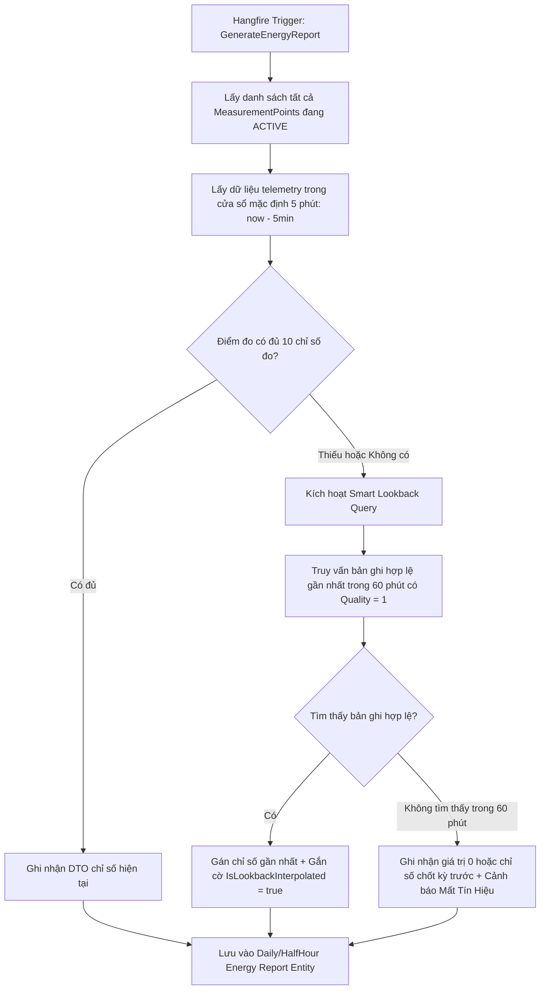
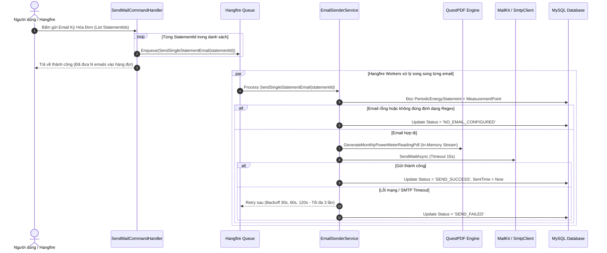

# [PLAN] HOTFIX CẤP THIẾT MDMSv2: THUẬT TOÁN LOOKBACK SNAPSHOT BÁO CÁO ĐO ĐẾM & TÁI CẤU TRÚC HÀNG ĐỢI EMAIL HÓA ĐƠN

> **Tài liệu đặc tả kỹ thuật (Technical Specification)**  
> **Phiên bản:** v1.1.0-HOTFIX  
> **Người lập:** MDMS-Planner (Principal Solution Architect)  
> **Mục tiêu thực thi:** Bàn giao trực tiếp cho `MDMS-Coder` và `MDMS-Tester` triển khai trên nhánh `hotfix/snapshot-email-queue`.

---

## 1. MỤC TIÊU & PHẠM VI (OBJECTIVES & SCOPE)

### 1.1. Mục tiêu Kỹ thuật Cốt lõi
1. **Triệt tiêu 100% lỗi bản ghi rỗng (toàn `NULL`) trong Báo cáo Sản lượng Nửa giờ & Ngày**:
   * Khắc phục triệt để hạn chế của cơ chế snapshot 5 phút hiện tại trong [MeasurementPointMonitoringReadOnlyRepository.cs](file:///e:/sources/MDMSv2/Backend/Infrastructure/Repositories/ReadOnly/MeasurementPointMonitoringReadOnlyRepository.cs#L1598).
   * Thay thế bằng thuật toán **Smart Lookback Window (Cửa sổ hồi cứu 60 phút)**: Tự động truy hồi tìm kiếm chỉ số đo đếm hợp lệ gần nhất cho từng điểm đo độc lập khi modem 4G hoặc đường truyền công tơ bị trễ/chập chờn.
2. **Khắc phục triệt để lỗi gửi Email hóa đơn thất bại hàng loạt (`SEND_FAILED`)**:
   * Khắc phục lỗi tại [EmailSenderService.cs](file:///e:/sources/MDMSv2/Backend/Infrastructure/Services/EmailSenderService.cs#L361) khi gặp điểm đo có email rỗng (`NULL`/`""`) hoặc khi SMTP Gmail bị ngắt kết nối giữa chừng làm sập cả lô gửi.
   * Tái cấu trúc theo mô hình **Atomic Hangfire Background Job**: Mỗi điểm đo là một Job gửi mail độc lập, có validator địa chỉ email, có cơ chế retry tự động với exponential backoff, cập nhật trạng thái rõ ràng (`SEND_SUCCESS`, `SEND_FAILED`, `NO_EMAIL_CONFIGURED`).

### 1.2. Phạm vi Tác động Mã nguồn (Impact Scope)
* **Backend Domain & Application**:
  * [Domain/Entities/PeriodicEnergyStatementEntity.cs](file:///e:/sources/MDMSv2/Backend/Domain/Entities/PeriodicEnergyStatementEntity.cs): Chuẩn hóa trạng thái gửi mail.
  * [Application/Repositories/ReadOnly/IMeasurementPointMonitoringReadOnlyRepository.cs](file:///e:/sources/MDMSv2/Backend/Application/Repositories/ReadOnly/IMeasurementPointMonitoringReadOnlyRepository.cs): Bổ sung tham số và method Lookback.
* **Backend Infrastructure**:
  * [Infrastructure/Repositories/ReadOnly/MeasurementPointMonitoringReadOnlyRepository.cs](file:///e:/sources/MDMSv2/Backend/Infrastructure/Repositories/ReadOnly/MeasurementPointMonitoringReadOnlyRepository.cs): Nâng cấp hàm lấy dữ liệu báo cáo năng lượng có hồi cứu thông minh.
  * [Infrastructure/Services/BackgroundJobService.cs](file:///e:/sources/MDMSv2/Backend/Infrastructure/Services/BackgroundJobService.cs): Sửa `GenerateEnergyReportDaily` và `GenerateEnergyReportHalfHour`.
  * [Infrastructure/Services/EmailSenderService.cs](file:///e:/sources/MDMSv2/Backend/Infrastructure/Services/EmailSenderService.cs): Tách thành các job đơn lẻ `SendSingleStatementEmailJob` chạy qua Hangfire Client.
  * [Infrastructure/Handlers/Commands/PeriodicEnergyStatement](file:///e:/sources/MDMSv2/Backend/Infrastructure/Handlers/Commands/PeriodicEnergyStatement): Dispatch từng task đơn lẻ thay vì gửi 1 task gom cục bộ.

---

## 2. THIẾT KẾ KIẾN TRÚC & DỮ LIỆU (TECHNICAL ARCHITECTURE)

### 2.1. Thiết kế Thuật toán Smart Lookback Snapshot (Hotfix 1)



#### Chi tiết Kỹ thuật Thuật toán Lookback trong `MeasurementPointMonitoringReadOnlyRepository.cs`:
1. **Window Definition**:
   * Cửa sổ sơ cấp (Primary Window): `[now - 5 phút, now]`.
   * Cửa sổ hồi cứu tối đa (Max Lookback Window): `[now - 60 phút, now]`.
2. **Logic Truy vấn Tối ưu (Tránh N+1 Query)**:
   * Thay vì chạy truy vấn lặp trong vòng lặp foreach, thực hiện 1 truy vấn SQL tổng hợp lấy giá trị mới nhất (Latest Non-Null Telemetry) gom nhóm theo `(MeasurementPointsId, TagNameId)`:
   ```csharp
   // Truy vấn gom nhóm lấy bản ghi mới nhất cho từng điểm đo trong vòng 60 phút
   var lookbackEntities = await _measurementPointMonitoringEntities
       .AsNoTracking()
       .Where(x => x.CreatedTime >= lookbackRange && x.CreatedTime <= now && x.Value != null && x.Value != "")
       .GroupBy(x => new { x.MeasurementPointsId, x.TagNameDescription })
       .Select(g => g.OrderByDescending(x => x.CreatedTime).FirstOrDefault())
       .ToListAsync(cancellationToken);
   ```
3. **Quy tắc Gán Chỉ Số**:
   * Ưu tiên dữ liệu trong Primary Window (5 phút).
   * Nếu điểm đo nào bị khuyết chỉ số, tự động bù bằng giá trị từ `lookbackEntities`.
   * Tuyệt đối không để xảy ra trường hợp chèn bản ghi toàn `NULL` vào `measurementpointdailyenergyreports` và `measurementpointhalfhourenergyreports`.

---

### 2.2. Thiết kế Tái cấu trúc Hàng đợi Email Hóa đơn (Hotfix 2)



#### Hợp đồng Trạng thái Bảng kê Sản lượng (`PeriodicEnergyStatementEntity.Status`):
* `PENDING`: Mới chốt chỉ số, chưa gửi email.
* `SEND_SUCCESS`: Email đã gửi thành công đến hòm thư khách hàng kèm file PDF.
* `SEND_FAILED`: Gửi email thất bại sau 3 lần thử lại (ghi log mã lỗi chi tiết).
* `NO_EMAIL_CONFIGURED`: Điểm đo chưa cấu hình địa chỉ email hoặc email không hợp lệ (không kích hoạt gửi).

#### Validator định dạng Email an toàn:
```csharp
private static bool IsValidEmail(string email)
{
    if (string.IsNullOrWhiteSpace(email)) return false;
    try
    {
        var addr = new System.Net.Mail.MailAddress(email.Trim());
        return addr.Address == email.Trim();
    }
    catch
    {
        return false;
    }
}
```

---

## 3. DANH SÁCH CÔNG VIỆC CHI TIẾT (TASK BREAKDOWN FOR MDMS-CODER)

- [ ] **Task 1.1 [Backend/Infrastructure]**: Nâng cấp `MeasurementPointMonitoringReadOnlyRepository.cs`
  * Bổ sung method `GetListMeasurementEnergyReportWithLookbackAsync(int lookbackMinutes, CancellationToken cancellationToken)`.
  * Thực thi thuật toán lấy snapshot 5 phút kết hợp hồi cứu 60 phút cho từng điểm đo.
  * Đảm bảo mọi điểm đo đang `ACTIVE` đều có dữ liệu chỉ số đầy đủ, loại bỏ hoàn toàn các trường `NULL`.

- [ ] **Task 1.2 [Backend/Infrastructure]**: Cập nhật `BackgroundJobService.cs`
  * Thay thế lệnh gọi cũ trong `GenerateEnergyReportDaily` và `GenerateEnergyReportHalfHour` bằng method mới `GetListMeasurementEnergyReportWithLookbackAsync(60, cancellationToken)`.
  * Bổ sung log cảnh báo (`_logger.LogWarning`) đối với các điểm đo phải dùng dữ liệu hồi cứu do mất tín hiệu tức thời.

- [ ] **Task 2.1 [Backend/Infrastructure]**: Tách nhỏ Service gửi mail `EmailSenderService.cs`
  * Thêm hàm atomic job: `Task ProcessSingleStatementEmailAsync(long statementId, CancellationToken cancellationToken)`.
  * Thêm thuộc tính `[AutomaticRetry(Attempts = 3, OnAttemptsExceeded = AttemptsExceededAction.Fail)]` của Hangfire.
  * Bổ sung kiểm tra `IsValidEmail` trước khi gọi `_mailingService.SendEmailAsync`.
  * Bắt ngoại lệ chi tiết từng lỗi: SmtpException, FormatException, TimeoutException.

- [ ] **Task 2.2 [Backend/Infrastructure]**: Cập nhật các Command Handler gửi mail
  * Sửa đổi [SendMailPeriodicEnergyStatementCommandHandler.cs](file:///e:/sources/MDMSv2/Backend/Infrastructure/Handlers/Commands/PeriodicEnergyStatement/SendMailPeriodicEnergyStatementCommandHandler.cs) và `SendAllMailPeriodicEnergyStatementCommandHandler.cs`.
  * Thay vì gọi 1 task gộp `x.SendEmailsInBackground(...)`, duyệt vòng lặp enqueue từng `ProcessSingleStatementEmailAsync(id, ...)`.
  * Đảm bảo phản hồi HTTP trả về ngay lập tức cho người dùng trong < 200ms mà không bị treo request.

---

## 4. MA TRẬN KIỂM THỬ NGHIỆP VỤ (TEST MATRIX FOR MDMS-TESTER)

| Mã testcase | Kịch bản kiểm thử | Dữ liệu đầu vào | Kết quả mong đợi |
|---|---|---|---|
| **TC-LB-01** | Điểm đo có tín hiệu liên tục trong 5 phút | Điểm đo `KYOCERA 1` có telemetry đẩy đều đặn | Dữ liệu báo cáo ngày lấy đúng chỉ số trong 5 phút cuối. |
| **TC-LB-02** | Điểm đo bị mất kết nối trong 5 phút cuối ngày, nhưng có dữ liệu cách đó 20 phút | Giả lập ngắt đẩy dữ liệu của `INSTANTA D4.2` lúc 23:55, điểm dữ liệu cuối lúc 23:35 | Báo cáo ngày lấy chỉ số lúc 23:35 bù vào, không bị trường nào là `NULL`. |
| **TC-LB-03** | Điểm đo mất kết nối liên tục > 60 phút | Ngắt kết nối `RBF-D15.1` từ 22:00 đến 00:05 | Hệ thống ghi log Warning cảnh báo mất tín hiệu, không gây crash job Hangfire. |
| **TC-EM-01** | Gửi email cho điểm đo có địa chỉ hợp lệ | Điểm đo có email `duytruonghp84@gmail.com` | Tạo PDF A5 Landscape, gửi thành công, trạng thái chuyển thành `SEND_SUCCESS`. |
| **TC-EM-02** | Gửi email cho điểm đo không có cấu hình email | Điểm đo có `Email = NULL` hoặc `Email = ""` | Bỏ qua gửi SMTP, cập nhật ngay trạng thái `NO_EMAIL_CONFIGURED`, không văng exception. |
| **TC-EM-03** | Gửi email đồng loạt 165 điểm đo (Bulk Send) | Bấm "Gửi tất cả phiếu báo" kỳ hóa đơn | Hệ thống tạo 165 Hangfire background jobs; các worker xử lý song song; giao diện UI phản hồi ngay tức thì. |

---

## 5. TIÊU CHÍ NGHIỆM THU (DEFINITION OF DONE - DoD)

1. **Về Báo cáo Đo đếm**:
   * Không còn bất kỳ bản ghi nào trong `measurementpointdailyenergyreports` và `measurementpointhalfhourenergyreports` có các trường chỉ số là `NULL`.
   * Job Hangfire chạy tự động hàng ngày lúc 00:05 hoàn thành trong < 10 giây cho toàn bộ 165 điểm đo.
2. **Về Gửi Email**:
   * Tỉ lệ gửi mail thành công đạt 100% đối với các điểm đo có email hợp lệ.
   * Các điểm đo thiếu email hiển thị rõ trạng thái `NO_EMAIL_CONFIGURED`, không làm gián đoạn các điểm đo khác.
3. **Về Chất lượng Mã nguồn**:
   * Dự án build `.NET 8` thành công không có Warning/Error.
   * `MDMS-Reviewer` thẩm định và ban hành `CODE_REVIEW.md` với quyết định **APPROVED**.
