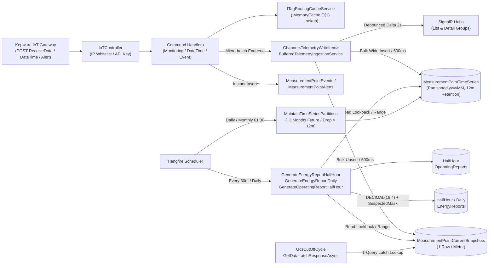

# [SPEC] TỐI ƯU HÓA CSDL ĐO ĐẾM & PIPELINE THU THẬP IOT (PHASE 1)

> **Tài liệu Đặc tả Kỹ thuật (Technical Specification)**  
> **Phiên bản:** v3.2.0-PHASE1-DB-PIPELINE-OPTIMIZATION  
> **Người thiết kế:** MDMS-Planner (Principal System Architect)  
> **Phạm vi:** Phase 1 — Chuyển đổi mô hình lưu trữ EAV sang Snapshot + Wide-Table TimeSeries Partition 12 tháng, Chuẩn hóa DECIMAL(18,4) + SuspectedMask cho Báo cáo Điện năng, Loại bỏ `MeasurementPointMonitoringHourly`, Tối ưu Ingestion Pipeline (`IMemoryCache` + `Channel<T>` + Debounced SignalR) & Bộ cài đặt Upgrade VM Zero-Data-Loss.  
> **Lưu ý phạm vi (Out-of-Scope Phase 1):** Cơ chế định danh theo `MeterSerial` + `ApiKeyHash`, gộp 1 Endpoint IoT, `MeterProfiles` Auto-Mapping, REST Heartbeat/Watchdog và xử lý MQTT thuộc **Phase 2 & 3**.

---

## 1. MỤC TIÊU KIẾN TRÚC & NGUYÊN TẮC THIẾT KẾ

1. **Chống phình to CSDL & Chuẩn hóa kiểu số (Numeric DECIMAL)**:
   - Xóa bỏ mô hình EAV nhiều triệu dòng với giá trị lưu kiểu `longtext` trên 5 bảng cũ:
     1. `MeasurementPointMonitoring`
     2. `ArchiveDataMeasurementPointMonitoring`
     3. `MeasurementPointMonitoringByDateTime`
     4. `MeasurementPointMonitoringByStatus`
     5. `MeasurementPointMonitoringHourly`
   - Thay thế bằng **2 bảng lõi**:
     * `MeasurementPointCurrentSnapshots` (**1 dòng / 1 Điểm đo**): phục vụ truy vấn $O(1)$ cho danh sách giám sát tổng hợp, trang chi tiết công tơ, chốt sổ GCS định kỳ (`GetDataLatchResponseAsync`), trạng thái `MatKetNoi` và 10 kênh cảnh báo `CanhBao01..10`, kèm 24 trường đồng hồ / thời điểm chốt / thời điểm $P_{max}$.
     * `MeasurementPointTimeSeries` (**Wide-Table Partitioned theo tháng `PartitionYm`**): gộp toàn bộ tham số điện trong cùng nhịp thu thập của 1 công tơ thành **1 bản ghi ngang** với các cột `DECIMAL(18,4)`. Cấu hình lưu giữ tự động **12 tháng** (`RETENTION_MONTHS = 12`) và tự tạo trước **3 tháng tương lai** (`p_YYYYMM` + `p_max` an toàn).
2. **Loại bỏ hoàn toàn `MeasurementPointMonitoringHourly` & chuẩn hóa `MeasurementPointHalfHourOperatingReports` (bỏ 9 cột `*Unit`)**:
   - **Không** bổ sung 4 cột `P/Q Max/Min` vào `MeasurementPointHalfHourOperatingReports`; toàn bộ các cột số đo hiện hữu được giữ nguyên, bổ sung `UNIQUE INDEX (MeasurementPointId, CreatedTime)`, và **xóa bỏ 9 cột `*Unit` trùng lặp** (`DienApPhaA..CUnit`, `DongDienPhaA..CUnit`, `CongSuatTacDungTong3PhaUnit`, `CongSuatPhanKhangTong3PhaUnit`, `TanSoHeThongUnit`) do đơn vị đã được cấu hình tập trung ở **"Liên kết dữ liệu"** (`TagName`). API JSON (`OperatingParameterReportResponse`) và các bộ xuất CSV/Excel/PDF/Biểu đồ vẫn trả đầy đủ đơn vị chuẩn qua helper dùng chung [`OperatingReportFallbackHelper.GetConfiguredUnitsAsync`](file:///e:/sources/MDMSv2/Backend/Infrastructure/Helpers/OperatingReportFallbackHelper.cs).
   - Dữ liệu lịch sử còn thiếu (theo giờ tròn) trong `MeasurementPointMonitoringHourly` được chuyển đổi bổ sung sang `MeasurementPointHalfHourOperatingReports` (nếu slot 30 phút đó chưa tồn tại).
   - Các truy vấn biểu đồ trong `MeasurementPointMonitoringHourlyReadOnlyRepository` được chuyển đổi trực tiếp sang SQL chuẩn hóa:
     * `GetLoadChartAsync`, `GetVoltageChartAsync`: tổng hợp SQL `GROUP BY` từ `MeasurementPointHalfHourOperatingReports`.
     * `GetPowerChartAsync`: truy vấn `MAX`/`MIN` trực tiếp từ `MeasurementPointTimeSeries` trong cửa sổ 12 tháng, tự động fallback sang `MAX`/`MIN` từ `MeasurementPointHalfHourOperatingReports` khi vượt quá phạm vi `MeasurementPointTimeSeries`.
     * `GetConsumptionOutputChartAsync`: tính delta sản lượng theo giờ/ngày/tháng từ `MeasurementPointHalfHourEnergyReports` và `MeasurementPointDailyEnergyReports` (hỗ trợ xử lý thay công tơ `curr < prev` không bị âm).
3. **Chuẩn hóa `DECIMAL(18,4)` & `SuspectedMask` trên 2 bảng Báo cáo Điện năng**:
   - Nâng cấp tại chỗ `MeasurementPointHalfHourEnergyReports` và `MeasurementPointDailyEnergyReports`: bổ sung 10 cột `DECIMAL(18,4) NULL` tương ứng 10 kênh `ChiSoTichLuy*`, cột `SuspectedMask INT NOT NULL DEFAULT 0` (Bit `0..9`), cột `IsSuspected TINYINT(1) NOT NULL DEFAULT 0`, và `UNIQUE INDEX (MeasurementPointId, CreatedTime)`.
   - Toàn bộ dữ liệu chuỗi cũ có `*` hoặc `(Not Topical)` được parse chính xác sang số `DECIMAL(18,4)` và mã hóa cờ nghi ngờ vào `SuspectedMask` / `IsSuspected`, sau đó mới xóa 10 cột chuỗi cũ và 10 cột `*Unit` dư thừa.
   - AutoMapper Profile (`MeasurementPointHalfHourEnergyReportProfile`, `MeasurementPointDailyEnergyReportProfile`) và Excel/CSV/PDF Exporter tái tạo lại định dạng `vi-VN` kèm dấu `*` từ `(decimal? + SuspectedMask)` và trả về đơn vị `kWh` / `kVArh` cố định, bảo đảm **100% tương thích JSON API với Frontend**.
4. **Chuẩn bị trường nền cho Phase 2 trên Events/Alerts**:
   - Điều chỉnh `MeasurementPointEvents` và `MeasurementPointAlerts`: cho phép `TagNameId` nhận giá trị `NULL` và bổ sung cột `ParameterCode VARCHAR(64) NULL` + index theo `(MeasurementPointId, CreatedTime)`.
5. **Tối ưu Pipeline Tiếp nhận IoT & Đồng bộ Thời gian thực**:
   - **`ITagRoutingCacheService` (`IMemoryCache`)**: tra cứu `(TagName -> MeasurementPointId, ParameterDescription, Unit)` trong $O(1)$ khi IoT Gateway đẩy gói tin; tự động vô hiệu hóa (invalidate) cache khi điểm đo hoặc liên kết tag thay đổi.
   - **`BufferedTelemetryIngestionService` (`Channel<T>` + `BackgroundService`)**: gom lô (micro-batch ~500ms hoặc 500 phần tử) để ghi hàng loạt bằng câu lệnh tham số hóa MySQL (`INSERT ... ON DUPLICATE KEY UPDATE` cho `MeasurementPointCurrentSnapshots`, bulk `INSERT` cho `MeasurementPointTimeSeries`) và phát thông điệp SignalR **Debounced Delta** (~2 giây/nhịp chỉ cho các điểm đo vừa thay đổi), chấm dứt hiện tượng truy vấn `PageSize = 1000` sau mỗi gói HTTP IoT.
   - **Quản trị vòng đời Partition qua Hangfire**: thay thế `GroupDataPerMeter` và `ArchiveDataMeasurementPointMonitoring` bằng Job `MaintainTimeSeriesPartitions` tạo trước phân vùng +3 tháng và `DROP PARTITION` quá 12 tháng.
6. **Chuyển đổi dữ liệu Zero-Data-Loss trên VM**:
   - Đóng gói hoàn chỉnh script `Installers/Database/20261111_phase1_optimize_metering_schema.sql` kết hợp nâng cấp `Installers/Scripts/Update_Hotfix.ps1`: tự động sao lưu `mysqldump` toàn bộ database `amr` trước khi chạy migration, thực thi backfill pivot, kiểm định toàn vẹn `COUNT` và `SUM` qua **Verification Gate** (`SIGNAL SQLSTATE '45000'` nếu sai lệch), và chỉ sau khi đạt 100% kiểm định mới `DROP` 5 bảng EAV/Hourly cũ cùng các cột string/unit cũ.

---

## 2. SƠ ĐỒ KIẾN TRÚC DỮ LIỆU & LUỒNG XỬ LÝ

---

## 3. ÁNH XẠ BITMASK `SuspectedMask` (`EnergySuspectedFlags`)

| Bit | Giá trị Mask | Kênh Điện Năng Tích Lũy (`MeasurementPointHalfHourEnergyReports` & `DailyEnergyReports`) | Đơn vị JSON |
|---|---|---|---|
| `0` | `1` | `ChiSoTichLuyDienNangTacDungAPTongKenhGiao` | `kWh` |
| `1` | `2` | `ChiSoTichLuyDienNangTacDungAPBieuGioBTKenhGiao` | `kWh` |
| `2` | `4` | `ChiSoTichLuyDienNangTacDungAPBieuGioCDKenhGiao` | `kWh` |
| `3` | `8` | `ChiSoTichLuyDienNangTacDungAPBieuGioTDKenhGiao` | `kWh` |
| `4` | `16` | `ChiSoTichLuyDienNangPhanKhangAQTongKenhGiao` | `kVArh` |
| `5` | `32` | `ChiSoTichLuyDienNangTacDungAPTongKenhNhan` | `kWh` |
| `6` | `64` | `ChiSoTichLuyDienNangTacDungAPBieuGioBTKenhNhan` | `kWh` |
| `7` | `128` | `ChiSoTichLuyDienNangTacDungAPBieuGioCDKenhNhan` | `kWh` |
| `8` | `256` | `ChiSoTichLuyDienNangTacDungAPBieuGioTDKenhNhan` | `kWh` |
| `9` | `512` | `ChiSoTichLuyDienNangPhanKhangAQTongKenhNhan` | `kVArh` |

---

## 4. DANH SÁCH CÔNG VIỆC CHI TIẾT (TASK BREAKDOWN - WBS)

- [x] **Task 1 [Domain & Application]**:
  * Tạo `MeasurementPointCurrentSnapshotEntity`, `MeasurementPointTimeSeriesEntity`, `EnergySuspectedFlags`, và `MeteringValueHelper`.
  * Cập nhật `MeasurementPointHalfHourEnergyReportEntity` & `MeasurementPointDailyEnergyReportEntity` dùng `decimal?` + `SuspectedMask` + `IsSuspected`; giữ nguyên toàn bộ cột của `MeasurementPointHalfHourOperatingReportEntity`.
  * Cập nhật `MeasurementPointsEventEntity` & `MeasurementPointsAlertEntity` (`long? TagNameId`, `string? ParameterCode`).
  * Xóa 5 Entity cũ (`MeasurementPointMonitoring*`, `ArchiveDataMeasurementPointMonitoring*`) cùng repository interfaces tương ứng; định nghĩa `ITagRoutingCacheService`, `IBufferedTelemetryIngestionService`, `IPartitionManagementService`.
- [x] **Task 2 [Infrastructure: EF Core, Cache, Ingestion Pipeline & Hangfire]**:
  * Cấu hình `IEntityTypeConfiguration` cho Snapshot, TimeSeries, EnergyReports, Events, Alerts; xóa 5 config cũ và làm sạch snapshot model cũ.
  * Hiện thực hóa `TagRoutingCacheService`, `BufferedTelemetryIngestionService` (batching SQL tham số hóa + SignalR debounced delta), `PartitionManagementService` (12 tháng retention, pre-create +3 tháng).
  * Cập nhật `MeasurementPointMonitoringCommandHandler`, `MeasurementPointMonitoringByDateTimeCommandHandler`, `MeasurementPointEventCommandHandler`, `BackgroundJobService`, `Program.cs` và gắn cache invalidation tại `MeasurementPoints` & `TagName` handlers.
- [x] **Task 3 [Infrastructure: Repositories & Mapping Profiles]**:
  * Refactor `MeasurementPointMonitoringReadOnlyRepository`, `MeasurementPointMonitoringHourlyReadOnlyRepository` (Charts từ `OperatingReports`, `TimeSeries`, `EnergyReports`), `EnergyConsumptionReportReadOnlyRepository`, `MeasurementPointHalfHourEnergyReport*`, `MeasurementPointDailyEnergyReport*`, `MeasurementPointHalfHourOperatingReport*`, `GcsCutOffCycleReadOnlyRepository`.
  * Cập nhật AutoMapper Profiles xuất đúng chuỗi `vi-VN` kèm `*` theo `SuspectedMask`.
- [x] **Task 4 [Database Migration Script & Installer Packaging]**:
  * Viết script idempotent `Installers/Database/20261111_phase1_optimize_metering_schema.sql` có Backfill toàn phần, Verification Gate (`COUNT` & `SUM`) và Drop 5 bảng cũ + cột chuỗi/unit cũ.
  * Cập nhật `Installers/Scripts/Update_Hotfix.ps1` bổ sung bước `mysqldump` Backup tự động, bảo vệ câu lệnh clean cũ và dừng triển khai ngay nếu SQL lỗi.
- [x] **Task 5 [Unit Testing, Code Review & Package Verification (`MDMS-Tester` & `MDMS-Reviewer`)]**:
  * Bổ sung bộ MSTest unit tests cho `EnergySuspectedFlags`/`MeteringValueHelper`, ánh xạ Snapshot & wide row TimeSeries, logic `PartitionYm` + 12 tháng cutoff, và batch aggregation.
  * Thực thi `dotnet build`, `dotnet test`, kiểm tra đóng gói `build_package.ps1` (với phần build hợp lệ), cập nhật `CHANGELOG_DEV.md`, `TEST_REPORT.md` và `CODE_REVIEW.md`.

---

## 5. TIÊU CHÍ NGHIỆM THU (DEFINITION OF DONE - DOD)

1. Toàn bộ 5 bảng EAV/Hourly cũ không còn tồn tại trong Domain/EF Core và được dọn sạch trong script migration SQL **chỉ sau khi Verification Gate xác nhận bảo lưu 100% số lượng bản ghi và tổng chỉ số** (Reports, Sổ GCS, Events, Alerts, OperatingReports).
2. `MeasurementPointHalfHourOperatingReports` giữ nguyên 100% các cột giá trị đo đếm số (`double`), loại bỏ hoàn toàn 9 cột `*Unit` dư thừa (resolve động theo `"Liên kết dữ liệu"` `TagName`), bổ sung dữ liệu giờ bị thiếu từ `MeasurementPointMonitoringHourly` và `UNIQUE INDEX (MeasurementPointId, CreatedTime)`.
3. `MeasurementPointHalfHourEnergyReports` và `MeasurementPointDailyEnergyReports` chuyển hoàn toàn sang `DECIMAL(18,4)` + `SuspectedMask`, nhưng HTTP JSON / CSV / Excel / PDF trả về cho người dùng cuối vẫn giữ nguyên format `vi-VN` kèm ký hiệu `*` và đơn vị `kWh`/`kVArh`.
4. `dotnet build Backend/AMR.sln` và `dotnet test Backend/Tests/MDMS.UnitTests/MDMS.UnitTests.csproj` đạt **0 Error**, 100% test cases PASS.
5. `Installers/Database/20261111_phase1_optimize_metering_schema.sql` và `Installers/Scripts/Update_Hotfix.ps1` được đóng gói sẵn sàng để chạy nâng cấp trực tiếp trên VM.
