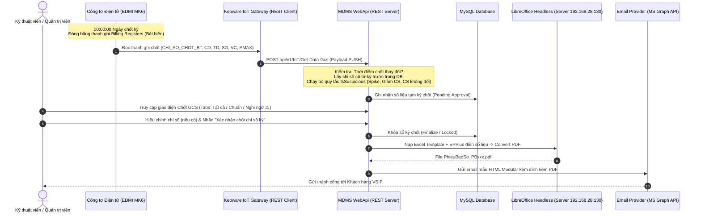

# [PLAN] KẾ HOẠCH TRIỂN KHAI NÂNG CẤP HỆ THỐNG EMAIL DOANH NGHIỆP, QUẢN LÝ MẪU EMAIL (HTML MODULAR) & PHIẾU BÁO CHỈ SỐ (EXCEL TO PDF QUA LIBREOFFICE HEADLESS) VÀ TÁI CẤU TRÚC NGHIỆP VỤ CHỐT CHỈ SỐ GCS (PURE PUSH REST SERVER)

> **Tài liệu Đặc Tả Kỹ Thuật & Kế Hoạch Triển Khai (Technical Specification & Task Breakdown)**  
> **Phiên bản:** v2.2.0-ENTERPRISE  
> **Kiến trúc sư giải pháp:** `MDMS-Planner`  
> **Dự án:** MDMSv2 - Hệ thống Quản trị Dữ liệu Đo đếm Điện tử (Meter Data Management System)  
> **Địa bàn áp dụng:** KCN VSIP Hải Phòng & Hệ thống Khách hàng Doanh nghiệp  
> **Vị trí trong chuỗi Multi-Agent:** Phase 1 - Khởi tạo & Định hướng Kiến trúc  

---

## 1. MỤC TIÊU & PHẠM VI (OBJECTIVES & SCOPE)

### 1.1. Module 1: Đa Nền Tảng Dịch Vụ Email Doanh Nghiệp (Đã Hoàn Thành)
1. **Microsoft Graph API (OAuth 2.0 Client Credentials Grant Flow)**:
   - Tích hợp chuẩn giao thức gửi thư của tập đoàn VSIP (`noreply.hoadondientu.hp@vsip.com.vn`).
   - Tự động xác thực qua Microsoft Entra ID (Azure AD), quản lý In-Memory Token Caching tự động refresh khi hết hạn.
   - Hỗ trợ gửi file đính kèm PDF Base64.
2. **Custom SMTP Server (Hệ thống Mail Server Doanh nghiệp)**:
   - Hỗ trợ Exchange On-Premise, Postfix, Zimbra, Lotus Domino...
   - Cấu hình linh hoạt các cổng: Port 25 (Internal Relay không mật khẩu), Port 465 (SSL/TLS), Port 587 (STARTTLS).
3. **Gmail / Google Workspace (App Password)**:
   - Hỗ trợ doanh nghiệp sử dụng tài khoản Google Workspace.
4. **Quản trị cấu hình động & Test Connection**:
   - Quản trị viên tùy chọn Provider, nhập tham số và nhấn "Kiểm tra kết nối" gửi mail test thời gian thực.

---

### 1.2. Module 2: Quản Lý Mẫu Email Doanh Nghiệp (HTML Khoa Học - Dễ Hiệu Chỉnh)
1. **Yêu cầu cốt lõi**:
   - Quản trị viên hệ thống là cán bộ vận hành, không có kỹ năng lập trình HTML/CSS, do đó mã nguồn email phải được **chia thành các khối (Modular Blocks) rõ ràng bằng các thẻ HTML comment tường minh**.
   - Khi cần chỉnh sửa nội dung văn bản (đổi tên công ty, đổi số hotline, sửa câu từ chúc mừng/hướng dẫn), quản trị viên chỉ cần tìm đến khối tương ứng, sửa chữ tiếng Việt bình thường mà **không làm vỡ cấu trúc bảng (table) và responsive layout của email**.
2. **3 Mẫu Email Doanh Nghiệp Chuẩn Hóa**:
   - **Mẫu 1: `USER_CREDENTIAL` (Thông tin cấp tài khoản người dùng mới)**:
     * Khối 1: Header - Tên công ty (`{{CompanyName}}`), Hệ thống MDMS.
     * Khối 2: Bảng thông tin tài khoản: Họ tên (`{{FullName}}`), Tên đăng nhập (`{{Username}}`), Mật khẩu khởi tạo (`{{Password}}`), Đơn vị (`{{CustomerName}}`).
     * Khối 3: Nút bấm truy cập (CTA Button): "ĐĂNG NHẬP VÀO HỆ THỐNG" (`{{LoginUrl}}`).
     * Khối 4: Khuyến cáo an toàn thông tin: Nhắc nhở đổi mật khẩu ngay trong lần đăng nhập đầu tiên, không chia sẻ cho bên thứ ba.
     * Khối 5: Bộ phận hỗ trợ kỹ thuật (`{{CareFullname}}`, `{{SupportPhone}}`, `{{SystemEmail}}`).
     * Khối 6: Chân trang hệ thống tự động.
   - **Mẫu 2: `FORGOT_PASSWORD` (Yêu cầu thiết lập lại mật khẩu)**:
     * Khối 1: Header - Tên công ty (`{{CompanyName}}`), Tiêu đề yêu cầu.
     * Khối 2: Thông tin tài khoản gửi yêu cầu (`{{Username}}`).
     * Khối 3: Nút bấm đặt lại mật khẩu: "THIẾT LẬP LẠI MẬT KHẨU" (`{{ResetLink}}`).
     * Khối 4: Cảnh báo bảo mật: Thời hạn liên kết có hiệu lực chính xác **10 phút**.
     * Khối 5: Kênh liên hệ kỹ thuật giải đáp khẩn cấp.
     * Khối 6: Chân trang hệ thống.
   - **Mẫu 3: `STATEMENT_NOTIFICATION` (Thông báo chỉ số điện, sản lượng & Pmax)**:
     * Khối 1: Header - Tên công ty (`{{CompanyName}}`), Kỳ ghi chỉ số (`{{Period}}`).
     * Khối 2: Thông tin khách hàng & Điểm đo: Mã KH (`{{CustomerCode}}`), Tên KH (`{{CustomerName}}`), Tên điểm đo (`{{PointName}}`), Mã điểm đo (`{{PointCode}}`), Số công tơ (`{{MeterSerial}}`), Hệ số nhân HSN (`{{Multiplier}}`), Địa chỉ (`{{Address}}`), Chu kỳ từ ngày (`{{FromDate}}`) đến ngày (`{{ToDate}}`).
     * Khối 3: Bảng chỉ số đo đếm & sản lượng 3 biểu giá đầy đủ:
       - Biểu Bình thường (BT): Chỉ số cũ `{{PreviousBt}}` | Chỉ số mới `{{Bt}}` | Sản lượng `{{ConsumtionBt}}` kWh.
       - Biểu Cao điểm (CD): Chỉ số cũ `{{PreviousCd}}` | Chỉ số mới `{{Cd}}` | Sản lượng `{{ConsumtionCd}}` kWh.
       - Biểu Thấp điểm (TD): Chỉ số cũ `{{PreviousTd}}` | Chỉ số mới `{{Td}}` | Sản lượng `{{ConsumtionTd}}` kWh.
       - Tổng hữu công (SG): Chỉ số cũ `{{PreviousSg}}` | Chỉ số mới `{{Sg}}` | Sản lượng `{{ConsumtionTotal}}` kWh.
       - Điện phản kháng vô công (VC): Chỉ số cũ `{{PreviousVc}}` | Chỉ số mới `{{Vc}}` | Sản lượng `{{ConsumtionVc}}` kVARh.
     * Khối 4: Thông số vận hành phụ tải:
       - Công suất cực đại $P_{max}$ (`{{Pmax}}`).
       - Thời điểm xuất hiện $P_{max}$ (`{{PmaxTime}}`).
       - Hệ số công suất $\text{Cos}\ \varphi$ (`{{CosPhi}}`).
     * Khối 5: Thông báo đính kèm tệp: Phiếu báo chỉ số định dạng PDF (`PhieuBaoSo_{{SerialNumber}}.pdf`).
     * Khối 6: Thông tin liên hệ đối soát: Người phụ trách (`{{CareFullname}}`), Hotline (`{{CarePhone}}`), Email tiếp nhận (`{{CareEmail}}`).
     * Khối 7: Chân trang hệ thống tự động.

---

### 1.3. Module 3: Mẫu Phiếu Báo PDF từ Template Excel (.xlsx) qua LibreOffice Headless CLI
1. **Vấn đề giải quyết**:
   - Định dạng HTML-to-PDF hoặc code trực tiếp bằng QuestPDF tuy nhanh nhưng việc thay đổi form mẫu in ấn, căn lề từng milimet, đổi logo, thêm bớt ghi chú, thay đổi font chữ kế toán rất khó khăn với quản trị viên.
   - Ngược lại, **Microsoft Excel** là công cụ văn phòng mà 100% cán bộ nghiệp vụ, kế toán và quản trị viên đều thành thạo.
2. **Giải pháp Kiến trúc Excel $\to$ PDF**:
   - Mẫu phiếu báo được lưu dưới dạng file Excel chuẩn (`.xlsx`).
   - Cán bộ tải file `.xlsx` mẫu chuẩn về máy, mở trên Excel để căn chỉnh viền ô, màu sắc, font chữ, kích thước lề, thiết lập trang in (Page Setup: A5 Landscape hoặc A4 Portrait), chèn ảnh logo đơn vị.
   - Các vị trí số liệu động được đánh dấu bằng các placeholder chuẩn: `{{TenCongTy}}`, `{{TenKhachHang}}`, `{{CSC_BT}}`, `{{CSM_BT}}`, `{{SL_BT}}`, `{{PMax}}`, `{{CosPhi}}`...
   - Cán bộ tải file `.xlsx` đã chỉnh sửa lên hệ thống (Upload Template).
   - **Backend Pipeline**:
     ```
     [Template .xlsx] + [Dữ liệu đo đếm thực tế]
            │
            ▼ (EPPlus thay thế các cell có {{...}})
     [File Excel hoàn chỉnh trong bộ nhớ]
            │
            ▼ (Ghi ra file tạm /temp/*.xlsx)
     [LibreOffice Headless CLI: soffice.exe --headless --convert-to pdf]
            │
            ▼ (PDF engine chất lượng cao)
     [File Phiếu Báo PDF chuẩn in ấn A5/A4]
            │
            ▼ (Gửi kèm Email Microsoft Graph / Tải về)
     ```
   - Chạy trên máy chủ Windows Server (`192.168.28.130`): Gọi `soffice.exe` thông qua `System.Diagnostics.Process` với cờ `--headless --convert-to pdf --outdir`.
   - Có cơ chế Fallback (nếu máy chủ chưa cài đặt LibreOffice $\to$ thông báo hướng dẫn cài đặt và tạm thời fallback sang QuestPDF).

---

### 1.4. Module 4: Tái Cấu Trúc Nghiệp Vụ Chốt Chỉ Số GCS (Mô Hình Pure PUSH - REST Server)
1. **Nguyên nhân thay đổi kiến trúc**:
   - Kiến trúc cũ đang sử dụng đồng thời cả REST Client và REST Server. Khi chốt chỉ số, Backend MDMS lại đóng vai trò REST Client thực hiện gọi HTTP GET lên Port 39320 của máy chủ Kepware (`BaseUrlGetDataFromServerIoT: http://...:39320/iotgateway/read?ids=...`).
   - Điểm yếu của việc PULL qua Port 39320:
     * Máy chủ Kepware thường đặt trong mạng nội bộ trạm biến áp / firewall / NAT, khó mở port ra ngoài.
     * Dễ bị timeout, nghẽn đường truyền hoặc rớt kết nối tại đúng thời điểm bấm nút chốt.
2. **Mô hình mới thống nhất: Pure PUSH (MDMS là REST Server duy nhất)**:
   - Bỏ hoàn toàn outgoing query lên Port 39320.
   - Agent **Kepware IoT Gateway REST Client** được cấu hình tự động đẩy (POST) dữ liệu gói đo đếm lên REST Server của MDMS (`POST /api/v1/IoT/Get-Data-Gcs` hoặc `ReceiveDataGcsCutoffAsync`).
3. **Cơ chế kích hoạt chốt chỉ số kỳ (Trigger Event)**:
   - Điều kiện kích hoạt: Khi thời điểm chốt của công tơ (`THOI_DIEM_CHOT_CONG_TO`) gửi về thay đổi so với thời điểm chốt của kỳ trước, đồng thời thời gian hiện tại đã vượt qua mốc thời gian chốt kỳ cài đặt (ví dụ 00:00:00 ngày đầu kỳ).
4. **Tính chất bất biến của bộ chỉ số chốt (Billing Registers Latch)**:
   - Các công tơ điện tử đa chức năng (EDMI MK6, Elster A1700, Landis+Gyr...) tự động khóa thanh ghi chỉ số chốt kỳ (Billing Reset / Latch) tại thời điểm 00:00:00 ngày quy định.
   - Bộ chỉ số chốt này được lưu bất biến trong thanh ghi EEPROM của công tơ cho tới kỳ chốt tiếp theo.
   - Do đó, **ngay cả khi kết nối mạng tạm thời bị gián đoạn đúng thời điểm chốt**, khi có mạng trở lại, số liệu công tơ gửi về vẫn là bộ chỉ số chốt chuẩn xác 100%, không bị sai lệch trôi dạt theo thời gian.
5. **Truy xuất chỉ số cũ (Previous Readings)**:
   - Hệ thống tự động lấy chỉ số kết thúc (Ending Readings) của kỳ chốt liền trước đã lưu trong CSDL (`GcsMonthlyDetail` hoặc `PeriodicEnergyStatement`).
   - Đối với **kỳ chốt đầu tiên** của điểm đo mới (chưa có lịch sử trong CSDL): Cung cấp giao diện cho phép cán bộ nghiệp vụ nhập tay chỉ số bắt đầu (Chỉ số cũ ban đầu).
6. **Bộ quy tắc tự động gắn cờ số liệu nghi ngờ (`IsSuspicious`)**:
   Hệ thống tự động kiểm tra và đánh dấu `IsSuspicious = true` kèm lý do chi tiết khi:
   - **Sản lượng bằng 0 (Chỉ số không đổi)**: Chỉ số mới = Chỉ số cũ (nguy cơ mất tín hiệu đọc dữ liệu hoặc phụ tải dừng vận hành).
   - **Chỉ số mới giảm (Sản lượng âm)**: $CS_{mới} < CS_{cũ}$ (nghi ngờ công tơ bị reset hoặc truyền sai dữ liệu, cần kiểm tra biên bản treo tháo).
   - **Sản lượng tăng/giảm đột biến**: Sản lượng kỳ này biến động vượt ngưỡng $\pm 30\%$ hoặc $\pm 50\%$ so với mức trung bình các kỳ trước.
   - **Lệch thời điểm chốt công tơ**: Thời điểm chốt ghi nhận trên công tơ sai lệch quá 24 giờ so với chu kỳ kế hoạch.
7. **Quy trình Nghiệp vụ & Giao diện Phê duyệt (Approval Workflow)**:
   - Giao diện UI chia tab trực quan: `[Tất cả điểm đo]` | `[Số liệu chuẩn]` | `[⚠️ Số liệu bị nghi ngờ]`.
   - Cán bộ được quyền chỉnh sửa thủ công số liệu (chỉ số cũ, chỉ số mới, hệ số nhân) ngay trên bảng và hệ thống tự động tính toán lại tức thì sản lượng.
   - Nút **"Xác nhận chốt chỉ số kỳ" (Approve & Finalize)**: Khóa sổ kỳ chốt, ghi nhận chính thức vào CSDL, kích hoạt quy trình sinh hàng loạt phiếu báo PDF và sẵn sàng gửi email thông báo cho khách hàng.

---

## 2. THIẾT KẾ KIẾN TRÚC & HỢP ĐỒNG DỮ LIỆU (TECHNICAL ARCHITECTURE)

### 2.1. Sơ đồ Luồng Dữ liệu Nghiệp vụ Chốt Chỉ Số Pure PUSH



---

### 2.2. Danh Mục Thẻ Giữ Chỗ (Placeholders & Merge Tags)

#### A. Nhóm Thông Tin Đơn Vị Phát Hành & Khách Hàng
| Thẻ Email | Thẻ Excel | Ý nghĩa | Ví dụ dữ liệu |
|---|---|---|---|
| `{{CompanyName}}` | `{{TenCongTy}}` | Tên doanh nghiệp bán điện | CÔNG TY TNHH VSIP HẢI PHÒNG |
| `{{CustomerName}}` | `{{TenKhachHang}}` | Tên khách hàng sử dụng điện | CÔNG TY TNHH KYOCERA VIỆT NAM |
| `{{CustomerCode}}` | `{{MaKhachHang}}` | Mã khách hàng | KH_KYOCERA_01 |
| `{{Address}}` | `{{DiaChiKhachHang}}` | Địa chỉ điểm đo | Lô đất số IN1-4, KCN VSIP Hải Phòng |
| `{{PointName}}` | `{{TenDiemDo}}` | Tên trạm / điểm đo | Điểm đo Trạm Biến Áp TBA 1 |
| `{{PointCode}}` | `{{MaDiemDo}}` | Mã định danh điểm đo | 101.402.001 |
| `{{MeterSerial}}` | `{{SoCongTo}}` | Số chế tạo công tơ | 23098172 |
| `{{Multiplier}}` | `{{HeSoNhan}}` | Hệ số nhân đo đếm (HSN) | 120 |
| `{{Period}}` | `{{KyChot}}` | Kỳ ghi chỉ số | Kỳ 1 Tháng 10/2026 |
| `{{FromDate}}` | `{{TuNgay}}` | Ngày bắt đầu chu kỳ | 01/10/2026 |
| `{{ToDate}}` | `{{DenNgay}}` | Ngày kết thúc chu kỳ | 31/10/2026 |

#### B. Nhóm Chỉ Số & Sản Lượng Đo Đếm
| Thẻ Email | Thẻ Excel | Ý nghĩa | Đơn vị |
|---|---|---|---|
| `{{PreviousBt}}` | `{{CSC_BT}}` | Chỉ số cũ biểu Bình thường | kWh |
| `{{Bt}}` | `{{CSM_BT}}` | Chỉ số mới biểu Bình thường | kWh |
| `{{ConsumtionBt}}` | `{{SL_BT}}` | Sản lượng biểu Bình thường | kWh |
| `{{PreviousCd}}` | `{{CSC_CD}}` | Chỉ số cũ biểu Cao điểm | kWh |
| `{{Cd}}` | `{{CSM_CD}}` | Chỉ số mới biểu Cao điểm | kWh |
| `{{ConsumtionCd}}` | `{{SL_CD}}` | Sản lượng biểu Cao điểm | kWh |
| `{{PreviousTd}}` | `{{CSC_TD}}` | Chỉ số cũ biểu Thấp điểm | kWh |
| `{{Td}}` | `{{CSM_TD}}` | Chỉ số mới biểu Thấp điểm | kWh |
| `{{ConsumtionTd}}` | `{{SL_TD}}` | Sản lượng biểu Thấp điểm | kWh |
| `{{PreviousSg}}` | `{{CSC_SG}}` | Chỉ số cũ Tổng Hữu Công | kWh |
| `{{Sg}}` | `{{CSM_SG}}` | Chỉ số mới Tổng Hữu Công | kWh |
| `{{ConsumtionTotal}}` | `{{SL_SG}}` | Tổng sản lượng điện hữu công | kWh |
| `{{PreviousVc}}` | `{{CSC_VC}}` | Chỉ số cũ Điện Vô Công | kVARh |
| `{{Vc}}` | `{{CSM_VC}}` | Chỉ số mới Điện Vô Công | kVARh |
| `{{ConsumtionVc}}` | `{{SL_VC}}` | Sản lượng điện vô công | kVARh |

#### C. Nhóm Thông Số Vận Hành Phụ Tải & Chứng Từ
| Thẻ Email | Thẻ Excel | Ý nghĩa | Ví dụ dữ liệu |
|---|---|---|---|
| `{{Pmax}}` | `{{PMax}}` | Công suất cực đại ghi nhận | 1,450.85 kW |
| `{{PmaxTime}}` | `{{ThoiDiemPMax}}` | Thời điểm xuất hiện $P_{max}$ | 15/10/2026 14:30:00 |
| `{{CosPhi}}` | `{{CosPhi}}` | Hệ số công suất $\text{Cos}\ \varphi$ | 0.98 |
| `{{SerialNumber}}` | `{{SoPhieuBao}}` | Số phiếu báo | PB-202610-001 |
| `{{CareFullname}}` | `{{NguoiLapPhieu}}` | Bộ phận phụ trách đối soát | Phòng Quản Lý Vận Hành Cơ Điện VSIP |
| `{{CarePhone}}` | `{{Hotline}}` | Số điện thoại hỗ trợ | 0225 3959868 |
| `{{CareEmail}}` | `{{EmailHoTro}}` | Email tiếp nhận phản hồi | noreply.mdms@vsip.com.vn |

---

### 2.3. Cấu Trúc Khối Mẫu Email (Semantic Modular Blocks)

```html
<!-- ======================================================== -->
<!-- [KHỐI 1] HEADER: TÊN CÔNG TY & HỆ THỐNG ĐO ĐẾM (MDMS)   -->
<!-- ======================================================== -->
...

<!-- ======================================================== -->
<!-- [KHỐI 2] THÔNG TIN KHÁCH HÀNG & ĐIỂM ĐO ĐIỆN             -->
<!-- ======================================================== -->
...

<!-- ======================================================== -->
<!-- [KHỐI 3] BẢNG BỘ CHỈ SỐ ĐO ĐẾM & SẢN LƯỢNG 3 BIỂU GIÁ    -->
<!-- ======================================================== -->
...

<!-- ======================================================== -->
<!-- [KHỐI 4] THÔNG SỐ VẬN HÀNH PHỤ TẢI (PMAX & COS PHI)     -->
<!-- ======================================================== -->
...

<!-- ======================================================== -->
<!-- [KHỐI 5] THÔNG BÁO TỆP ĐÍNH KÈM PHIẾU BÁO (PDF)          -->
<!-- ======================================================== -->
...

<!-- ======================================================== -->
<!-- [KHỐI 6] THÔNG TIN LIÊN HỆ ĐỐI SOÁT & CHĂM SÓC KHÁCH HÀNG -->
<!-- ======================================================== -->
...

<!-- ======================================================== -->
<!-- [KHỐI 7] CHÂN TRANG HỆ THỐNG                             -->
<!-- ======================================================== -->
...
```

---

## 3. DANH SÁCH CÔNG VIỆC CHI TIẾT (TASK BREAKDOWN - WBS)

### Phase 1: Nền tảng Dịch vụ Email Doanh Nghiệp (Hoàn thành 100%)
- [x] **Task 1.1**: Tạo Entities, cấu hình EF Core DbContext và scripts MySQL (`SystemEmailConfigs`, `NotificationTemplates`, `StatementPdfTemplates`, `MeterReplacements`).
- [x] **Task 1.2**: Hiện thực hóa `MicrosoftGraphEmailProvider` (OAuth 2.0 Client Credentials Grant Flow, In-Memory Token Cache, Base64 Attachments).
- [x] **Task 1.3**: Hiện thực hóa `SmtpEmailProvider` trên nền MailKit (hỗ trợ STARTTLS, SSL/TLS, Custom SMTP và Gmail).
- [x] **Task 1.4**: Hiện thực hóa `EmailProviderFactory` điều phối provider theo Database.
- [x] **Task 1.5**: Tạo Controller `EmailConfigController` với các API CRUD và `POST /test-connection`.
- [x] **Task 1.6**: Xây dựng Frontend Quản trị Cấu hình Email Doanh nghiệp (`/email-config`) kèm tính năng Test Connection trực quan.

### Phase 2: Đa Mẫu Email Khoa Học & Mẫu Phiếu Báo PDF Excel $\to$ LibreOffice
- [x] **Task 2.1**: Refactor bộ mẫu Email mặc định (`STATEMENT_NOTIFICATION`, `USER_CREDENTIAL`, `FORGOT_PASSWORD`) trong `NotificationTemplateService.cs` và Frontend theo cấu trúc phân khối comment rõ ràng, bổ sung đầy đủ bộ chỉ số mới/cũ/sản lượng, Pmax, CosPhi, Metadata.
- [ ] **Task 2.2 [Backend]**: Xây dựng `StatementExcelPdfGenerator.cs`:
  * Tích hợp thư viện `EPPlus` để nạp file template Excel `.xlsx` và thay thế toàn bộ thẻ giữ chỗ `{{...}}`.
  * Thực thi LibreOffice Headless CLI (`soffice.exe --headless --convert-to pdf --outdir`) chuyển đổi sang PDF.
  * Cấu hình đường dẫn LibreOffice trong `appsettings.json` (`"LibreOfficePath": "C:\\Program Files\\LibreOffice\\program\\soffice.exe"`).
- [ ] **Task 2.3 [Backend/WebApi]**: Bổ sung Endpoint upload template Excel `.xlsx`, tải file template mẫu chuẩn (`.xlsx`), và xem trước PDF chuyển đổi từ file Excel.
- [ ] **Task 2.4 [Frontend]**: Cập nhật trang `statement-pdf-templates/index.tsx`: Bổ sung nút "Tải tệp mẫu Excel chuẩn (.xlsx)", Upload file Excel template tùy biến, và Preview trực tiếp PDF chuyển đổi qua LibreOffice.

### Phase 3: Nghiệp Vụ Treo / Tháo Công Tơ EDMI MK6 & Tính Sản Lượng Phân Đoạn
- [ ] **Task 3.1 [Backend/Application]**: Thiết kế DTOs, Command và Validator cho nghiệp vụ Lập Biên Bản Treo/Tháo Công Tơ.
- [ ] **Task 3.2 [Backend/Infrastructure]**: Hiện thực hóa thuật toán tính sản lượng phân đoạn khi có phát sinh thay thế công tơ trong kỳ:
  $$\text{Sản lượng kỳ} = (CS_{tháo} - CS_{đầu\ kỳ}) \times HS_{cũ} + (CS_{cuối\ kỳ} - CS_{treo}) \times HS_{mới}$$
- [ ] **Task 3.3 [Backend/WebApi]**: Tạo `MeterReplacementController`.
- [ ] **Task 3.4 [Frontend]**: Xây dựng màn hình Lập Biên Bản Treo / Tháo Công Tơ và hiển thị chi tiết 2 dòng trên bảng chốt kỳ.

### Phase 4: Tái Cấu Trúc Nghiệp Vụ Chốt Chỉ Số GCS (Mô hình Pure PUSH & Rà soát Số liệu Nghi ngờ)
- [ ] **Task 4.1 [Backend/WebApi & Infrastructure]**:
  * Loại bỏ hoàn toàn phương thức gọi HTTP GET lên Port 39320 trong `GcsCutOffCycleReadOnlyRepository.cs`.
  * Xây dựng Endpoint nhận dữ liệu PUSH: `POST api/v1/IoT/Receive-Gcs-Data` (hoặc nâng cấp `IoTController.cs`).
  * Xử lý nhận diện sự kiện chốt kỳ khi thời điểm chốt công tơ (`THOI_DIEM_CHOT_CONG_TO`) thay đổi so với kỳ trước và sau thời điểm chốt cài đặt.
- [ ] **Task 4.2 [Backend/Domain & Application]**:
  * Hiện thực hóa logic truy xuất chỉ số cũ từ CSDL kỳ liền trước.
  * Bổ sung quy tắc kiểm tra bất thường và gán cờ `IsSuspicious = true` kèm mô tả: Sản lượng = 0, Chỉ số giảm, Sản lượng tăng/giảm đột biến vượt ngưỡng $\pm 30\%$, Sai lệch thời điểm chốt.
- [ ] **Task 4.3 [Backend/Application & WebApi]**:
  * Tạo Command/Endpoint cho phép hiệu chỉnh thủ công chỉ số cũ, chỉ số mới, hệ số nhân và tự động tính lại sản lượng.
  * Tạo Endpoint **"Xác nhận chốt chỉ số kỳ" (Approve & Finalize)**: Khóa sổ kỳ chốt, sinh phiếu báo PDF qua LibreOffice và chuyển trạng thái sẵn sàng gửi email.
- [ ] **Task 4.4 [Frontend]**:
  * Nâng cấp giao diện trang Chốt Chỉ Số (`/gcs-management` / `notice-detail`):
    * Bổ sung Tab lọc nhanh: `[Tất cả điểm đo]` | `[Số liệu chuẩn]` | `[⚠️ Số liệu bị nghi ngờ]`.
    * Hỗ trợ chỉnh sửa inline số liệu và tự động tính lại ngay sản lượng.
    * Nút bấm hành động nổi bật: "Xác nhận chốt chỉ số kỳ" kèm modal xác nhận an toàn.

---

## 4. TIÊU CHÍ NGHIỆM THU (DEFINITION OF DONE - DOD)

1. **Email Templates (HTML Modular)**:
   - Cả 3 mẫu (`USER_CREDENTIAL`, `FORGOT_PASSWORD`, `STATEMENT_NOTIFICATION`) đều được cấu trúc phân khối comment rành mạch.
   - Thử nghiệm chỉnh sửa text bất kỳ bởi người không biết code không làm vỡ giao diện.
   - Hiển thị đầy đủ bộ chỉ số 3 giá, tổng SG, vô công VC, $P_{max}$, $T_{Pmax}$, $\text{Cos}\ \varphi$, thông tin điểm đo và HSN.
2. **Phiếu Báo PDF Excel $\to$ LibreOffice**:
   - Quản trị viên tải file Excel mẫu về, chỉnh sửa bằng Microsoft Excel hoặc WPS Office rồi upload lại thành công.
   - Backend gọi LibreOffice Headless CLI chuyển đổi thành PDF thành công trong thời gian < 2 giây.
   - File PDF hiển thị đúng chuẩn in ấn khổ A5 ngang hoặc A4 dọc, giữ nguyên toàn bộ định dạng font chữ, viền kẻ và hình ảnh logo.
3. **Chốt Chỉ Số GCS Pure PUSH**:
   - Hệ thống không thực hiện bất kỳ truy vấn PULL nào lên Port 39320 của Kepware.
   - Kepware IoT Gateway REST Client tự động POST dữ liệu bộ chỉ số chốt lên MDMS WebApi.
   - Hệ thống nhận diện chuẩn xác chu kỳ chốt khi thời điểm chốt công tơ thay đổi sau mốc cài đặt.
   - Số liệu nghi ngờ (sản lượng = 0, chỉ số giảm, đột biến $\pm 30\%$) được gom riêng vào Tab `[⚠️ Số liệu bị nghi ngờ]`.
   - Cán bộ chỉnh sửa số liệu và bấm "Xác nhận chốt chỉ số kỳ" thành công, dữ liệu được khóa sổ an toàn trong CSDL.
4. **Tiêu Chuẩn Kỹ Thuật**:
   - Backend build `.NET 8` Release thành công với **0 lỗi (`0 Error(s)`)**.
   - Frontend build Vite + TypeScript (`npm run build:uat`) thành công với **0 lỗi (`0 Error(s)`)**.
   - **Tuyệt đối tuân thủ**: Không commit hoặc push code lên Git trừ khi người dùng yêu cầu trực tiếp.
