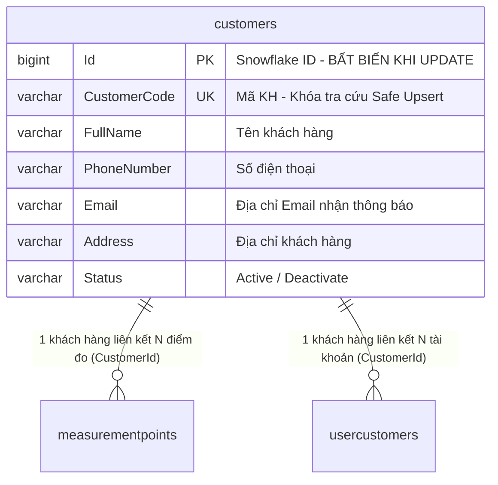

# [PLAN] QUẢN LÝ KHÁCH HÀNG: IMPORT CSV AN TOÀN (SAFE UPSERT), PHÂN QUYỀN ADMIN (RBAC) & TỐI ƯU HÓA BỘ LỌC / TRẢI NGHIỆM CHI TIẾT

> **Tài liệu đặc tả kỹ thuật (Technical Specification)**  
> **Phiên bản:** v1.0.0-FEATURE  
> **Người lập:** MDMS-Planner (Principal Solution Architect)  
> **Phê duyệt bởi:** Quản trị viên hệ thống & Người dùng  
> **Mục tiêu thực thi:** Bàn giao trực tiếp cho `MDMS-Coder` hiện thực hóa và `MDMS-Tester` kiểm định theo chuỗi Multi-Agent của MDMSv2.

---

## 1. MỤC TIÊU & PHẠM VI (OBJECTIVES & SCOPE)

### 1.1. Mục tiêu Nghiệp vụ & Kỹ thuật
1. **Tối ưu hóa Bộ lọc Tìm kiếm Khách hàng (Client List Filters)**:
   * Thống nhất quy chuẩn tìm kiếm chính xác: Lọc theo **Mã khách hàng** (`customerCode`) và **Trạng thái** (`status`).
   * Loại bỏ bộ lọc theo **Tên khách hàng** (`fullName`) để đơn giản hóa giao diện và hạn chế nhầm lẫn cho người vận hành.
2. **Cải tiến Trải nghiệm Mở Chi tiết Khách hàng (Open in New Tab)**:
   * Trên bảng danh sách khách hàng, trong menu hành động `(...)` ở cuối mỗi hàng, khi người dùng click vào **"Chi tiết"**, hệ thống sẽ mở trang chi tiết khách hàng tại **một tab trình duyệt mới** (`window.open(url, '_blank')`) thay vì điều hướng ngay trên tab hiện tại, giúp người vận hành không bị mất ngữ cảnh bộ lọc danh sách.
3. **Đồng bộ Thuộc tính Email trong Xuất File CSV (Export CSV Enhancement)**:
   * Bổ sung cột **Email** vào tệp CSV xuất ra từ máy chủ (`CustomerReadWriteRepository.GenerateCustomerCsv`) và từ client (`Constants.listHeaderExport.clients` & `tableDataSource`), đảm bảo quy trình trọn vẹn (Round-trip): Xuất file -> Chỉnh sửa trên Excel -> Import ngược lại hệ thống.
4. **Tính năng Nhập Dữ liệu từ CSV An toàn (Safe Upsert Customer Import)**:
   * Cho phép quản trị viên tải lên tệp CSV/Excel chứa danh sách khách hàng để cập nhật thông tin hàng loạt hoặc thêm mới khách hàng.
   * **Bảo vệ toàn vẹn khóa ngoại (Zero FK Disruption)**: Đối chiếu theo `Mã KH` (`CustomerCode`). Nếu khách hàng đã tồn tại, chỉ thực hiện cập nhật các thuộc tính (`FullName`, `PhoneNumber`, `Email`, `Address`, `Status`) và giữ nguyên 100% `customers.Id`. Tuyệt đối không xóa hoặc tạo lại ID để không ảnh hưởng tới `measurementpoints` (điểm đo, sản lượng, chốt chỉ số) và `usercustomers` (tài khoản portal). Nếu chưa có, sinh mới `Id` qua Snowflake.
   * **Chế độ Hợp nhất/Bổ sung (Merge/Append Only)**: Tuyệt đối không xóa bất kỳ khách hàng nào đang có trong cơ sở dữ liệu nếu họ không xuất hiện trong file CSV.
   * **Khả năng tương thích tệp cao**: Hỗ trợ chuẩn UTF-8 (BOM), tự động nhận diện phân cách dấu phẩy `,` hoặc chấm phẩy `;` (phổ biến khi Excel tiếng Việt lưu CSV), chấp nhận cả tiêu đề Tiếng Việt và Tiếng Anh.
5. **Cơ chế Phân quyền Nghiêm ngặt (Role-Based Access Control - RBAC)**:
   * Chỉ tài khoản có vai trò **Admin** hoặc **SuperAdmin** mới được phép sử dụng tính năng Import CSV nhằm ngăn chặn rủi ro chỉnh sửa sai sót dữ liệu hệ thống từ người dùng thông thường.
   * **Frontend Protection**: Ẩn nút "Import CSV" với các vai trò không phải Admin/SuperAdmin thông qua component `<PrivateComponent roles={[Constants.Role.Admin.value, Constants.Role.SuperAdmin.value]}>`.
   * **Backend Enforcement**: Endpoint `[HttpPost("Customers/Import-Csv")]` được bảo vệ bằng `[Permissions(Roles = [DefaultRoles.SuperAdmin, DefaultRoles.Admin])]`. Trả về `403 Forbidden` nếu người dùng không đủ thẩm quyền kể cả khi gọi trực tiếp qua Postman/cURL.

---

## 2. THIẾT KẾ KIẾN TRÚC & DỮ LIỆU (TECHNICAL ARCHITECTURE)

### 2.1. Thiết kế Cơ sở Dữ liệu & Toàn vẹn Khóa ngoại (Relational Safety)



* **Nguyên tắc Safe Upsert**:
  * Khi duyệt từng dòng trong tệp CSV:
    1. Kiểm tra `CustomerCode` có hợp lệ không (không được rỗng).
    2. Truy vấn `customers` theo `CustomerCode && !Deleted`.
    3. **Trường hợp đã tồn tại**:
       * Cập nhật `FullName`, `PhoneNumber`, `Email`, `Address`, `Status`.
       * Ghi nhận audit: `ModifiedTime = DateTimeOffset.UtcNow`, `ModifiedBy = currentUserId`, `ModifiedName = currentUserName`.
       * Không đụng đến `Id` $\rightarrow$ Toàn bộ `measurementpoints.CustomerId` và `usercustomers.CustomerId` giữ nguyên vẹn 100%.
       * Tăng biến đếm `UpdatedCount`.
    4. **Trường hợp chưa tồn tại**:
       * Sinh `Id` mới từ `_snowflakeIdService.GenerateId(cancellationToken)`.
       * Tạo thực thể `CustomerEntity` mới với `CustomerCode`, `FullName`, `PhoneNumber`, `Email`, `Address`, `Status`.
       * Ghi nhận audit: `CreatedTime`, `CreatedBy`, `CreatedName`, `ModifiedTime`, `ModifiedBy`, `ModifiedName`.
       * Thêm vào DbContext.
       * Tăng biến đếm `InsertedCount`.
    5. **Trường hợp lỗi dòng** (Mã KH trống hoặc dữ liệu sai định dạng):
       * Lưu vào danh sách lỗi dòng `Errors` gồm số dòng `RowNumber`, `CustomerCode` và chi tiết lỗi `ErrorMessage`. Không ngắt toàn bộ lô nếu chỉ có 1 dòng lỗi.

### 2.2. Đặc tả API Backend (.NET 8 WebApi)

#### A. Endpoint Nhập Khách hàng từ CSV (Import CSV)
* **Method & Route**: `POST /api/v1/Customers/Import-Csv`
* **Authorization**: `[Permissions(Roles = [DefaultRoles.SuperAdmin, DefaultRoles.Admin])]`
* **Content-Type**: `multipart/form-data`
* **Request Form**:
  * `file`: `IFormFile` (Tệp `.csv`, dung lượng tối đa 10MB).
* **Response DTO (`ImportCustomerResponse`)**:
  ```json
  {
    "success": true,
    "code": 200,
    "data": {
      "totalRows": 25,
      "insertedCount": 5,
      "updatedCount": 20,
      "errorCount": 0,
      "errors": []
    },
    "message": "Nhập dữ liệu khách hàng từ CSV thành công!"
  }
  ```
* **Mã lỗi & Xử lý ngoại lệ**:
  * `401 Unauthorized`: Chưa đăng nhập hoặc Token hết hạn.
  * `403 Forbidden`: Người dùng không có vai trò `SuperAdmin` hoặc `Admin`.
  * `400 Bad Request`: Tệp không đúng định dạng `.csv`, tệp rỗng hoặc định dạng tiêu đề không khớp.

#### B. Cập nhật Endpoint Xuất CSV (Export CSV)
* **Route**: `POST /api/v1/Customers/Export-Csv-Customers`
* **Cấu trúc cột xuất ra**:
  `STT, Tên KH, Mã KH, Số điện thoại, Email, Địa chỉ, Trạng thái`
* **Mã hóa**: `UTF-8` có BOM để Microsoft Excel tiếng Việt mở trực tiếp không bị lỗi font Tiếng Việt.

---

### 2.3. Thiết kế Giao diện Frontend (React 18 + Ant Design 5)

#### A. Cải tiến Trang Danh sách Khách hàng (`client-management/index.tsx`)
1. **Bộ lọc tìm kiếm**:
   * Xóa ô input `Nhập tên khách hàng` (`dataForm.name`).
   * Giữ lại 2 ô lọc: `Nhập mã khách hàng` (`dataForm.code`) và `Trạng thái` (`dataForm.status`).
   * Cập nhật `handleClearSearch` và `useEffect` debounce tương ứng.
2. **Menu hành động**:
   * Khi click item `Chi tiết`:
     ```typescript
     onClick: () => {
       const url = ROUTE_PATH.CUSTOMER_DETAIL.replace(Constants.ReplaceRouterConfig.id, record.key);
       window.open(url, '_blank');
     }
     ```
3. **Nút "Import CSV"**:
   * Vị trí: Đặt cạnh nút "Xuất file" ở thanh tiêu đề trang.
   * Phân quyền: Bọc trong `<PrivateComponent roles={[Constants.Role.Admin.value, Constants.Role.SuperAdmin.value]}>`.
   * Giao diện: Nút icon tải lên kèm tooltip "Nhập từ CSV".
4. **Modal Nhập CSV (`DialogImportCustomerCsv`)**:
   * Sử dụng `<Modal>` của Ant Design.
   * Khu vực kéo thả tệp (`<Upload.Dragger accept=".csv">`).
   * Nút "Tải file mẫu CSV" để người dùng tải file chuẩn về điền thông tin.
   * Hiển thị cảnh báo: *"Hệ thống sẽ cập nhật thông tin nếu mã khách hàng đã tồn tại, và thêm mới nếu mã chưa có. Liên kết điểm đo và tài khoản được bảo toàn tuyệt đối."*
   * Sau khi bấm "Thực hiện nhập":
     * Gọi API backend `importCustomerCsv`.
     * Hiển thị Spin/Loading.
     * Khi thành công: Hiển thị kết quả tổng quan (Tổng số dòng, Số thêm mới, Số cập nhật, Số lỗi nếu có).
     * Tự động làm mới danh sách khách hàng (`getListCustomerAsync`).

---

## 3. PHÂN RÃ CÔNG VIỆC CHI TIẾT (TASK BREAKDOWN FOR MDMS-CODER)

### Nhóm 1: Backend .NET 8 (Clean Architecture)
- [ ] **Task 1: [Application] Định nghĩa DTO & Commands**:
  * Tạo [Backend/Application/DataTransferObjects/Responses/Customers/ImportCustomerResponse.cs](file:///e:/sources/MDMSv2/Backend/Application/DataTransferObjects/Responses/Customers/ImportCustomerResponse.cs).
  * Tạo [Backend/Application/DataTransferObjects/Requests/Customers/ImportCustomerRequest.cs](file:///e:/sources/MDMSv2/Backend/Application/DataTransferObjects/Requests/Customers/ImportCustomerRequest.cs).
  * Tạo [Backend/Application/Commands/Customers/ImportCustomersCommand.cs](file:///e:/sources/MDMSv2/Backend/Application/Commands/Customers/ImportCustomersCommand.cs).
- [ ] **Task 2: [Application/Repositories] Cập nhật Interface**:
  * Cập nhật [Backend/Application/Repositories/ReadWrite/ICustomerReadWriteRepository.cs](file:///e:/sources/MDMSv2/Backend/Application/Repositories/ReadWrite/ICustomerReadWriteRepository.cs) bổ sung method `ImportCustomersFromCsvAsync`.
- [ ] **Task 3: [Infrastructure/Repositories] Hiện thực hóa Xử lý CSV**:
  * Trong [Backend/Infrastructure/Repositories/ReadWrite/CustomerReadWriteRepository.cs](file:///e:/sources/MDMSv2/Backend/Infrastructure/Repositories/ReadWrite/CustomerReadWriteRepository.cs):
    * Thêm cột `Email` vào `GenerateCustomerCsv`.
    * Hiện thực hóa `ImportCustomersFromCsvAsync`: Xử lý đọc stream CSV, chuẩn hóa mã hóa UTF-8/BOM, phân tích cú pháp tiêu đề linh hoạt (Việt/Anh), Safe Upsert theo `CustomerCode`, giữ nguyên `Id` nếu tồn tại, tạo mới qua `SnowflakeIdService` nếu chưa có.
- [ ] **Task 4: [Infrastructure/Handlers] Tạo Command Handler**:
  * Tạo [Backend/Infrastructure/Handlers/Commands/Customers/ImportCustomersCommandHandler.cs](file:///e:/sources/MDMSv2/Backend/Infrastructure/Handlers/Commands/Customers/ImportCustomersCommandHandler.cs) gọi repository.
- [ ] **Task 5: [WebApi] Khai báo URL Route & Controller Endpoint**:
  * Thêm `public const string ImportCsv = "Customers/Import-Csv";` vào [Backend/WebApi/Common/Url.cs](file:///e:/sources/MDMSv2/Backend/WebApi/Common/Url.cs).
  * Thêm endpoint `[HttpPost(Common.Url.Default.Customer.ImportCsv)]` với attribute `[Permissions(Roles = [DefaultRoles.SuperAdmin, DefaultRoles.Admin])]` vào [Backend/WebApi/Controllers/CustomerController.cs](file:///e:/sources/MDMSv2/Backend/WebApi/Controllers/CustomerController.cs).

### Nhóm 2: Frontend (React 18 + Vite + Ant Design)
- [ ] **Task 6: [Frontend/Constants & Types] Đồng bộ Cột Email**:
  * Cập nhật `Constants.listHeaderExport.clients` trong [Frontend/src/core/application/common/constants.ts](file:///e:/sources/MDMSv2/Frontend/src/core/application/common/constants.ts) bổ sung cột `Email`.
  * Cập nhật interface nếu cần.
- [ ] **Task 7: [Frontend/Services] Viết Hook / API Service**:
  * Thêm hàm `importCustomerCsv(file)` gọi API `POST /api/v1/Customers/Import-Csv` với `multipart/form-data`.
- [ ] **Task 8: [Frontend/UI Components] Tối ưu Trang Quản lý Khách hàng**:
  * Trong [Frontend/src/pages/client-management/index.tsx](file:///e:/sources/MDMSv2/Frontend/src/pages/client-management/index.tsx):
    * Bỏ ô tìm kiếm `name`, giữ `code` và `status`.
    * Cập nhật menu hành động "Chi tiết" gọi `window.open(..., '_blank')`.
    * Thêm cột `email` vào `tableDataSource`.
    * Thêm nút "Nhập CSV" bọc trong `<PrivateComponent roles={[Constants.Role.Admin.value, Constants.Role.SuperAdmin.value]}>`.
    * Tạo component/modal `DialogImportCustomerCsv` cho phép upload file `.csv`, tải file mẫu, và hiển thị thông báo kết quả chi tiết.

### Nhóm 3: Kiểm thử & Biên dịch
- [ ] **Task 9: [Self-Verification] Biên dịch & Kiểm tra chuẩn**:
  * Chạy `dotnet build` trên solution Backend.
  * Chạy `npm run check:lint` và `npm run build:prod` trên Frontend.
- [ ] **Task 10: [Handover] Bàn giao sang MDMS-Tester**:
  * Soạn tài liệu bàn giao `CHANGELOG_DEV.md` và cung cấp file test mẫu `khachhang_template.csv`.

---

## 4. MA TRẬN KIỂM THỬ SƠ BỘ (TEST MATRIX FOR MDMS-TESTER)

| Mã kiểm thử | Hạng mục | Kịch bản kiểm thử | Kết quả kỳ vọng |
|---|---|---|---|
| **TC-RBAC-01** | Backend RBAC | Gọi API `POST /api/v1/Customers/Import-Csv` bằng tài khoản thường (`Customer`/`Staff`) | Trả về `403 Forbidden` |
| **TC-RBAC-02** | Frontend RBAC | Đăng nhập tài khoản thường vào trang Quản lý khách hàng | Nút "Nhập từ CSV" và nút "Thêm khách hàng" hoàn toàn ẩn |
| **TC-UI-01** | Lọc dữ liệu | Nhập `Mã KH` hoặc chọn `Trạng thái` | Bảng tải lại dữ liệu đúng điều kiện lọc; ô tìm tên KH không còn xuất hiện |
| **TC-UI-02** | Mở chi tiết | Click vào menu `(...)` -> Chọn "Chi tiết" | Mở trang thông tin chi tiết khách hàng tại một Tab trình duyệt mới |
| **TC-EXP-01** | Xuất CSV | Nhấn nút "Xuất file" -> Chọn xuất CSV | Tệp CSV tải về có đầy đủ cột `Email` và mở được trực tiếp trên Excel không lỗi font |
| **TC-IMP-01** | Import Update | Tải lên CSV sửa email/sđt của khách hàng đang có trong DB | Dữ liệu được cập nhật thành công, `customers.Id` không đổi, điểm đo liên kết không đổi |
| **TC-IMP-02** | Import Insert | Tải lên CSV chứa mã khách hàng mới | Khách hàng mới được thêm vào DB với Snowflake ID mới |
| **TC-IMP-03** | Import Validate | Tải lên CSV có dòng bị rỗng `Mã KH` | Dòng rỗng bị báo lỗi, các dòng hợp lệ khác vẫn được cập nhật bình thường |
| **TC-IMP-04** | Tương thích CSV | Tải lên file CSV định dạng phân cách dấu chấm phẩy `;` hoặc dấu phẩy `,` có dấu Tiếng Việt | Hệ thống tự động nhận diện và xử lý thành công 100% |

---

## 5. TIÊU CHÍ NGHIỆM THU (DEFINITION OF DONE - DoD)
1. **Kiến trúc**: Tuân thủ tuyệt đối Clean Architecture, logic đọc CSV và xử lý DB nằm tại tầng Infrastructure/Application, Controller mỏng chỉ làm nhiệm vụ nhận request và phân quyền.
2. **Bảo mật**: Phân quyền 2 tầng (UI và API) chỉ cho phép `Admin` và `SuperAdmin`.
3. **An toàn Dữ liệu**: Không có bất kỳ nguy cơ gãy khóa ngoại nào trên bảng `measurementpoints` hoặc `usercustomers`.
4. **Biên dịch**: Solution Backend build 0 errors, Frontend Vite build thành công không lỗi type và không lỗi linter.
5. **Multi-Agent Flow**: Hoàn thành đúng tuần tự `MDMS-Planner` $\rightarrow$ `MDMS-Coder` $\rightarrow$ `MDMS-Tester` $\rightarrow$ `MDMS-Reviewer`.
