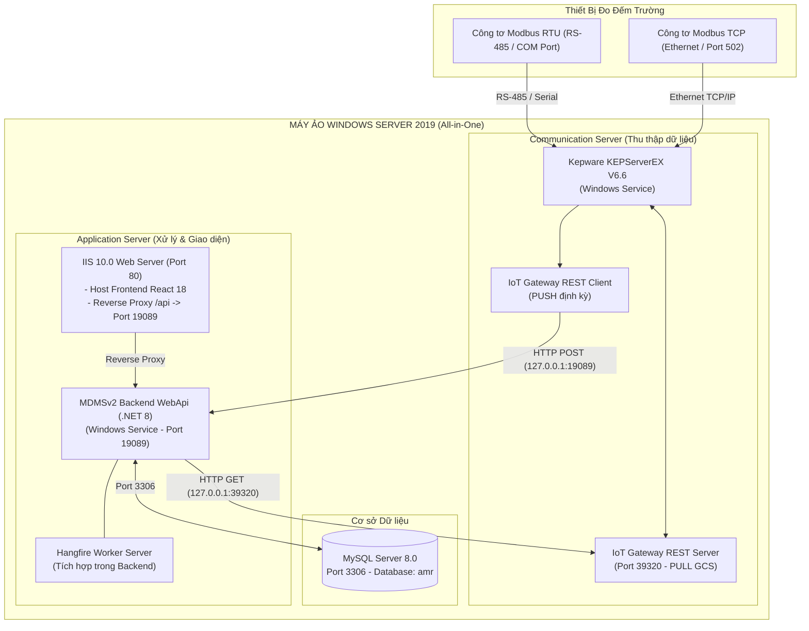

# HƯỚNG DẪN ĐÓNG GÓI VÀ TRIỂN KHAI HỆ THỐNG MDMSv2
## Môi Trường Kiểm Nghiệm (All-in-One trên Windows Server 2019)

Tài liệu này cung cấp hướng dẫn toàn diện từ quá trình đóng gói bộ cài đặt (**Installation Package**) từ mã nguồn cho đến quy trình triển khai, cấu hình và vận hành thử nghiệm toàn bộ hệ thống **MDMSv2 (Meter Data Management System v2)** trên **01 máy ảo chạy Windows Server 2019**.

---

## 1. TỔNG QUAN KIẾN TRÚC MÔI TRƯỜNG KIỂM NGHIỆM

Trên môi trường kiểm nghiệm (Single-node Testbed / VM), toàn bộ các thành phần của **Application Server** và **Communication Server** được hợp nhất triển khai trên cùng một máy ảo thông qua cơ chế giao tiếp cục bộ (**Loopback `127.0.0.1`**):



---

## 2. YÊU CẦU HỆ THỐNG MÁY ẢO WINDOWS SERVER 2019

### 2.1. Cấu hình Phần cứng Đề xuất
* **Hệ điều hành**: Windows Server 2019 Standard hoặc Datacenter (64-bit).
* **CPU**: Tối thiểu 4 vCPU (Khuyến nghị 8 vCPU để chạy đồng thời Kepware và MySQL).
* **RAM**: Tối thiểu 8 GB (Khuyến nghị 16 GB).
* **Ổ đĩa cứng**: Tối thiểu 80 GB dung lượng trống (SSD hoặc NVMe).
* **Cổng giao tiếp**:
  * 01 Card mạng Ethernet (đặt IP tĩnh).
  * (Tùy chọn) Cổng COM vật lý hoặc USB-to-RS485 adapter kết nối công tơ Modbus RTU.

### 2.2. Danh mục Phần mềm Phụ trợ (Prerequisites)
1. **Web Server (IIS)**: Tích hợp sẵn trong Windows Features (kèm WebSockets).
2. **IIS URL Rewrite 2.1 & Application Request Routing (ARR) 3.0**: Module mở rộng cho IIS để làm Reverse Proxy.
3. **Java Runtime Environment (JRE 8)**: Thành phần bắt buộc cho Kepware IoT Gateway (được Wizard cài đặt tự động).
4. **Microsoft Edge**: Trình duyệt hiện đại thay thế Internet Explorer trên Windows Server 2019 (được Wizard cài đặt tự động).
5. **MySQL Community Server 8.0 (64-bit)**: Chạy dưới dạng Windows Service.
6. **Kepware KEPServerEX V6.6.350.00**: Bộ thu thập dữ liệu công tơ Modbus.

---

## 3. CẤU TRÚC GÓI CÀI ĐẶT (INSTALLATION PACKAGE STRUCTURE)

Sau khi đóng gói, thư mục bộ cài đặt `MDMSv2_InstallPackage` sẽ có cấu trúc chuẩn như sau:

```text
MDMSv2_InstallPackage/
├── SetupMDMS.ps1                          # [WIZARD CHÍNH] Cài đặt & cấu hình toàn diện từ A-Z
├── Backend/                                # Thư mục thực thi Backend WebApi
│   ├── WebApi.exe                          # File chạy chính (.NET 8 Self-contained)
│   ├── appsettings.Production.json         # Cấu hình đã tối ưu cho máy ảo
│   └── *.dll                               # Các thư viện phụ thuộc
├── Frontend/                               # Thư mục giao diện Web tĩnh
│   ├── index.html                          # Trang chủ SPA
│   ├── assets/                             # Bundle Javascript & CSS
│   └── web.config                          # Cấu hình IIS URL Rewrite & Reverse Proxy
├── MySQL/                                  # [THƯ MỤC CHỨA BỘ CÀI MYSQL SERVER 8.0]
│   ├── README.md                           # Hướng dẫn đặt file mysql-installer-*.msi
│   └── (Đặt file cài đặt MySQL 8.0 tại đây)
├── Kepware/                                # [THƯ MỤC CHỨA BỘ CÀI KEPWARE SERVER]
│   ├── README.md                           # Hướng dẫn đặt file KEPServerEX-*.exe
│   ├── kepware_iot_gateway_config.md       # Hướng dẫn cấu hình IoT Gateway REST Server/Client
│   └── (Đặt file cài đặt Kepware tại đây)
├── Prerequisites/                          # Thư viện phụ trợ offline
│   ├── rewrite_amd64_en-US.msi             # IIS URL Rewrite 2.1
│   ├── requestRouter_amd64.msi             # IIS Application Request Routing (ARR) 3.0
│   ├── jre-8u451-windows-i586-iftw.exe     # Java Runtime Environment (cho Kepware IoT Gateway)
│   └── MicrosoftEdgeSetup.exe              # Microsoft Edge Browser (thay thế IE trên Server 2019)
├── Database/                               # Script cơ sở dữ liệu
│   ├── amr_full.sql                        # Script DDL chuẩn toàn bộ cấu trúc CSDL 'amr' (khung trắng)
│   ├── amr_master_data.sql                 # [KHUYÊN DÙNG] Dữ liệu Master Data: Khách hàng, Điểm đo, Tags (~3.2 MB)
│   ├── reset_operational_data_clean_slate.sql # Script xóa sạch dữ liệu đo đếm/báo cáo về môi trường trắng
│   └── amr_data.sql                        # (Tùy chọn) Bản sao lưu đầy đủ 1.54 GB (kèm toàn bộ lịch sử)
└── Scripts/                                # Bộ script PowerShell cài đặt & quản trị CSDL
    ├── SetupMDMS.ps1                       # Kịch bản Wizard cài đặt toàn diện từ A-Z
    ├── 1_Install_Prerequisites.ps1         # Bật IIS, cài Rewrite, ARR, Java, Edge & Firewall
    ├── 2_Setup_Backend_Service.ps1         # Đăng ký WebApi thành Windows Background Task
    ├── 3_Setup_Frontend_IIS.ps1            # Cấu hình Website Frontend trên IIS
    ├── 4_Verify_System.ps1                 # Kiểm tra hoạt động toàn diện (Health Check)
    ├── Import_MasterData.ps1               # [MỚI] Nạp Master Data (Khách hàng, Sổ GCS, Điểm đo, Tags) trong 2 giây
    ├── Extract_MasterData.ps1              # [MỚI] Trích xuất Master Data từ file dump amr_data.sql dung lượng bất kỳ
    ├── Export_MasterData_From_LiveDB.ps1   # [MỚI] Xuất Master Data trực tiếp từ CSDL đang chạy (chỉ mất 2-5 giây)
    └── Import_AmrData.ps1                  # Nạp toàn bộ dữ liệu 1.54 GB (kèm lịch sử cũ)
```

---

## 4. QUY TRÌNH ĐÓNG GÓI TỰ ĐỘNG TỪ MÃ NGUỒN (BUILDING THE PACKAGE)

Thực hiện trên máy tính phát triển (Dev Environment) nơi có cài đặt `.NET 8 SDK` và `Node.js / Yarn`.

### Bước 1: Mở PowerShell tại thư mục gốc dự án
```powershell
cd e:\sources\MDMSv2
```

### Bước 2: Chạy Kịch bản Đóng gói Tự động
```powershell
.\build_package.ps1 -Configuration Release
```

*Kịch bản sẽ tự động*:
1. Biên dịch Backend với cờ `--self-contained true` cho kiến trúc `win-x64` (máy ảo đích không cần cài .NET SDK).
2. Biên dịch Frontend bằng `yarn build:uat` và tạo sẵn tệp `web.config` cho IIS.
3. Tự động sao chép các tệp script cơ sở dữ liệu (`amr_full.sql`, `amr_master_data.sql`, `reset_operational_data_clean_slate.sql`) và toàn bộ kịch bản triển khai sang gói đóng gói.
4. Đặt kịch bản Wizard `SetupMDMS.ps1` ngay tại thư mục gốc gói cài đặt.

### Bước 3: Bổ sung File Cài đặt MySQL 8.0 & Kepware
Trước khi chuyển gói sang máy ảo, bạn có thể copy trực tiếp:
- File cài đặt **MySQL 8.0** (`mysql-installer-community-8.0.*.msi`) vào thư mục: `Publish\MDMSv2_InstallPackage\MySQL\`
- File cài đặt **Kepware** (`KEPServerEX-*.exe`) vào thư mục: `Publish\MDMSv2_InstallPackage\Kepware\`

### Bước 4: Nén Thành Tệp ZIP
Nén toàn bộ thư mục `Publish\MDMSv2_InstallPackage` thành tệp `MDMSv2_InstallPackage.zip` và copy sang máy ảo Windows Server 2019 (qua RDP Copy hoặc ổ chia sẻ mạng).

---

## 5. QUY TRÌNH CÀI ĐẶT & TRIỂN KHAI TRÊN WINDOWS SERVER 2019

### Cách 1: Sử dụng Wizard Tự động Hóa Toàn diện (Khuyến nghị)
1. Giải nén `MDMSv2_InstallPackage.zip` vào đường dẫn: `C:\MDMSv2`.
2. Bổ sung các file cài đặt (nếu chưa có sẵn):
   - Copy file cài đặt MySQL 8.0 vào `C:\MDMSv2\MySQL\`
   - Copy file cài đặt Kepware vào `C:\MDMSv2\Kepware\`
3. Mở **PowerShell với quyền Administrator**, di chuyển vào `C:\MDMSv2`:
   ```powershell
   cd C:\MDMSv2
   .\SetupMDMS.ps1
   ```
4. **Wizard tương tác thông minh sẽ tự động**:
   * **Bước 1**: Cài đặt IIS, IIS URL Rewrite 2.1, ARR 3.0, bật ARR Proxy và mở Windows Firewall.
   * **Bước 2**: Quét và mở bộ cài MySQL 8.0 từ thư mục `C:\MDMSv2\MySQL`.
     - Hỏi mật khẩu root đã đặt cho MySQL Server.
     - Khởi tạo khung CSDL `amr` sạch từ `amr_full.sql`.
     - **Tự động hỏi nạp Master Data**: Nếu chọn `Y`, Wizard tự động nạp toàn bộ danh mục Khách hàng, Điểm đo, Liên kết thông số thanh ghi (Tags) thực tế từ `amr_master_data.sql` trong 2 giây để sẵn sàng cho môi trường "trắng".
     - Tự động cập nhật chuỗi kết nối an toàn vào `appsettings.Production.json`.
   * **Bước 3**: Hỏi tên đăng nhập và mật khẩu Quản trị MDMS (Super Admin), tự động đồng bộ vào bảng `users`.
   * **Bước 4**: Quét và mở bộ cài Kepware từ thư mục `C:\MDMSv2\Kepware`.
   * **Bước 5**: Đăng ký và khởi động Backend WebApi (.NET 8) dạng Windows Background Task (chạy quyền SYSTEM, tự khởi động cùng máy tính).
   * **Bước 6**: Xóa Default Web Site, tạo IIS Website `MDMSv2_Web` cổng 80 cho React Frontend.
   * **Bước 7**: Chạy Health Check toàn diện 4 dịch vụ và in bảng tổng kết nghiệm thu kèm thông tin đăng nhập.

---

### Cách 2: Chạy Từng Bước Thủ Công (Khi Cần Kiểm Soát Riêng Biệt)

#### Bước 5.1: Cài đặt Prerequisites & Cấu hình Mạng
```powershell
cd C:\MDMSv2\Scripts
.\1_Install_Prerequisites.ps1
```

#### Bước 5.2: Cài đặt MySQL 8.0 và Khởi tạo CSDL 'amr'
1. Chạy bộ cài MySQL trong `C:\MDMSv2\MySQL\`. Chọn **Server Only**, Port **3306**, đặt mật khẩu root.
2. Khởi tạo khung database sạch:
   ```bash
   mysql -h 127.0.0.1 -P 3306 -u root -p < C:\MDMSv2\Database\amr_full.sql
   ```

#### Bước 5.3: Nạp Master Data (Khách hàng, Điểm đo, Tags) cho Môi trường Trắng
Chạy script chuyên dụng để nạp danh mục thực tế mà không mang theo dữ liệu đo đếm cũ:
```powershell
cd C:\MDMSv2\Scripts
.\Import_MasterData.ps1
```
> [!NOTE]
> * Tệp `amr_master_data.sql` chỉ nặng **~3.2 MB** nên quá trình nạp diễn ra tức thì (~2 giây).
> * Nếu bạn có tệp `amr_data.sql` gốc (1.54 GB), script sẽ tự động trích xuất thông minh để chỉ lấy đúng Khách hàng, Điểm đo, Tags mà không nạp 1.54 GB dữ liệu lịch sử.

#### Bước 5.4: Cài đặt và Cấu hình Kepware KEPServerEX V6.6
1. Chạy bộ cài Kepware trong `C:\MDMSv2\Kepware\`. Chọn tích hợp **Modbus Suite** và **IoT Gateway**.
2. Sau khi cài xong, cấu hình theo hướng dẫn tại [kepware_iot_gateway_config.md](file:///e:/sources/MDMSv2/Installers/Kepware/kepware_iot_gateway_config.md):
   * **Modbus RTU/TCP Driver**: Khai báo Channel và Device công tơ.
   * **IoT Gateway REST Server Agent**: Mở cổng `39320` (`http://127.0.0.1:39320/iotgateway/read`).
   * **IoT Gateway REST Client Agent**: Đặt URL gửi dữ liệu về `http://127.0.0.1:19089/api/v1/iot/measurement-point-monitoring` với tần suất `5000ms`.

#### Bước 5.5: Đăng ký Dịch vụ Chạy ngầm Tự động cho Backend (.NET 8 WebApi)
1. Kiểm tra cấu hình `C:\MDMSv2\Backend\appsettings.Production.json` đảm bảo thông tin kết nối MySQL và cổng `19089`.
2. Chạy script thiết lập dịch vụ:
   ```powershell
   cd C:\MDMSv2\Scripts
   .\2_Setup_Backend_Service.ps1
   ```

#### Bước 5.6: Triển khai Giao diện Người dùng Frontend lên IIS
```powershell
cd C:\MDMSv2\Scripts
.\3_Setup_Frontend_IIS.ps1
```

---

## 6. QUY TRÌNH KIỂM THỬ THỰC TẾ TRÊN MÁY ẢO MỚI (CLEAN-SLATE TEST PLAN)

### 6.1. Kiểm tra Kết nối Dịch vụ (Health Check)
Chạy script kiểm tra tự động:
```powershell
cd C:\MDMSv2\Scripts
.\4_Verify_System.ps1
```

| Hạng mục kiểm tra | Địa chỉ URL | Kết quả kỳ vọng |
|---|---|---|
| **Cổng Giao diện Web** | `http://localhost/` | Màn hình đăng nhập MDMSv2 hiển thị bình thường |
| **Tài liệu Swagger API** | `http://localhost/swagger/` hoặc `http://localhost:19089/swagger/` | Danh sách toàn bộ 22 cụm API Endpoints |
| **Hangfire Dashboard** | `http://localhost/dashboard` | Bảng quản lý tiến trình nền, Recurring Jobs sẵn sàng |
| **Kepware REST Server** | `http://127.0.0.1:39320/iotgateway/read` | Trả về JSON trạng thái của Kepware |

---

### 6.2. Kịch bản Kiểm thử Nghiệp vụ trên Môi trường "Trắng"
1. **Đăng nhập Web Portal**:
   - Truy cập `http://localhost` (hoặc IP máy ảo từ máy trạm).
   - Đăng nhập với tài khoản: `admin` / mật khẩu: `Admin@123` (hoặc mật khẩu bạn đã thiết lập).
2. **Kiểm tra Màn hình "Quản lý khách hàng"**:
   - Xác nhận danh sách khách hàng hiển thị đầy đủ (~69 khách hàng thực tế: VSIP, Kyocera, Zeon, Regina Miracle...).
   - Kiểm tra bộ lọc tìm kiếm hoạt động mượt mà.
3. **Kiểm tra Màn hình "Quản lý điểm đo"**:
   - Xác nhận tổng số điểm đo hiển thị chính xác **162 điểm đo**.
   - Bấm nút menu hành động `(...)` $\to$ **"Chi tiết"** $\to$ Xác nhận mở tab mới với đầy đủ thông số cấu hình và danh mục thanh ghi đo đếm (Tags).
4. **Kiểm tra Màn hình "Thông số tổng hợp"**:
   - Truy vấn trang Thông số tổng hợp: Danh sách hiển thị đúng 162 điểm đo.
   - Trạng thái các cột chỉ số hiển thị giá trị mặc định `-` vì chưa có chu kỳ dữ liệu mới gửi về.
5. **Kiểm tra Báo cáo Đo đếm ("Chỉ số điện", "Sản lượng điện", "Thông số vận hành")**:
   - Xác nhận các bảng báo cáo hoàn toàn **"trắng"** (`0` bản ghi), không bị lẫn số liệu quá khứ.
6. **Bật Kepware thu thập dữ liệu thực tế**:
   - Kết nối cổng COM/RS-485 hoặc Ethernet tới công tơ tại hiện trường.
   - Kepware IoT Client tự động bắn dữ liệu về Backend `http://127.0.0.1:19089/api/v1/iot/measurement-point-monitoring`.
   - Quan sát thông số tức thời cập nhật trên Web và Hangfire kích hoạt tính toán chu kỳ 30 phút.

---

## 7. CÁCH RESET DỮ LIỆU VỀ TRẠNG THÁI "TRẮNG" BẤT KỲ LÚC NÀO

Nếu sau quá trình kiểm thử thử nghiệm, bạn muốn xóa toàn bộ dữ liệu phát sinh (chỉ số, sản lượng, telemetry, phiếu báo...) để bắt đầu lại một chu kỳ kiểm thử mới mà **không cần cài lại database hay mất cấu hình Khách hàng / Điểm đo**:

1. Mở PowerShell hoặc công cụ MySQL (HeidiSQL, Navicat, DBeaver).
2. Thực thi script reset:
   ```bash
   mysql -h 127.0.0.1 -P 3306 -u root -p amr < C:\MDMSv2\Database\reset_operational_data_clean_slate.sql
   ```
3. Khởi động lại Backend Service để Hangfire làm mới hàng đợi:
   ```powershell
   Restart-Service -Name "MDMSv2_BackendService"
   ```
Toàn bộ dữ liệu phát sinh sẽ được dọn sạch về `0`, trong khi danh mục Khách hàng, 162 Điểm đo và Users được bảo toàn nguyên vẹn.

---

### 1. Truy cập bất cứ trang nào báo lỗi "Request failed with status code 502" (Bad Gateway)
* **Nguyên nhân**:
  1. Khi bạn sao chép đè thư mục `Backend` từ bộ cài lên máy ảo `C:\MDMSv2\Backend`, tệp `appsettings.Production.json` mặc định có mật khẩu MySQL để trống (`"Password": ""`).
  2. Khi dịch vụ Backend khởi động, tiến trình `WebApi.exe` cố gắng kết nối tới MySQL nhưng bị từ chối xác thực (`Access denied for user 'root'@'127.0.0.1'`), dẫn đến tiến trình bị **crash (dừng đột ngột)**.
  3. Cổng `19089` bị đóng khiến IIS ARR không thể kết nối tới Backend và phản hồi lỗi **502 Bad Gateway**.
* **Cách khắc phục ngay lập tức (10 giây)**:
  1. Mở tệp `C:\MDMSv2\Backend\appsettings.Production.json` bằng Notepad.
  2. Tại khối `"AppDb"`, điền mật khẩu MySQL root của máy ảo (ví dụ: `"Password": "Abc@123456"`):
     ```json
     "AppDb": {
       "Server": "127.0.0.1",
       "UserName": "root",
       "Password": "Abc@123456",
       "Database": "amr",
       "Port": "3306"
     }
     ```
  3. Khởi động lại dịch vụ Backend bằng PowerShell (Run as Administrator):
     ```powershell
     Stop-Process -Name "WebApi" -Force -ErrorAction SilentlyContinue
     Start-ScheduledTask -TaskName "MDMSv2_BackendService"
     ```
     Hoặc chạy lại kịch bản cập nhật mới:
     ```powershell
     cd C:\MDMSv2\Scripts
     .\Update_Hotfix.ps1
     ```
     *(Bản `Update_Hotfix.ps1` mới đã được tích hợp cơ chế tự động bảo toàn mật khẩu và nhắc người dùng nếu phát hiện mật khẩu trống).*

### 2. Quan hệ Khách hàng (`customers`), Điểm đo (`measurementpoints`) và Sổ GCS (`gcs`)
* Trong hệ thống MDMSv2:
  * Mỗi bản ghi điểm đo (`measurementpoints`) chứa khóa ngoại `CustomerId` trỏ tới khách hàng tương ứng.
  * Mỗi bản ghi điểm đo cũng chứa khóa ngoại `GcsId` trỏ tới Sổ GCS tương ứng (`gcs.Id` - ví dụ: Sổ GCS 1 kỳ `GCS-1`).
* **Bảo toàn khi Nạp & Reset dữ liệu môi trường trắng**:
  * Tệp `amr_master_data.sql` và kịch bản `Import_MasterData.ps1` đã tích hợp đầy đủ cả 3 bảng: `customers`, `gcs`, `gcscutoffcycle`. Do đó toàn bộ 162 điểm đo đều giữ nguyên liên kết `CustomerId` và `GcsId`.
  * Tệp `reset_operational_data_clean_slate.sql` **chỉ xóa** dữ liệu vận hành/đo đếm (`measurementpointdailyenergyreports`, `measurementpointhalfhourenergyreports`, `measurementpointhalfhouroperatingreports`, `periodicenergystatement`, `gcsmonthlydetail`, `gcstemporary`...), hoàn toàn **không xóa** Sổ GCS và **không đặt lại** `GcsId = NULL`.

### 3. Backend Service không khởi động được
* **Nguyên nhân**: Dịch vụ MySQL chưa bật hoặc cổng 19089 bị ứng dụng khác chiếm dụng.
* **Cách khắc phục**:
  * Kiểm tra trạng thái dịch vụ MySQL: `Get-Service MySQL80`.
  * Kiểm tra file log lỗi mới nhất tại: `C:\MDMSv2\Backend\Logs\*.log`.
  * Chạy trực tiếp `C:\MDMSv2\Backend\WebApi.exe` trong Command Prompt để xem thông điệp lỗi trực tiếp.

### 4. Truy cập Web bị lỗi 502.3 Bad Gateway
* **Nguyên nhân**: Module ARR chưa bật tính năng Proxy trên IIS.
* **Cách khắc phục**: Mở IIS Manager $\to$ Server $\to$ **Application Request Routing Cache** $\to$ **Server Proxy Settings** $\to$ Tích chọn **Enable proxy** $\to$ Bấm Apply.

### 5. Kepware REST Client báo lỗi kết nối (HTTP 404 / Connection Refused)
* **Nguyên nhân**: Backend service chưa chạy hoặc sai endpoint nhận dữ liệu.
* **Cách khắc phục**: Đảm bảo URL trong Kepware REST Client cấu hình chính xác:
  `http://127.0.0.1:19089/api/v1/iot/measurement-point-monitoring`
  (Lưu ý phương thức gửi là `POST`).

### 6. Kết nối Modbus RTU công tơ bị Time Out
* **Nguyên nhân**: Sai thông số cổng COM, sai baudrate hoặc trùng địa chỉ Modbus Slave ID.
* **Cách khắc phục**:
  * Dùng Kepware **OPC Quick Client** kiểm tra giá trị Tag trực tiếp.
  * Đảm bảo dây RS-485 đấu nối đúng cực $A (+)$ và $B (-)$.
