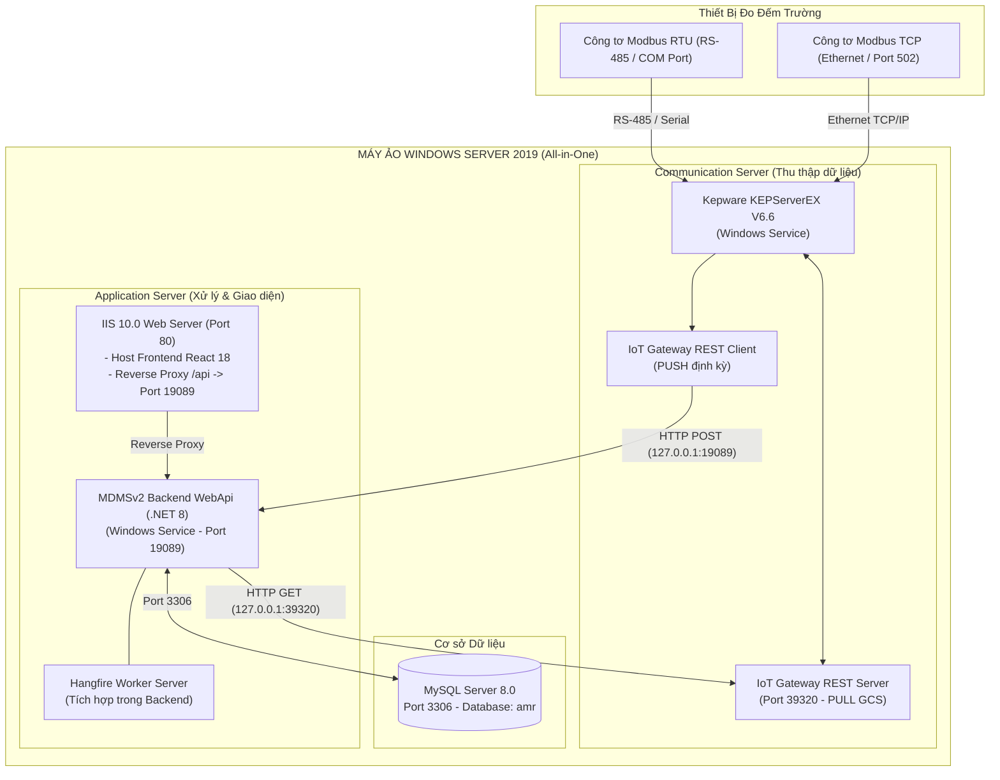

# HƯỚNG DẪN ĐÓNG GÓI VÀ TRIỂN KHAI HỆ THỐNG MDMSv2
## Môi Trường Kiểm Nghiệm (All-in-One trên Windows Server 2019)

Tài liệu này cung cấp hướng dẫn toàn diện từ quá trình đóng gói bộ cài đặt (**Installation Package**) từ mã nguồn cho đến quy trình triển khai, cấu hình và vận hành thử nghiệm toàn bộ hệ thống **MDMSv2 (Meter Data Management System v2)** trên **01 máy ảo chạy Windows Server 2019**.

---

## 1. TỔNG QUAN KIẾN TRÚC MÔI TRƯỜNG KIỂM NGHIỆM

Trên môi trường kiểm nghiệm (Single-node Testbed / VM), toàn bộ các thành phần của **Application Server** và **Communication Server** được hợp nhất triển khai trên cùng một máy ảo thông qua cơ chế giao tiếp cục bộ (**Loopback `127.0.0.1`**):



---

## 2. YÊU CẦU HỆ THỐNG MÁY ẢO WINDOWS SERVER 2019

### 2.1. Cấu hình Phần cứng Đề xuất
* **Hệ điều hành**: Windows Server 2019 Standard hoặc Datacenter (64-bit).
* **CPU**: Tối thiểu 4 vCPU (Khuyến nghị 8 vCPU để chạy đồng thời Kepware và MySQL).
* **RAM**: Tối thiểu 8 GB (Khuyến nghị 16 GB).
* **Ổ đĩa cứng**: Tối thiểu 80 GB dung lượng trống (SSD hoặc NVMe).
* **Cổng giao tiếp**:
  * 01 Card mạng Ethernet (đặt IP tĩnh).
  * (Tùy chọn) Cổng COM vật lý hoặc USB-to-RS485 adapter kết nối công tơ Modbus RTU.

### 2.2. Danh mục Phần mềm Phụ trợ (Prerequisites)
1. **Web Server (IIS)**: Tích hợp sẵn trong Windows Features (kèm WebSockets).
2. **IIS URL Rewrite 2.1 & Application Request Routing (ARR) 3.0**: Module mở rộng cho IIS để làm Reverse Proxy.
3. **Java Runtime Environment (JRE 8)**: Thành phần bắt buộc cho Kepware IoT Gateway (được Wizard cài đặt tự động).
4. **Microsoft Edge**: Trình duyệt hiện đại thay thế Internet Explorer trên Windows Server 2019 (được Wizard cài đặt tự động).
5. **MySQL Community Server 8.0 (64-bit)**: Chạy dưới dạng Windows Service.
6. **Kepware KEPServerEX V6.6.350.00**: Bộ thu thập dữ liệu công tơ Modbus.

---

## 3. CẤU TRÚC GÓI CÀI ĐẶT (INSTALLATION PACKAGE STRUCTURE)

Sau khi đóng gói, thư mục bộ cài đặt `MDMSv2_InstallPackage` sẽ có cấu trúc chuẩn như sau:

```text
MDMSv2_InstallPackage/
├── SetupMDMS.ps1                          # [WIZARD CHÍNH] Cài đặt & cấu hình toàn diện từ A-Z
├── Backend/                                # Thư mục thực thi Backend WebApi
│   ├── WebApi.exe                          # File chạy chính (.NET 8 Self-contained)
│   ├── appsettings.Production.json         # Cấu hình đã tối ưu cho máy ảo
│   └── *.dll                               # Các thư viện phụ thuộc
├── Frontend/                               # Thư mục giao diện Web tĩnh
│   ├── index.html                          # Trang chủ SPA
│   ├── assets/                             # Bundle Javascript & CSS
│   └── web.config                          # Cấu hình IIS URL Rewrite & Reverse Proxy
├── MySQL/                                  # [THƯ MỤC CHỨA BỘ CÀI MYSQL SERVER 8.0]
│   ├── README.md                           # Hướng dẫn đặt file mysql-installer-*.msi
│   └── (Đặt file cài đặt MySQL 8.0 tại đây)
├── Kepware/                                # [THƯ MỤC CHỨA BỘ CÀI KEPWARE SERVER]
│   ├── README.md                           # Hướng dẫn đặt file KEPServerEX-*.exe
│   ├── kepware_iot_gateway_config.md       # Hướng dẫn cấu hình IoT Gateway REST Server/Client
│   └── (Đặt file cài đặt Kepware tại đây)
├── Prerequisites/                          # Thư viện phụ trợ offline
│   ├── rewrite_amd64_en-US.msi             # IIS URL Rewrite 2.1
│   ├── requestRouter_amd64.msi             # IIS Application Request Routing (ARR) 3.0
│   ├── jre-8u451-windows-i586-iftw.exe     # Java Runtime Environment (cho Kepware IoT Gateway)
│   └── MicrosoftEdgeSetup.exe              # Microsoft Edge Browser (thay thế IE trên Server 2019)
├── Database/                               # Script cơ sở dữ liệu
│   ├── amr_full.sql                        # Script MySQL dump đầy đủ toàn bộ cơ sở dữ liệu 'amr'
│   └── init_amr_database.sql               # Script khởi tạo Database 'amr' cơ bản
└── Scripts/                                # Bộ script PowerShell cài đặt chi tiết
    ├── SetupMDMS.ps1                      # Kịch bản Wizard cài đặt toàn diện
    ├── 1_Install_Prerequisites.ps1         # Bật IIS, cài Rewrite, ARR, Java, Edge & Firewall
    ├── 2_Setup_Backend_Service.ps1         # Đăng ký WebApi thành Windows Background Task
    ├── 3_Setup_Frontend_IIS.ps1            # Cấu hình Website Frontend trên IIS
    └── 4_Verify_System.ps1                 # Kiểm tra hoạt động toàn diện (Health Check)
```

---

## 4. QUY TRÌNH ĐÓNG GÓI TỰ ĐỘNG TỪ MÃ NGUỒN (BUILDING THE PACKAGE)

Thực hiện trên máy tính phát triển (Dev Environment) nơi có cài đặt `.NET 8 SDK` và `Node.js / Yarn`.

### Bước 1: Mở PowerShell tại thư mục gốc dự án
```powershell
cd e:\sources\MDMSv2
```

### Bước 2: Chạy Kịch bản Đóng gói Tự động
```powershell
.\build_package.ps1 -Configuration Release
```

*Kịch bản sẽ tự động*:
1. Biên dịch Backend với cờ `--self-contained true` cho kiến trúc `win-x64` (máy ảo đích không cần cài .NET SDK).
2. Biên dịch Frontend bằng `yarn build:uat` và tạo sẵn tệp `web.config` cho IIS.
3. Tạo sẵn cấu trúc các thư mục `MySQL`, `Kepware`, `Prerequisites`, `Database`, `Scripts`.
4. Đặt kịch bản Wizard `SetupMDMS.ps1` ngay tại thư mục gốc gói cài đặt.

### Bước 3: Bổ sung File Cài đặt MySQL 8.0 & Kepware
Trước khi chuyển gói sang máy ảo, bạn có thể copy trực tiếp:
- File cài đặt **MySQL 8.0** (`mysql-installer-community-8.0.*.msi`) vào thư mục: `Publish\MDMSv2_InstallPackage\MySQL\`
- File cài đặt **Kepware** (`KEPServerEX-*.exe`) vào thư mục: `Publish\MDMSv2_InstallPackage\Kepware\`

### Bước 4: Nén Thành Tệp ZIP
Nén toàn bộ thư mục `Publish\MDMSv2_InstallPackage` thành tệp `MDMSv2_InstallPackage.zip` và copy sang máy ảo Windows Server 2019 (qua RDP Copy hoặc ổ chia sẻ mạng).

---

## 5. QUY TRÌNH CÀI ĐẶT & TRIỂN KHAI TRÊN WINDOWS SERVER 2019 (DÙNG WIZARD)

### Cách 1: Sử dụng Wizard Tự động Hóa Toàn diện (Khuyến nghị)
1. Giải nén `MDMSv2_InstallPackage.zip` vào đường dẫn: `C:\MDMSv2`.
2. Bổ sung các file cài đặt (nếu chưa có sẵn):
   - Copy file cài đặt MySQL 8.0 vào `C:\MDMSv2\MySQL\`
   - Copy file cài đặt Kepware vào `C:\MDMSv2\Kepware\`
3. Mở **PowerShell với quyền Administrator**, di chuyển vào `C:\MDMSv2`:
   ```powershell
   cd C:\MDMSv2
   .\SetupMDMS.ps1
   ```
4. **Wizard tương tác thông minh sẽ tự động**:
   * **Bước 1**: Cài đặt IIS, IIS URL Rewrite 2.1, ARR 3.0, bật ARR Proxy và mở Windows Firewall.
   * **Bước 2**: Quét và mở bộ cài MySQL 8.0 từ thư mục `C:\MDMSv2\MySQL`.
     - Hỏi người dùng mật khẩu root đã đặt cho MySQL.
     - Tự động kiểm tra kết nối, tạo database `amr` và cập nhật chuỗi kết nối an toàn vào `appsettings.Production.json` (hoàn toàn không hardcode).
   * **Bước 3**: Hỏi tên đăng nhập và mật khẩu Quản trị MDMS (Super Admin).
     - Mã hóa mật khẩu theo chuẩn bảo mật PBKDF2 RFC2898.
     - Tự động đồng bộ tài khoản mới vào bảng `users` trong cơ sở dữ liệu `amr`.
   * **Bước 4**: Quét và mở bộ cài Kepware từ thư mục `C:\MDMSv2\Kepware`.
   * **Bước 5**: Đăng ký và khởi động Backend WebApi (.NET 8) dạng Windows Background Task (chạy quyền SYSTEM, tự khởi động cùng máy tính).
   * **Bước 6**: Xóa Default Web Site, tạo IIS Website `MDMSv2_Web` cổng 80 cho React Frontend.
   * **Bước 7**: Chạy Health Check toàn diện 4 dịch vụ và in bảng tổng kết nghiệm thu kèm thông tin đăng nhập.

---

### Cách 2: Chạy Từng Bước Thủ Công (Khi Cần Kiểm Soát Riêng Biệt)
2. Trong quá trình cài đặt, chọn tích hợp **Modbus Suite** và **IoT Gateway**.
3. Sau khi cài xong, cấu hình theo hướng dẫn tại [kepware_iot_gateway_config.md](file:///e:/sources/MDMSv2/Installers/Kepware/kepware_iot_gateway_config.md):
   * **Modbus RTU/TCP Driver**: Khai báo Channel và Device công tơ.
   * **IoT Gateway REST Server Agent**: Mở cổng `39320` (`http://127.0.0.1:39320/iotgateway/read`).
   * **IoT Gateway REST Client Agent**: Đặt URL gửi dữ liệu về `http://127.0.0.1:19089/api/v1/iot/measurement-point-monitoring` với tần suất `5000ms`.

---

### Bước 5.5: Đăng ký Dịch vụ Chạy ngầm Tự động cho Backend (.NET 8 WebApi)
1. Kiểm tra file cấu hình `C:\MDMSv2\Backend\appsettings.Production.json` đảm bảo thông tin kết nối MySQL và cổng hoạt động chính xác:
   ```json
   "Urls": "http://0.0.0.0:19089",
   "AppDb": {
     "Server": "127.0.0.1",
     "UserName": "root",
     "Password": "Abc@123456",
     "Database": "amr",
     "Port": "3306"
   },
   "BaseUrlGetDataFromServerIoT": "http://127.0.0.1:39320/iotgateway/read"
   ```
2. Chạy script thiết lập dịch vụ:
   ```powershell
   cd C:\MDMSv2\Scripts
   .\2_Setup_Backend_Service.ps1
   ```
3. Dịch vụ `MDMSv2_BackendService` sẽ được đăng ký chạy nền dưới quyền `NT AUTHORITY\SYSTEM` tự động cùng Windows (tránh lỗi handshake Win32 SCM `1053`). Script sẽ tự động dọn dẹp các service cũ, cấu hình firewall mở cổng `19089`, kích hoạt dịch vụ và lặp kiểm tra kết nối cổng `19089`.

---

### Bước 5.6: Triển khai Giao diện Người dùng Frontend lên IIS
1. Chạy script thiết lập IIS Website:
   ```powershell
   cd C:\MDMSv2\Scripts
   .\3_Setup_Frontend_IIS.ps1
   ```
2. Website `MDMSv2_Web` được kích hoạt trên cổng 80. Khi người dùng truy cập `http://localhost`, IIS sẽ phục vụ giao diện React và tự động chuyển hướng các API call (`/api/*`, `/swagger/*`, `/dashboard/*`) sang Backend tại cổng `19089`.

---

## 6. KIỂM TRA TOÀN DIỆN HỆ THỐNG (HEALTH CHECK & VERIFICATION)

Chạy script kiểm tra tự động:
```powershell
cd C:\MDMSv2\Scripts
.\4_Verify_System.ps1
```

### Các Địa Chỉ Kiểm Tra Trực Tiếp trên Trình Duyệt:
| Hạng mục kiểm tra | Địa chỉ URL | Kết quả kỳ vọng |
|---|---|---|
| **Cổng Giao diện Web** | `http://localhost/` | Màn hình đăng nhập MDMSv2 hiển thị bình thường |
| **Tài liệu Swagger API** | `http://localhost/swagger/` hoặc `http://localhost:19089/swagger/` | Danh sách toàn bộ API Endpoints |
| **Hangfire Dashboard** | `http://localhost/dashboard` hoặc `http://localhost:19089/dashboard` | Bảng quản lý tiến trình nền, các recurring jobs sẵn sàng |
| **Kepware REST Server** | `http://127.0.0.1:39320/iotgateway/read` | Trả về JSON trạng thái của Kepware |

---

## 7. XỬ LÝ SỰ CỐ THƯỜNG GẶP (TROUBLESHOOTING)

### 1. Backend Service không khởi động được
* **Nguyên nhân**: MySQL chưa chạy hoặc sai mật khẩu kết nối.
* **Cách khắc phục**:
  * Kiểm tra Event Viewer: `Windows Logs` $\to$ `Application`.
  * Thử chạy trực tiếp `C:\MDMSv2\Backend\WebApi.exe` qua Command Prompt để xem log lỗi chi tiết hiển thị ra console.

### 2. Truy cập Web bị lỗi 502.3 Bad Gateway
* **Nguyên nhân**: Module ARR chưa bật tính năng Proxy trên IIS.
* **Cách khắc phục**: Mở IIS Manager $\to$ Server $\to$ **Application Request Routing Cache** $\to$ **Server Proxy Settings** $\to$ Tích chọn **Enable proxy** $\to$ Bấm Apply.

### 3. Kepware REST Client báo lỗi kết nối (HTTP 404 / Connection Refused)
* **Nguyên nhân**: Backend service chưa chạy hoặc sai endpoint nhận dữ liệu.
* **Cách khắc phục**: Đảm bảo URL trong Kepware REST Client cấu hình chính xác:
  `http://127.0.0.1:19089/api/v1/iot/measurement-point-monitoring`
  (Lưu ý phương thức gửi là `POST`).

### 4. Kết nối Modbus RTU công tơ bị Time Out
* **Nguyên nhân**: Sai thông số cổng COM, sai baudrate hoặc trùng địa chỉ Modbus Slave ID.
* **Cách khắc phục**:
  * Dùng Kepware **OPC Quick Client** kiểm tra giá trị Tag trực tiếp.
  * Đảm bảo dây RS-485 đấu nối đúng cực $A (+)$ và $B (-)$.
