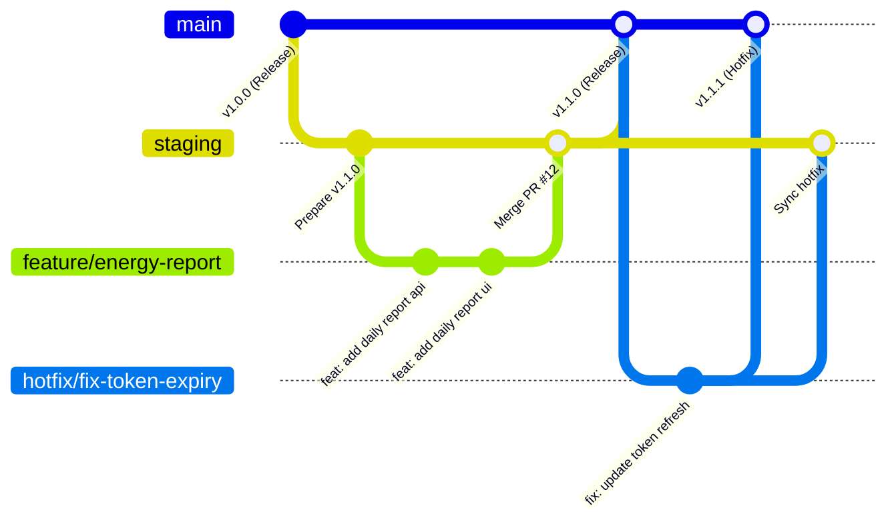

# Hướng dẫn Quản lý Mã nguồn (Source Control) - Dự án MDMSv2

Tài liệu này quy định toàn diện phương án quản lý mã nguồn (Source Control & Version Control) bằng Git cho dự án **MDMSv2 (Meter Data Management System v2)**. Dự án là một kho mã nguồn tích hợp (Multi-project / Monorepo) chứa cả **Backend (.NET 8 Clean Architecture)** và **Frontend (React 18 + TypeScript + Vite)**.

* **Kho mã nguồn từ xa (Remote Repository)**: `https://github.com/nthung2307/MDMSv2.git`
* **Nhánh mặc định (Default Branch)**: `main`

---

## 1. Chiến lược Phân nhánh (Branching Strategy)

Dự án áp dụng mô hình kết hợp giữa **Git Flow** tinh gọn và **Feature Branch Workflow**, đồng thời sử dụng **Git Tags** theo chuẩn Semantic Versioning để quản lý các phiên bản phát hành.



### 1.1. Các Nhánh Chính (Long-lived Branches)
1. **`main` (Production Branch)**:
   * Chứa mã nguồn ổn định nhất đã được kiểm thử kỹ lưỡng và triển khai thực tế trên môi trường Production.
   * **Quy tắc vàng**: **Tuyệt đối KHÔNG commit trực tiếp lên nhánh `main`**. Mọi thay đổi vào `main` đều phải thông qua Pull Request (PR) từ nhánh `staging` hoặc nhánh `hotfix/*` sau khi được `MDMS-Reviewer` phê duyệt.
2. **`staging` (Integration / Staging Branch)**:
   * Nhánh tích hợp cho môi trường UAT (User Acceptance Testing) và Staging.
   * Là nơi hội tụ của tất cả các nhánh tính năng (`feature/*`) và sửa lỗi (`bugfix/*`) sau khi đã hoàn thành để tiến hành kiểm thử liên thông giữa Backend, Frontend, Cơ sở dữ liệu và các Job nền Hangfire.

### 1.2. Các Nhánh Tạm thời (Short-lived Branches)
1. **`feature/<ten-tinh-nang>`**:
   * Tạo từ `staging`. Dùng để phát triển tính năng mới.
   * Khi hoàn tất, tạo Pull Request để merge ngược lại vào `staging`.
2. **`bugfix/<ma-loi-hoac-ten-loi>`**:
   * Tạo từ `staging`. Dùng để sửa lỗi phát sinh trong quá trình kiểm thử tại môi trường Staging/UAT.
3. **`hotfix/<phien-ban-va-loi>`**:
   * Tạo trực tiếp từ `main`. Dùng để khắc phục khẩn cấp các lỗi nghiêm trọng xảy ra trên Production mà không thể chờ chu kỳ release tiếp theo.
   * Sau khi sửa xong, merge vào `main` (tạo tag mới) và merge đồng bộ vào `staging`.
4. **`release/<phien-ban>` (Tùy chọn)**:
   * Tạo từ `staging` khi chuẩn bị đóng gói phiên bản mới (ví dụ `release/v1.2.0`), dùng để rà soát đóng gói cuối cùng, nâng version và cập nhật Changelog trước khi vào `main`.

---

## 2. Quy tắc Đặt tên Nhánh (Branch Naming Conventions)

Tên nhánh phải viết bằng chữ thường (lowercase), sử dụng dấu gạch ngang (`-`) để phân tách các từ, và bắt buộc có tiền tố phân loại:

| Loại nhánh | Tiền tố | Định dạng quy chuẩn | Ví dụ mẫu |
|---|---|---|---|
| Tính năng mới | `feature/` | `feature/<module>-<mo-ta-ngan>` | `feature/measurement-point-export` |
| Sửa lỗi thường | `bugfix/` | `bugfix/<module>-<mo-ta-loi>` | `bugfix/hangfire-cutoff-race-condition` |
| Vá lỗi khẩn cấp | `hotfix/` | `hotfix/<phien-ban>-<mo-ta-loi>` | `hotfix/v1.0.1-jwt-auth-expired` |
| Tái cấu trúc | `refactor/` | `refactor/<module>-<noi-dung>` | `refactor/clean-architecture-dtos` |
| Tài liệu | `docs/` | `docs/<noi-dung>` | `docs/update-multi-agent-system` |

---

## 3. Chuẩn hóa Thông điệp Commit (Conventional Commits)

Dự án áp dụng chặt chẽ chuẩn **Conventional Commits**, được đồng bộ và kiểm soát tự động bởi công cụ **Husky & Commitlint** cấu hình sẵn tại `Frontend/commitlint.config.cjs`.

### 3.1. Cấu trúc Commit Message
```text
<type>(<scope>): <subject>

[optional body: mô tả chi tiết lý do và giải pháp]

[optional footer: liên kết issue hoặc pull request]
```

### 3.2. Danh mục Commit Types Hợp lệ
Dự án quy định danh sách các type sau:

* **`feat`**: Phát triển tính năng mới cho người dùng hoặc hệ thống.
  * *Ví dụ*: `feat(daily-report): add export to excel functionality`
* **`fix`**: Sửa lỗi trong hệ thống hoặc giao diện.
  * *Ví dụ*: `fix(gcs): resolve negative energy calculation on rollover`
* **`improve`**: Cải thiện hiệu năng, trải nghiệm người dùng mà không thay đổi tính năng.
  * *Ví dụ*: `improve(frontend): debounce measurement point search input`
* **`refactor`**: Tái cấu trúc mã nguồn (không thêm tính năng, không sửa lỗi).
  * *Ví dụ*: `refactor(infrastructure): split repository implementations`
* **`docs`**: Thêm mới hoặc cập nhật tài liệu dự án, markdown, guide.
  * *Ví dụ*: `docs(source-control): add multi-agent git workflow guide`
* **`chore`**: Công việc phụ trợ, cập nhật dependency, cấu hình dự án.
  * *Ví dụ*: `chore(deps): update pomelo mysql provider to 8.0.2`
* **`style`**: Định dạng code, sửa khoảng trắng, linter formatting (không đổi logic).
  * *Ví dụ*: `style(frontend): format components with prettier`
* **`test`**: Viết thêm hoặc sửa đổi các ca kiểm thử tự động, test suite.
  * *Ví dụ*: `test(api): add integration test for periodic statement endpoint`
* **`revert`**: Hoàn tác lại một commit trước đó do lỗi.
  * *Ví dụ*: `revert: revert "feat: add experimental signalr stream"`
* **`ci`**: Thay đổi cấu hình tích hợp liên tục (CI/CD, GitHub Actions, Docker build).
  * *Ví dụ*: `ci(docker): optimize webapi multi-stage build cache`
* **`build`**: Thay đổi liên quan đến hệ thống build hoặc package ngoài.
  * *Ví dụ*: `build(vite): configure chunk splitting for ant design`

---

## 4. Mô hình Phối hợp Multi-Agent trong Quy trình Quản lý Mã nguồn

Hệ thống Multi-Agent của MDMSv2 phối hợp chặt chẽ theo từng giai đoạn trên Git:

| Vai trò Agent | Mô hình Trí tuệ Nhân tạo | Nhiệm vụ trên Git | Nhánh tác nghiệp |
|---|---|---|---|
| **MDMS-Planner** | Claude Opus 5.5 Medium | Khảo sát mã nguồn, phân tích tác động, khởi tạo tài liệu thiết kế `PLAN_SPEC.md` | `staging` hoặc nhánh tính năng |
| **MDMS-Coder** | Gemini 3.8 Flash High | Tạo nhánh tính năng, viết mã nguồn Backend & Frontend, tự kiểm tra lint/build, commit mã nguồn chuẩn | `feature/*`, `bugfix/*` |
| **MDMS-Tester** | Gemini 3.8 Flash High | Kéo code từ nhánh tính năng, thực thi kiểm thử, xác nhận kết quả qua `TEST_REPORT.md` | `feature/*`, `bugfix/*` |
| **MDMS-Reviewer** | Claude Opus 5.5 Medium | Thẩm định Git Diff, rà soát Clean Architecture, bảo mật, approve PR và cho phép Merge | `feature/*` $\to$ `staging` $\to$ `main` |

---

## 5. Quy trình Làm việc Thực chiến Hàng ngày (Step-by-Step Cheatsheet)

### 5.1. Khởi tạo & Đồng bộ lần đầu (Initial Setup)
```bash
# Clone dự án về máy tính
git clone https://github.com/nthung2307/MDMSv2.git
cd MDMSv2

# Cài đặt dependencies cho Frontend (kích hoạt Husky hook)
cd Frontend
yarn install
cd ..

# Kiểm tra trạng thái kho mã nguồn
git status
```

### 5.2. Phát triển Tính năng Mới (Feature Development Workflow)
```bash
# 1. Chuyển sang nhánh staging và kéo mã nguồn mới nhất
git checkout staging
git pull origin staging

# 2. Tạo nhánh tính năng mới từ staging
git checkout -b feature/energy-statement-report

# 3. Tiến hành lập trình mã nguồn (Backend & Frontend)...

# 4. Kiểm tra trạng thái các file đã sửa
git status

# 5. Kiểm tra linter và build trước khi commit
cd Frontend && yarn check:lint && cd ..

# 6. Thêm file vào Staging Area và commit chuẩn Conventional Commits
git add .
git commit -m "feat(report): add periodic energy statement generation endpoint"

# 7. Đẩy nhánh lên Remote Repository
git push -u origin feature/energy-statement-report
```

### 5.3. Tạo Pull Request & Merge Code
1. Mở giao diện GitHub của repository `nthung2307/MDMSv2`.
2. Tạo Pull Request (PR) từ nhánh `feature/energy-statement-report` vào nhánh `staging`.
3. Điền nội dung mô tả PR: Đính kèm tài liệu bàn giao `CHANGELOG_DEV.md` của Coder và `TEST_REPORT.md` của Tester.
4. Gán `MDMS-Reviewer` thực hiện Code Review.
5. Khi `MDMS-Reviewer` đưa ra quyết định **APPROVED**, thực hiện gộp nhánh bằng phương thức **Squash and Merge** hoặc **Create a merge commit** tùy theo quy định release.
6. Xóa nhánh tính năng trên remote sau khi đã merge thành công.

### 5.4. Phát hành Phiên bản Mới (Release Versioning & Git Tags)
Khi nhánh `staging` đã ổn định và sẵn sàng phát hành cho Production:

```bash
# 1. Chuyển về nhánh main và kéo dữ liệu mới
git checkout main
git pull origin main

# 2. Hợp nhất staging vào main
git merge staging

# 3. Tạo Git Tag đánh dấu phiên bản (theo Semantic Versioning)
git tag -a v1.1.0 -m "Release v1.1.0: Tích hợp báo cáo sản lượng điện định kỳ và tối ưu Hangfire"

# 4. Đẩy mã nguồn và Tag lên GitHub
git push origin main
git push origin v1.1.0
```

### 5.5. Xử lý Lỗi Khẩn cấp trên Production (Hotfix Workflow)
```bash
# 1. Tạo nhánh hotfix trực tiếp từ main
git checkout main
git pull origin main
git checkout -b hotfix/v1.1.1-fix-connection-leak

# 2. Sửa lỗi, tự kiểm tra và commit
git add .
git commit -m "fix(mysql): resolve connection pool leak in hangfire worker"

# 3. Đẩy nhánh hotfix lên và mở PR vào main
git push -u origin hotfix/v1.1.1-fix-connection-leak

# 4. Sau khi review và merge vào main, tạo tag hotfix:
git checkout main
git pull origin main
git tag -a v1.1.1 -m "Hotfix v1.1.1: Sửa triệt để rò rỉ kết nối MySQL trong worker"
git push origin v1.1.1

# 5. Đồng bộ ngược hotfix vào staging để tránh mất code:
git checkout staging
git pull origin staging
git merge main
git push origin staging
```

---

## 6. Xử lý Xung đột Mã nguồn (Merge Conflict Resolution)

Khi có xung đột xảy ra trong quá trình merge hoặc rebase:

1. **Tuyệt đối không sử dụng cờ ép buộc (`--force`)** trên các nhánh chung (`main`, `staging`).
2. Mở trình soạn thảo mã nguồn (VS Code, Visual Studio, JetBrains Rider) để rà soát từng khối xung đột:
   * `<<<<<<< HEAD`: Mã nguồn hiện tại trên nhánh đang đứng.
   * `=======`: Ranh giới phân chia.
   * `>>>>>>> branch-name`: Mã nguồn từ nhánh đang cố gắng merge vào.
3. Sau khi giải quyết thủ công:
   * Backend: Chạy kiểm tra biên dịch solution `.NET 8`.
   * Frontend: Chạy kiểm tra kiểu `yarn build:dev` để chắc chắn không gãy cú pháp.
4. Lưu và hoàn tất merge:
   ```bash
   git add .
   git commit -m "chore(merge): resolve conflicts between staging and feature/energy-report"
   git push origin <ten-nhanh>
   ```

---

## 7. Quản lý Bảo mật & Tệp Cấu hình Môi trường

Để bảo vệ bí mật hệ thống và giữ sạch kho mã nguồn:

1. **Tuyệt đối không commit tệp chứa thông tin nhạy cảm**:
   * File môi trường: `.env`, `.env.production`, `.env.uat`, `.env.local`.
   * Cấu hình nhạy cảm Backend: `appsettings.Production.json`, các file chứa chuỗi kết nối MySQL (`ConnectionStrings:DefaultConnection`), mật khẩu MailKit, khóa JWT Secret.
   * Dữ liệu tạm thời: `SavedRequests/*.txt`, thư mục logs, cache dữ liệu đo đếm.
   * Thư mục build và phụ thuộc: `bin/`, `obj/`, `node_modules/`, `dist/`.
2. **Cấu hình file mẫu**:
   * Cung cấp các file mẫu không chứa mật khẩu thực tế: `.env.example`, `appsettings.Example.json` để thành viên mới hoặc Agent có căn cứ thiết lập cấu hình.
